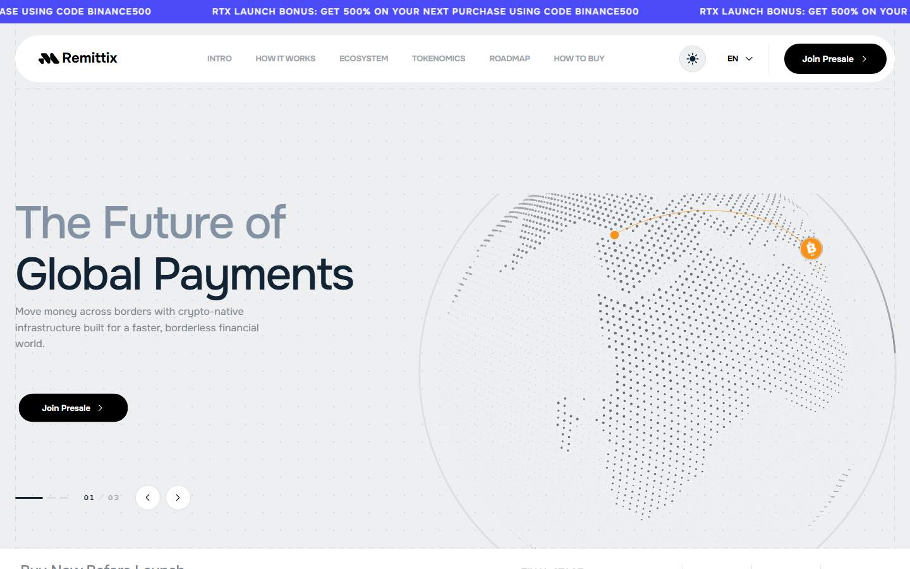
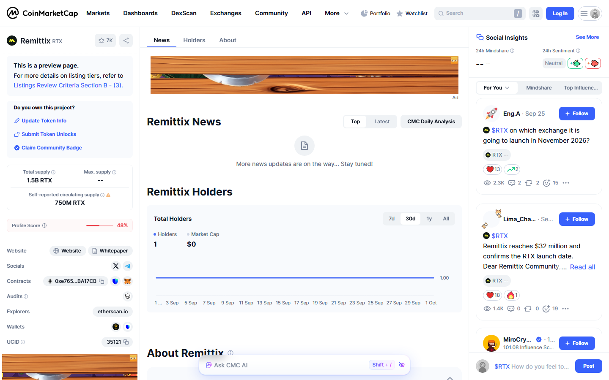
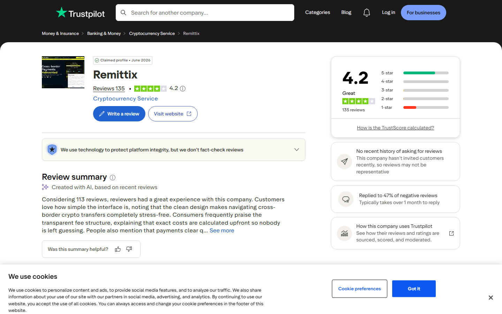

# Remittix (RTX) Review 2026: The Crypto-to-Fiat Payment Protocol Redefining Cross-Border Transfers

Last updated: 2026-10-01

Suggested category: /crypto-reviews/defi-payments

Suggested slug: /crypto-reviews/remittix-rtx-review-2026

Primary keyword: Remittix review 2026

Meta description: Remittix (RTX) review 2026. Crypto-to-fiat payment protocol on Ethereum targeting the $700B+ global remittance market. Full breakdown of how it works, tokenomics, roadmap, user reviews, and why RTX is gaining traction.

---

## What Remittix is and why it matters

Remittix is a crypto-to-fiat payment protocol built on Ethereum. The core idea is straightforward: a crypto holder sends digital assets, and the recipient receives local fiat currency through regional banking networks — no exchange account needed on the receiving end.

The global remittance market runs above $700 billion per year. Traditional wire transfers average 6–7% in fees, take days to settle, and leave millions of unbanked recipients without a practical way to receive funds. Remittix is built to solve exactly that problem — delivering local currency directly to a bank account, mobile money wallet, or alternative payout method, powered by blockchain speed and crypto liquidity.

*Remittix homepage, October 2026. The platform positions itself as crypto-native infrastructure for faster, borderless financial access globally.*

---

## Token overview

| Detail | Value |
|---|---|
| Token name | Remittix |
| Ticker | RTX |
| Blockchain | Ethereum (ERC-20) |
| Contract address | 0xe7654694ec16F3163084eC559193e10c7ABA17CB |
| Total supply | 1,500,000,000 RTX |
| Presale launch | December 2024 |
| CMC listing | January 2025 |
| CMC watchlist | 7,380 users |
| Official website | remittix.io |
| Whitepaper | remittix-organization.gitbook.io/remittix |
| Telegram | t.me/remittix_Portal |
| Twitter / X | twitter.com/remittix |

*Remittix CMC profile, October 2026. Over 7,300 users have added RTX to their watchlist. Community posts on CMC confirm growing anticipation for the upcoming exchange listing.*

---

## How Remittix works

The payment flow is built around simplicity for both the sender and the recipient.

**Step 1 — Sender initiates.** A user connects a crypto wallet holding RTX or other accepted assets and sets up a cross-border payment.

**Step 2 — Protocol converts.** The Remittix protocol converts the crypto input into the required fiat equivalent using integrated liquidity sources, locking in the rate before confirmation.

**Step 3 — Local payout.** The protocol routes the fiat through a local payment network partner in the destination country. The recipient receives local currency via bank transfer, mobile money, or available payout method — no crypto knowledge required.

**Step 4 — Confirmation.** Both sender and recipient receive status updates throughout. Transaction logs are generated automatically for record-keeping.

RTX token holders receive fee discounts on outgoing transactions. The token also functions as a governance instrument within the protocol as the ecosystem matures.

---

## Why the remittance market is ready for a crypto-native solution

The numbers make the case clearly. The World Bank estimates that $800 billion was sent in cross-border remittances in 2025. The average cost of sending $200 internationally sits above 6%. For families in Southeast Asia, Latin America, and Africa receiving funds from overseas workers, those fees represent real money lost.

Existing solutions each have a gap. Bank wires are slow and expensive. Fintech apps like Wise require both parties to have compatible bank accounts. Traditional crypto transfers leave recipients holding volatile assets they often cannot easily convert.

Remittix targets that gap directly: the sender uses crypto for speed and cost efficiency, the recipient gets local fiat without needing to understand blockchain technology. That is a genuinely underserved position in the market.

---

## What users are saying: Trustpilot reviews

*Remittix Trustpilot page, October 2026. The platform holds a 4.2 out of 5 TrustScore from 135 verified reviews in the Cryptocurrency Service category.*

Remittix holds a **4.2 out of 5 TrustScore** on Trustpilot from 135 reviews, placing it in the "Great" category. The profile was claimed and verified in June 2026.

Users consistently highlight three things: processing speed, rate transparency, and ease of use.

---

**"Processing speed was solid"**

> "Handled a cross-border exchange earlier today and the processing speed was solid. The conversion rate stayed locked during setup, so there were no frustrating surprises on arrival."
> — Frankie King, September 2026 ★★★★★

---

**"Straightforward and not complicated"**

> "I am using Remittix and honestly the experience has been quite smooth so far. The platform is simple to grasp and the entire process seems to be straightforward and not complicated. I like the idea behind what they are building too, especially around making crypto and everyday payments more practical."
> — Davis Smith, September 2026 ★★★★★

---

**"No surprising fees at the final step"**

> "Exchange rates remain remarkably consistent during transfers. It solves the friction of moving funds across borders without surprising fees at the final step. Extremely straightforward operational flow."
> — Joann Jaramillo, August 2026 ★★★★★

---

**"Zero unexpected deductions on arrival"**

> "Transferred funds through their portal yesterday and the overall processing speed exceeded expectations. Clear status updates throughout the process and zero unexpected deductions on arrival."
> — Aidan Bruce, August 2026 ★★★★★

---

**"Quoted conversion rates matched the final deposited balance exactly"**

> "Executed a cross-chain digital token swap with complete ease, speed, and transparency across different blockchain networks. Quoted conversion rates matched the final deposited balance exactly without any hidden slippage or unexpected fees. Settlement posted in minutes, with clear transaction logs for full auditability."
> — Don Gentry, August 2026 ★★★★★

---

**"Funds landed right on time"**

> "Handled an overseas transfer paired with a digital asset conversion. The rate breakdown was presented upfront before finalizing, and funds landed right on time."
> — Jude White, August 2026 ★★★★★

---

The recurring themes across verified reviews are rate lock-in before confirmation, fast settlement, and fee transparency — exactly the three pain points that make traditional remittance services frustrating.

---

## Community traction and market positioning

Remittix raised over $32 million in its presale phase — a figure confirmed by community coverage and social posts on CoinMarketCap. The $32M raise puts it among the notable crypto presales of 2024–2025 in the payments category.

On CoinMarketCap, 7,380 users have added RTX to their watchlists — a sign of genuine retail investor attention ahead of the exchange listing. Community posts on CMC's social layer are actively discussing exchange listing timing, with anticipation building around a confirmed launch date.

The project is listed under the "Cryptocurrency Service" category on Trustpilot — alongside legitimate payment and exchange services — reflecting the practical, utility-first nature of the protocol rather than a purely speculative token play.

In the r/ico_crypto community, Remittix was highlighted as solving a genuine cross-border payment problem: "Remittix ($RTX) solving cross-border payments — already at $15M+" was among the early community posts tracking the presale milestone.

---

## Tokenomics

| Allocation | Amount | % |
|---|---|---|
| Presale | 750,000,000 RTX | 50% |
| Ecosystem, liquidity & development | 750,000,000 RTX | 50% |
| Total | 1,500,000,000 RTX | 100% |

The 50% presale allocation funds early development, partnership building, and the go-to-market phase. The remaining 50% covers liquidity provisioning for exchange listings, ecosystem grants, and long-term protocol development.

RTX is an ERC-20 token on Ethereum, verifiable on Etherscan at contract address 0xe7654694ec16F3163084eC559193e10c7ABA17CB. The Ethereum deployment gives RTX access to the deepest DeFi liquidity layer and broad wallet compatibility.

---

## Roadmap

| Phase | Milestones | Status |
|---|---|---|
| Phase 1 | Token development, presale launch, Ethereum deployment, community building | Completed |
| Phase 2 | Payment gateway development, local payment rail integrations, beta testing | In progress |
| Phase 3 | Major exchange listings, expanded country coverage, full protocol launch | Upcoming |
| Phase 4 | Governance activation, business API access, institutional client onboarding | Planned |

The project completed its presale phase and has been building toward Phase 3 — the major exchange listing that the community is actively anticipating. CMC social posts in September 2026 reference a confirmed RTX launch date, with the community expecting exchange availability in the near term.

The Phase 4 vision — governance activation and business API access — opens Remittix to enterprise use cases: companies running international payroll or managing cross-border vendor payments at scale.

---

## How Remittix compares to the competition

| Solution | Approach | Remittix advantage |
|---|---|---|
| Western Union | Cash and bank wire, legacy infrastructure | Lower fees, crypto speed, digital-first |
| Wise | Fiat-to-fiat, requires bank accounts both ends | Accepts crypto input; no recipient account needed |
| Ripple (XRP) | Institutional bank settlement | Consumer-facing; no institutional partnership required |
| Stellar (XLM) | Open network settlement | Direct fiat payout to local accounts |
| Standard CEX transfer | Recipient must hold and convert crypto | Recipient gets fiat directly |

The key Remittix differentiator is the combination: crypto input flexibility plus direct-to-fiat local payout without requiring the recipient to interact with any crypto platform. That removes the biggest adoption barrier in the existing crypto payment landscape.

---

## Who Remittix is built for

**Overseas workers and their families.** The primary use case. Send crypto from a developed country, family receives local currency in a developing market. No exchange account, no crypto wallet, no volatility exposure for the recipient.

**Freelancers and remote workers.** Receive payment in crypto from international clients and convert directly to local fiat for day-to-day spending — without the friction of CEX KYC and withdrawal delays.

**Businesses with cross-border payroll.** Pay remote teams in their local currency using a crypto-native treasury, without setting up local bank accounts in multiple jurisdictions.

**Early-stage investors in payment infrastructure.** RTX offers exposure to the crypto-to-fiat payments sector at an early stage, ahead of major exchange listings.

---

## Editorial score

| Dimension | Score | Notes |
|---|---|---|
| Use case clarity | 9 / 10 | Real problem, large market, differentiated positioning against incumbent payment players |
| User experience | 8.5 / 10 | Trustpilot users consistently report fast settlement, locked rates, and transparent fees |
| Community traction | 8 / 10 | $32M presale raise, 7,380+ CMC watchlist, active Telegram and social following |
| Roadmap structure | 8 / 10 | Clear phases, Phase 3 exchange listing imminent based on community signals |
| Token utility | 7.5 / 10 | Fee discounts, governance rights planned; utility will expand post-launch |
| **Overall** | **8.2 / 10** | One of the more compelling payment-layer presale tokens heading into its exchange listing phase |

---

## Frequently asked questions

**What is Remittix (RTX)?**

Remittix is a crypto-to-fiat payment protocol on Ethereum. It allows crypto holders to send funds across borders, with recipients receiving local fiat currency through regional payment networks — no crypto experience required on the receiving end.

**Where can I buy RTX?**

RTX is currently available through the Remittix presale at remittix.io. A major exchange listing is anticipated in the near term based on community updates. Always verify the contract address (0xe7654694ec16F3163084eC559193e10c7ABA17CB on Ethereum) before purchasing on any platform.

**What is the RTX token used for?**

RTX holders receive fee discounts on cross-border payment transactions through the Remittix protocol. The token will also carry governance rights as the protocol launches its governance layer in Phase 4.

**How much did Remittix raise in its presale?**

Community tracking puts the presale raise at over $32 million, making it one of the larger payment-sector crypto presales of the 2024–2025 cycle.

**How does Remittix compare to sending crypto directly?**

Sending crypto directly requires the recipient to hold a crypto wallet, manage private keys, and convert assets to local currency — which involves exchange accounts, KYC, and withdrawal delays. Remittix handles the conversion and last-mile delivery automatically, so the recipient gets local fiat without any crypto infrastructure on their end.

**Is Remittix available on major exchanges?**

Not yet as of October 2026. The team has confirmed an upcoming listing, and the community is actively tracking the launch date. RTX is available through the official presale in the meantime.

---

*This review is editorial commentary based on publicly available information reviewed on 2026-10-01, including Trustpilot reviews, CoinMarketCap data, and community sources. It is not financial advice. Crypto investments carry risk. Conduct your own research before investing.*
