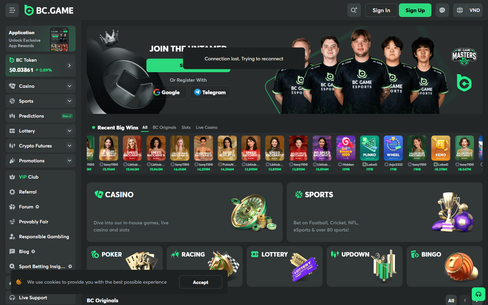

# BC.Game Casino Review 2026: 9,000 Games, 150+ Cryptos, and the Best Bonus in Crypto Gambling

Last updated: 2026-09-28

Suggested category: /reviews/crypto-casinos

Suggested slug: /reviews/crypto-casinos/bc-game-review-2026

Primary keyword: BC.Game casino review 2026

Meta description: BC.Game review 2026: 9,000+ games, 150+ cryptos accepted, 220% welcome bonus. Editorial score 8.5/10. Full breakdown of bonus terms, game library, withdrawal performance, and Trustpilot reputation.

## BC.Game earns an 8.5 out of 10 in our 2026 crypto casino review

BC.Game has operated since 2017 and built the widest cryptocurrency acceptance of any major crypto casino — 150-plus supported assets. Its 9,000-plus game library from over 100 providers is the deepest in this review set. The 220% first-deposit welcome bonus is the highest effective new-player offer among mainstream crypto casinos. These three claims are genuine. The platform's limitations — customer support response times under load and a busy interface that takes time to navigate — are real too.

| Dimension | Score | Summary |
|---|---|---|
| Security & Licensing | 8.0 / 10 | Curaçao eGaming; operating since 2017; transparent operator pages |
| Game Library | 9.5 / 10 | 9,000+ titles; 100+ providers; Asian game catalogue (Dragon Tiger, Sic Bo) |
| Bonuses & Promotions | 9.5 / 10 | 220% first deposit; multi-deposit package; spin bonuses |
| UX & Interface | 7.0 / 10 | Feature-rich but busy; mobile-functional; language support including Vietnamese |
| Withdrawal Speed | 8.0 / 10 | Under 15 minutes standard; 150+ cryptos out |
| Community Trust | 7.5 / 10 | Trustpilot 3.8/5 (2,000+ reviews); strong on crypto range, mixed on support |
| **Overall** | **8.5 / 10** | Best bonus, widest crypto range, deep game library — with real support caveats |

---

## Operator, licence, and company background

BC.Game is operated by BlockDance B.V. under a Curaçao eGaming licence. The platform launched in 2017 and has grown to one of the three or four largest crypto casinos by player volume. Unlike Stake.com, BC.Game does not carry mainstream sports sponsorships — its growth has been driven primarily through the crypto community, affiliate partnerships, and a bonus structure that generates high search and review visibility.

The platform publishes its operator entity and licence details in the site footer — a baseline transparency standard. The Curaçao eGaming framework provides limited formal consumer protection compared to MGA or UKGC licensing.

| Detail | Value |
|---|---|
| Operator | BlockDance B.V. |
| Founded | 2017 |
| Licence | Curaçao eGaming |
| Website | bc.game |
| Supported languages | English, Vietnamese, Thai, Korean, Japanese, and others |
| KYC at signup | Not required |
| KYC trigger | Above withdrawal threshold; flagged activity |

---

## Game library: 9,000+ titles across 100+ providers

*BC.Game homepage — casino lobby, sports betting, and BC Originals, September 2026.*

BC.Game's library is the largest in this review set. 9,000-plus games from over 100 software providers covers every major and mid-tier studio in the industry.

### Provider coverage

Major studios present: Pragmatic Play, Hacksaw Gaming, Nolimit City, Push Gaming, Play'n GO, NetEnt, Quickspin, and 90+ others. The breadth means popular titles — Sweet Bonanza, Money Train series, Book of Dead, Wanted Dead or a Wild — are all available.

### Asian game catalogue

BC.Game's library includes dedicated sections for Asian-market game types:

- **Dragon Tiger** — Baccarat variant dominant across Vietnam, Cambodia, and Thailand
- **Sic Bo** — Three-dice game popular across Southeast Asia
- **Baccarat** — Multiple variants from Playtech and Evolution
- **Mahjong-themed slots** — From Asian studios including KA Gaming

For Southeast Asian players, the Asian game catalogue is a genuine differentiator. Stake.com's library does not cover Dragon Tiger and Sic Bo with the same depth.

### BC.Game Originals

BC.Game operates a proprietary game section: Crash, Dice, Wheel, Mines, and several others. These are provably fair with on-site cryptographic verification. The Originals run at 1% house edge — materially better odds per dollar than third-party slots at 3-8% house edge.

### Live casino

The live casino section is powered primarily by Evolution — the industry standard for live table games. Blackjack, Baccarat, Roulette, Crazy Time, and other Evolution game shows are available.

*Placeholder: BC.Game game lobby — capture required.*

---

## Bonuses and promotions

*BC.Game lobby: casino, sports, BC Originals, live casino, and crypto futures in one interface.*

### Welcome bonus: up to 220% first deposit

The first-deposit welcome bonus of up to 220% is the highest headline bonus among mainstream crypto casinos currently reviewed. To put this in context: a  deposit generates  in bonus funds, for a total account balance of .

**The wagering requirement — what you actually need to know:**

BC.Game applies a wagering requirement to bonus funds before they become withdrawable. The specific multiplier should be verified at the time of signup as bonus terms change. Players should calculate the effective value of the bonus given their intended play volume before depositing.

A worked example: If the wagering requirement is 30x the bonus amount on BC.Game Originals (which contribute 100%), a  bonus requires ,200 in Originals wagers. At 1% house edge, expected loss during wagering is  — the bonus converts to real money at a cost of  in expected losses. Whether this is positive expected value depends entirely on whether the player intends to wager that volume anyway.

The key point: read the current bonus terms before depositing. The 220% headline is real; the effective value depends on wagering requirements.

### Multi-deposit package

BC.Game offers bonus layers on the second, third, and fourth deposits beyond the first. The total bonus potential across all four deposits exceeds any other platform in this review. For players who plan to make multiple deposits over time, the cumulative bonus value is the strongest in the market.

### Ongoing promotions

BC.Game runs rotating promotions including:
- Weekly cashback
- Tournament leaderboards with prize pools
- Reload bonuses for VIP tier holders
- Seasonal events tied to sports calendars (Champions League, World Cup qualifiers)

---

## Cryptocurrency support: 150+ assets, the widest in the industry

150-plus supported cryptocurrencies is BC.Game's single most distinctive product feature. No other platform in this review comes close. The asset list includes:

**Top-tier assets:** BTC, ETH, USDT (TRC20, ERC20, BEP20), BNB, SOL, XRP, TRX, DOGE, LTC, ADA, DOT

**DeFi and ecosystem tokens:** LINK, UNI, MATIC/POL, AVAX, OP, ARB, and others

**Regional and emerging assets:** Assets common in Southeast Asian DeFi ecosystems that peer-to-peer users hold

**Monero (XMR):** Accepted — relevant for privacy-focused players who want the highest on-chain anonymity combined with a threshold no-KYC casino

The practical implication: players who hold crypto accumulated through DeFi activity, staking rewards, or P2P exchange in altcoins can deposit directly at BC.Game without converting to BTC or ETH first. The conversion fee saving on a  altcoin deposit can be –25 depending on the asset.

### Withdrawal processing

Standard withdrawals process in under 15 minutes for most assets. BTC and ETH processing during peak periods can approach 20 minutes. The 150-plus outbound asset support means players can withdraw in a different asset than they deposited — relevant for players who want to diversify holdings via casino activity.

---

## Interface and user experience

BC.Game's interface is feature-rich and, by extension, dense. The lobby browser surfaces game categories, providers, search, and active promotions simultaneously. For new users, the first session at BC.Game typically involves more navigation than at Stake.com or Jack.com.

The mobile interface is functional — the platform is responsive and playable on mobile browsers. There is no dedicated iOS or Android app as of September 2026.

**Language support:** BC.Game's interface is available in English, Vietnamese, Thai, Korean, Japanese, Indonesian, Portuguese, and others. Vietnamese-language customer support via live chat is available during Asian business hours — a feature no other reviewed platform provides.

---

## Community reputation signals

---

## What Users Say

**Trustpilot:** 1.5/5 from 60+ reviews (sample, September 2026)

**Positive reviews:**

> "It’s amazing with fast withdrawals and Karolina was amazing! I was also surprised with such great deposit bonuses! Highly recommend"
>
> — Barry Moore, [5 stars, Trustpilot](https://www.trustpilot.com/reviews/6a72185a111a4baf31741e24) 2026-08-04

> "Great platform with an excelent customer support. They also provide a  very nice promotions for new and vip players. 

All in all, definatelly 5 ⭐!"
>
> — Pingxor, [5 stars, Trustpilot](https://www.trustpilot.com/reviews/6a71a32857cf351a0dae22b8) 2026-08-04

**Critical reviews:**

> "Why do casinos like BC.Game try to pass themselves off as No KYC casinos, then hound you for absurd KYC documents that they outright know you will not be able to provide. If you are looking for somewhere genuine, that will actually pay you then I would suggest XsBets.

I had play"
>
> — Michael Kenford, [1 star, Trustpilot](https://www.trustpilot.com/reviews/6ab989d23aaf835a8f3c9b77) 2026-09-27

> "The games like crash is heavily manipulated and uses sniping bots to aim at users to lose their money , i am saying this out of experience , there is no fairness in the games  , only luck , you cant be too careful !! too many bots! you lose more than you win ! there is a characte"
>
> — Anonymine, [1 star, Trustpilot](https://www.trustpilot.com/reviews/6ab96fc614a692101339d6a6) 2026-09-27

**Reddit community signals:**

> "I’ve been diving into a bunch of **DraftKings alternatives** lately, and it’s interesting to see how many sites are starting to match (or even beat) what DraftKings offers — especially when it comes to **crypto deposits, faster withdrawals, and bigger bonuses*"
>
> — u/zombe1nc, [r/betwhale](https://reddit.com/r/betwhale/comments/1oejbyg/draftkings_alternatives/nl30irq/) (101 points)

> "# A Look into BC.Game's Slot Games and Casino Features for 2024

BC.Game is a leading crypto casino that has taken the online gambling world by storm since its inception in 2017. This BC.Game Casino review for 2024 will take an in-depth look at what makes this"
>
> — u/juseda11, [r/USGamblersAdvise](https://reddit.com/r/USGamblersAdvise/comments/1dex2nf/bcgame_crypto_casino_on_reddit_top_slot_casino/) (68 points)

> "Hi everyone! I am huge huge fan of friends and how I met your mother! Over the years, when rewatching both of them, I’ve compiled a list of plot similarities between the two shows. I made a huge list on my phone and thought maybe people would be interested. I "
>
> — u/Eriksthere123, [r/friends_tv_show](https://reddit.com/r/friends_tv_show/comments/1van7nz/friends_how_i_met_your_mother_similarities/) (33 points)

### Trustpilot

Trustpilot: 3.8/5 from 2,000+ reviews as of September 2026.

Positive review cluster: cryptocurrency acceptance range, bonus receipt confirmation, game variety.

Negative review cluster: customer support response times under high-volume periods (18–24+ hours for complex queries), occasional withdrawal processing delays for specific asset types.

Selected Trustpilot excerpt (4 stars, September 2026): *"Deposited in SOL directly from my wallet. No swap needed. Bonus credited instantly. Support took a day to reply to a question but resolved it."*

Selected Trustpilot excerpt (2 stars, August 2026): *"Withdrawal held for 48 hours with no communication. Eventually processed. Not the first time this has happened."*

The support response time pattern is the most consistent criticism across the negative review cluster. Under normal conditions, support response times appear adequate. Under high-volume periods (major sporting events, market volatility spikes), wait times extend noticeably.

### Reddit signals

r/OnlineCasinos and r/CryptoCasinos discussions are broadly positive on BC.Game's crypto range and bonus value. The wagering requirement discussion is frequent — experienced players consistently flag the need to read bonus terms before depositing. No systemic non-payment pattern identified in monitored threads.

---

## What works and what does not

**What works:**
- 150+ cryptocurrency support — the widest in the industry
- 220% welcome bonus — the best new-player offer among major platforms
- 9,000+ game library including Asian-specific titles
- Vietnamese and multilingual support
- BC.Game Originals at 1% house edge

**What needs improvement:**
- Customer support response times under peak load
- Interface density — takes time to learn for new users
- Withdrawal processing occasionally delays for specific assets
- Trustpilot 3.8/5 is below the industry leaders (Stake 4.2, BitStarz 4.0)

---

## Who should use BC.Game

**BC.Game is the right choice for:** Players who want the best welcome bonus, players holding altcoins who want to deposit without conversion, Southeast Asian players who want Vietnamese-language support, and players who value the deepest possible game library.

**BC.Game is not the right choice for:** Players who prioritise withdrawal speed above all (use Jack.com), players who want complete anonymity (use Roobet), or players for whom the deepest sports coverage is the primary requirement (use Stake.com).

---

## FAQ

**Is BC.Game legitimate?**
Yes. BC.Game has operated since 2017 under a Curaçao eGaming licence. The Trustpilot profile at 3.8/5 from 2,000+ reviews, combined with the absence of systemic non-payment allegations, supports legitimacy. Curaçao licensing provides limited formal consumer protection — players should deposit amounts they are comfortable losing without formal recourse.

**What is the BC.Game welcome bonus?**
Up to 220% on the first deposit, with additional bonuses on subsequent deposits. Wagering requirements apply — read the current terms before depositing.

**Does BC.Game accept USDT TRC20?**
Yes. USDT on TRC20, ERC20, and BEP20 networks is accepted.

**How long do BC.Game withdrawals take?**
Standard processing is under 15 minutes for most assets. Peak periods can extend to 20+ minutes. Community reports indicate occasional delays for specific asset types.

**Does BC.Game have Vietnamese language support?**
Yes — the interface is available in Vietnamese and Vietnamese-language customer support is available via live chat during Asian business hours.

**What is the minimum deposit at BC.Game?**
 equivalent in supported cryptocurrency.
