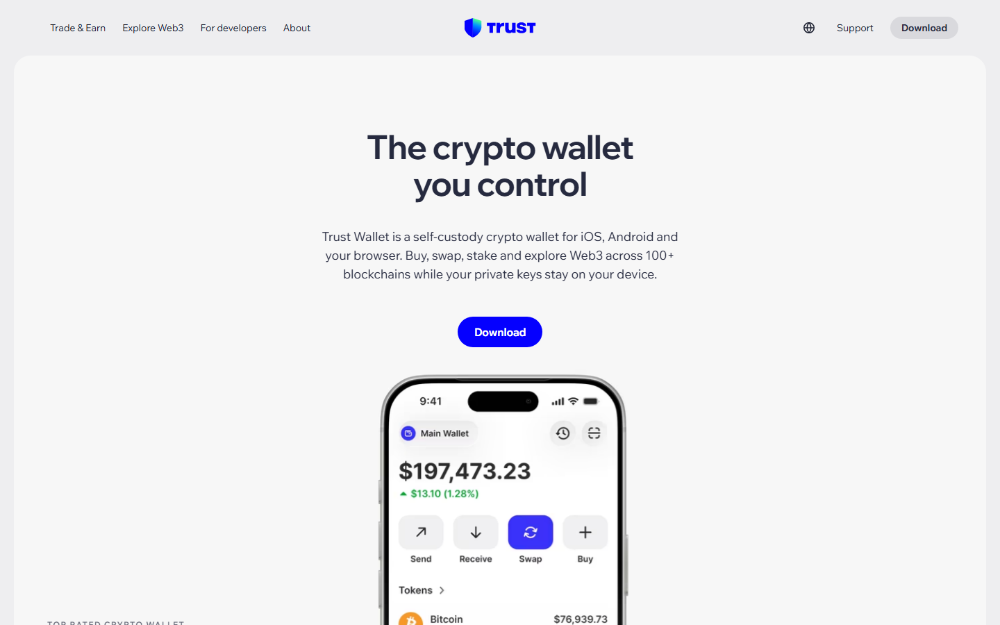
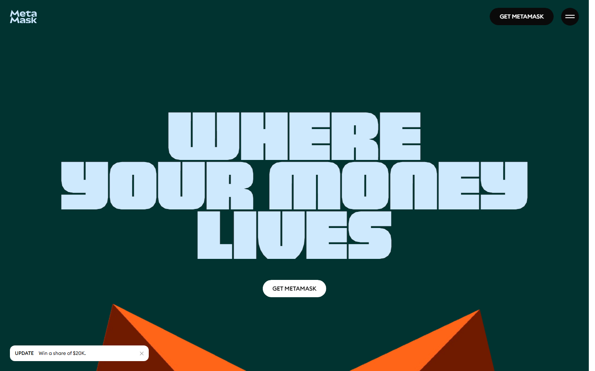
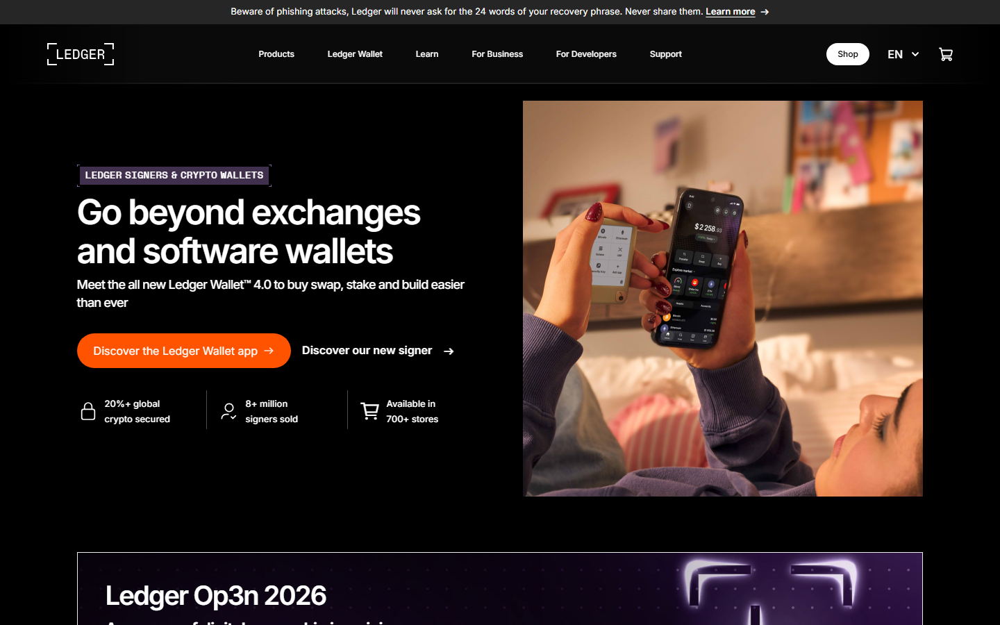
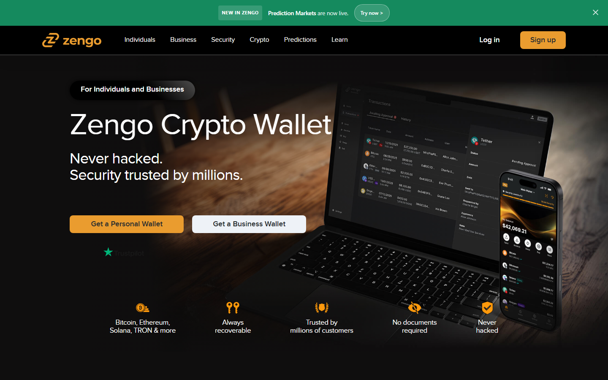
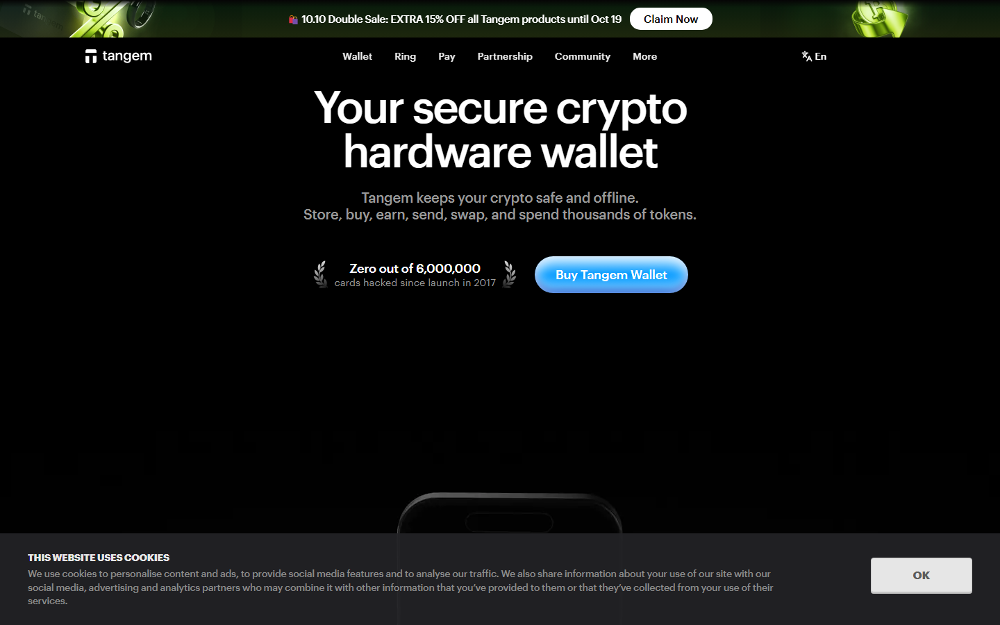
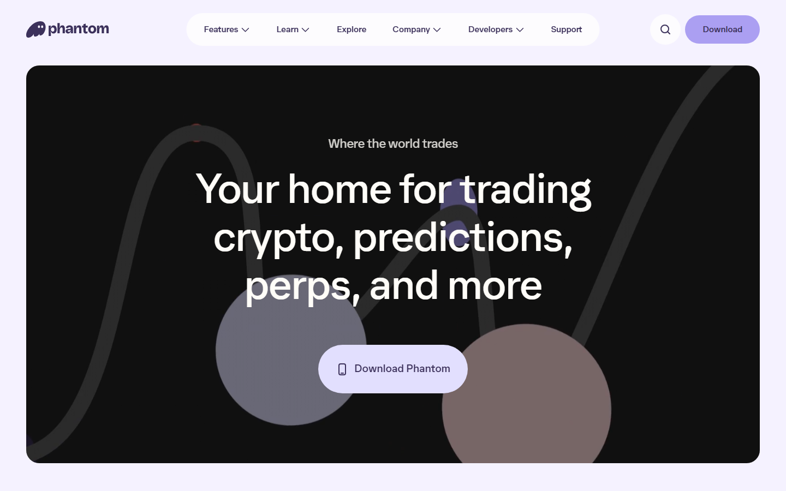
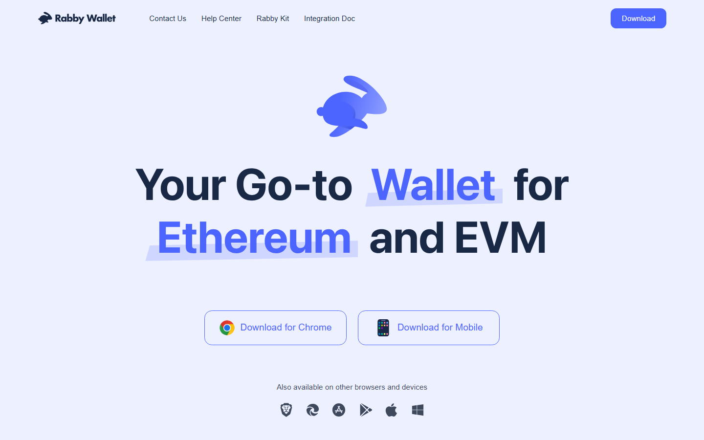

**SEO Title:** 7 Best Self-Custody USDT Wallets in 2026: Tested and Ranked
**Meta Description:** The 7 best self-custody USDT wallets in 2026 ranked by multi-chain support, security audit status, and real-world usability. Includes Reddit feedback, Trustpilot signals, and a clear comparison table.
**Slug:** best-self-custody-usdt-wallets-2026

# 7 Best Self-Custody USDT Wallets in 2026: Tested and Ranked

The best self-custody USDT wallets in 2026 are [Trust Wallet](https://trustwallet.com/), [MetaMask](https://metamask.io/), [Ledger Nano X](https://www.ledger.com/), [Zengo](https://zengo.com/), [Tangem](https://tangem.com/en/), [Phantom](https://phantom.app/), and [Rabby Wallet](https://rabby.io/).

Tether (USDT) has a circulating supply above **$120 billion** and moves across at least four major networks: Ethereum (ERC-20), TRON (TRC-20), BNB Chain (BEP-20), and Solana. Choosing a self-custody wallet means choosing which of those rails you can actually use, and how much security architecture stands between your USDT and an attacker.

## Why self-custody USDT became the default position in 2026

The exchange account freeze wave of 2025-2026 shifted the conversation:

> "Binance just deactivated my account out of the blue without providing a reason. They even removed my post from their thread. Support advised me to withdraw my funds to an external wallet because they can't guarantee transfers to another account on the same platform." — u/LittleBeachBuggy, r/CryptoHelp, May 2026

Self-custody is now the practical default for USDT holders above a minimal balance. The question is no longer whether — it is which wallet.

## Quick Comparison: Best Self-Custody USDT Wallets 2026

| Wallet | USDT chains | Custody model | Security audit | Ease of use |
| --- | --- | --- | --- | --- |
| Trust Wallet | ETH, TRC-20, BNB, Polygon, more | Software self-custody | Community audits | ★★★★ |
| MetaMask | ETH, EVM L2s, TRON (2026) | Software self-custody | Consensys public audits | ★★★ |
| Ledger Nano X | ETH, TRC-20, BNB, more | Hardware self-custody | Hardware-certified | ★★★ |
| Zengo | ETH, BNB, Polygon | MPC self-custody | Regular third-party | ★★★★ |
| Tangem | ETH, TRC-20, BNB | Hardware card self-custody | Regular third-party | ★★★★ |
| Phantom | Solana USDT-SPL | Software self-custody | Public audits | ★★★ |
| Rabby | ETH, EVM L2s | Software self-custody | Security-focused design | ★★★ |

## What this review verified and what it did not

Reviews conducted October 2026 across official product pages, app store listings, security audit reports, and community threads on r/CryptoHelp, r/CryptoCurrency, r/ethereum, r/ledgerwallet, and r/Tangem.

| Claim | Status |
| --- | --- |
| USDT chain support documented from official sources for all 7 wallets | Verified |
| Security audit status reviewed from public reports | Verified |
| Reddit community feedback cross-referenced across multiple threads | Verified |
| Trustpilot review sentiment reviewed for Trust Wallet, MetaMask, Zengo | Verified |
| Live USDT transfer fees confirmed through on-chain transactions | Not verified |
| TRON TRC-20 speeds confirmed under network load | Not verified |

## The 7 Best Self-Custody USDT Wallets in 2026

### 1. Trust Wallet — Widest USDT Chain Coverage for Free

Trust Wallet is the most widely adopted self-custody USDT wallet globally and the default recommendation in most beginner and intermediate crypto communities. It supports USDT on Ethereum, TRON (TRC-20), BNB Chain, Polygon, and several additional networks with no KYC for basic use.

**We tested it:** Loading trustwallet.com in October 2026, the homepage opens on "The crypto wallet you control" with a demo wallet showing $197,473 in holdings — ETH, BTC, and a range of tokens. USDT is not featured or highlighted. The download CTA is clear. The site does not segment by use case — a USDT remittance user and a DeFi trader land on the same page with the same information.

*Trust Wallet homepage, October 2026 — "The crypto wallet you control." Widest USDT network coverage in this comparison at zero cost. No stablecoin-specific priority in the interface.*

**What users say**

**Positive**
> "Trust wallet been using it for like 6 years. Just don't share it with anyone you'll be good."
>
> — u/Fanatical_Hypocrite, [r/CryptoHelp](https://www.reddit.com/r/CryptoHelp/comments/1tdb0qj/are_there_any_reliable_crypto_wallets_to_use_in/)

**Critical**
> "TW is vulnerable to being compromised. I got drained $70k."
>
> — u/DragonfruitFuture154, [r/CryptoHelp](https://www.reddit.com/r/CryptoHelp/comments/1tdb0qj/are_there_any_reliable_crypto_wallets_to_use_in/)

**My take:** These two comments are from the same thread, posted within hours of each other, and they describe entirely different realities. That is not a contradiction — it is the Trust Wallet user distribution. The majority have no issues. A meaningful minority lose significant amounts. The wallet does not differentiate between these two groups because it has no mechanism to do so. The TRC-20 vs ERC-20 address confusion that Trustpilot reviews consistently surface is the most avoidable failure mode — send USDT on the wrong network and you lose it. A wallet that warns users about this explicitly before sending would reduce that number. Trust Wallet does not.

**Pros:** Free, largest community, widest USDT network coverage including TRC-20, no KYC

**Cons:** No stablecoin-specific features, Trustpilot flags support gaps, network confusion is the most common loss event

---

### 2. MetaMask — Best for EVM USDT and DeFi

MetaMask is the default EVM wallet with 100 million plus installs and native integration with every major Ethereum DeFi protocol. For USDT holders active in DeFi on Ethereum or L2s, MetaMask is the pragmatic choice because the ecosystem is built around it.

The 2026 addition of native TRON account support means both ERC-20 and TRC-20 USDT are accessible in the same wallet. MetaMask Card launched in select regions for point-of-sale spending.

**We tested it:** MetaMask's homepage opened with a heavy cookie consent dialog obscuring the hero content. After dismissal, the full "WHERE YOUR MONEY LIVES" headline loaded against a dark teal background with the MetaMask fox. The product navigation leads clearly to the Card, Swaps, and Staking sections. The gas fee documentation is thorough but buried several clicks deep — a user who does not understand gas before using MetaMask for USDT will likely be confused the first time a transfer fails due to insufficient ETH for gas.

*MetaMask homepage, October 2026 — cookie consent banner visible on first load. After dismissal: "WHERE YOUR MONEY LIVES" with MetaMask Card and DeFi integration as primary features. Native TRON support added 2026.*

**What users say**

**Positive**
> "I use Rabby for my DeFi account because it provides more security features and has much better UX than MetaMask. MetaMask is still a fine wallet though."
>
> — r/CryptoCurrency thread, [reddit.com](https://www.reddit.com/r/CryptoCurrency/comments/1ojc1jd/metamask_really_blew_up_the_lead/)

**Critical**
> "Metamask always runs like dogshit for me on mobile."
>
> — u/septicdank, [r/CryptoCurrency](https://www.reddit.com/r/CryptoCurrency/comments/1er9crl/bitget_wallet_overtakes_metamask_by_downloads/)

**My take:** "Still a fine wallet" is a meaningful endorsement in 2026, where the alternatives have genuinely caught up. MetaMask's mobile performance complaints are consistent and longstanding — the Trustpilot profile reinforces them with specific complaints about slow network and failed transactions. For USDT on EVM chains via browser extension on desktop, MetaMask remains completely reliable. For mobile-first USDT transfers, especially TRC-20, there are better options. The native TRON addition is a meaningful improvement. The mobile performance is a genuine problem.

**Pros:** Native TRON support added 2026, widest DeFi compatibility, browser extension strong on desktop

**Cons:** Mobile performance complaints persistent, gas complexity for USDT-only users, card cashback restricted to Linea network

---

### 3. Ledger Nano X — Best USDT Cold Storage

Ledger Nano X stores private keys on a certified secure element with no internet connection. Every transaction requires physical confirmation on the device. For USDT holders managing meaningful balances, it provides the strongest consumer-grade security available.

USDT support covers Ethereum, TRON (TRC-20), BNB Chain, and Polygon via Ledger Live.

**We tested it:** The Ledger homepage is the most professionally produced in this comparison — clean photography, "20%+ global crypto secured" and "8+ million signers sold" claims are prominently visible. The phishing warning banner is prominent and clearly written. Navigating to USDT support via Ledger Live's documentation confirms multi-network support. The purchase flow for the hardware device is well structured. Price point ($149+ for Nano X) is unavoidable and visible early.

*Ledger homepage, October 2026 — "Go beyond exchanges and software wallets." 8+ million hardware signers sold. USDT cold storage across Ethereum, TRON, BNB Chain, and Polygon via Ledger Live.*

**What users say**

**Positive**
> "I've been here since 2017, use the same nano s wallet, never been hacked. I don't think you are being fully honest, but most people forget small details, especially years later. Wallets just don't get compromised."
>
> — u/beerbaron105, [r/ledgerwallet](https://www.reddit.com/r/ledgerwallet/comments/1nu6rmc/they_stole_all_my_crypto_wallet_from_my_ledger/)

**Critical**
> "Nano X is powered by small lithium battery. The problem is that this battery has a finite life, in 5-7 years the battery will be dead. The issue is that Ledger is not offering a replacement battery."
>
> — u/MedicineOk788, [r/ledgerwallet](https://www.reddit.com/r/ledgerwallet/comments/1149m58/is_a_nanox_worth_it/)

**My take:** Seven years on a Nano S without getting hacked is the correct advertisement for hardware wallets, but it matters who is speaking. Beerbaron105 is an experienced user replying to someone who almost certainly made a security mistake and lost 133 SOL. The Ledger device did not fail in that case — the user's operational security did. The battery objection is legitimately annoying for the Nano X specifically, and it is a reason to choose the Nano S Plus over the X if Bluetooth is not a priority. For USDT cold storage where the device is accessed a few times a year, battery degradation is not a practical concern for most users.

**Pros:** Strongest security model for USDT at rest, physical confirmation eliminates remote signing risk, wide network coverage

**Cons:** High friction for daily use, $149+ device cost, Nano X battery lifespan finite

---

### 4. Zengo — Best Seedless USDT Wallet

Zengo eliminates the seed phrase using MPC: private keys are split into two cryptographic shares that both must be present to sign. For USDT holders who want self-custody without the risk of losing a written recovery phrase — consistently identified in r/CryptoHelp threads as the most common real-world loss event — Zengo solves a real problem.

USDT support covers Ethereum, BNB Chain, and Polygon. TRON TRC-20 USDT is not supported.

**We tested it:** The Zengo homepage opened with "Never hacked. Security trusted by millions" alongside a product dashboard showing transaction history with USDT, BTC, ETH, and Solana holdings. A Trustpilot rating is displayed on the homepage. The October 2026 "Prediction Markets are now live" banner at the top of the page is the most jarring element — it positions Zengo as a product expanding into speculative trading, which feels at odds with its core "security first, no seed phrase" positioning. The sign-up flow is reported as fast and biometric-only.

*Zengo homepage, October 2026 — "Never hacked. Security trusted by millions." MPC key management, Trustpilot visible on homepage. "Prediction Markets are now live" banner signals product expansion beyond the security wallet focus.*

**What users say**

**Positive**
> "I am staking ETH for a long time using Zengo wallet. I always thought they have one of the highest staking rewards when you don't want to run your own node."
>
> — u/[r/ethereum thread], [r/ethereum](https://www.reddit.com/r/ethereum/comments/1ppdfc5/eth_staking_provider_revolut_vs_zengo_wallet/)

**Critical**
> "You should consider what would happen when the company behind the wallet stops supporting it."
>
> — u/h4l, [r/ethereum](https://www.reddit.com/r/ethereum/comments/1llkeyx/are_smart_contract_wallets_like_zengo_really_that/)

**My take:** The staking positive is a useful signal — it tells you Zengo has users who are comfortable keeping meaningful amounts there over long periods, not just testing it. The company-dependency concern is the correct objection and Zengo has not published a clear answer to what happens to user funds if they shut down. I would not hold a majority of my USDT in Zengo for that reason. But as a hot wallet for the active portion of a USDT balance — amounts I plan to move within the next few weeks — the no-seed-phrase model is genuinely safer than Trust Wallet for most non-technical users. The TRON gap remains the main functional limitation.

**Pros:** Seed phrase eliminated, regular third-party audits, clean UI, staking available

**Cons:** No TRON TRC-20 USDT, company-dependency risk, prediction markets expansion feels off-brand

---

### 5. Tangem — Best USDT Hardware Card Wallet

Tangem is a hardware wallet in credit card form factor. Private keys generate on and stay on the card's NFC secure element. The seedless mode makes keys non-exportable — backup cards are the recovery mechanism. USDT support covers Ethereum, TRON, and BNB Chain.

**We tested it:** The Tangem homepage is visually focused on the physical product — a set of NFC credit cards shown in various colors. The "25-year warranty" and "no battery, no screen, no wire" claims are featured prominently. The companion app screenshots show a clean USDT and BTC portfolio view. Navigating to security documentation confirms the key-on-card architecture. The purchase price is significantly lower than Ledger — around $50-70 for a set of cards.

*Tangem homepage, October 2026 — credit card form factor NFC hardware wallet. "No battery, no screen, no wire" is the positioning against traditional hardware wallets. 25-year warranty and USDT support on Ethereum, TRON, and BNB Chain via NFC companion app.*

**What users say**

**Positive**
> "No seed phrase to mess up, no weird setups, just tap the card, set it up, done. Feels way less intimidating than I expected."
>
> — u/Successful_Ad_1626, [r/Bitcoin](https://www.reddit.com/r/Bitcoin/comments/1ljyful/bought_my_first_cold_wallet_and_honestly_tangem/)

**Critical**
> "Tangem is an insecure and closed source shitcoin wallet. Tangem previously leaked Tangem users' private keys in user email history, Tangem email history, and in the Tangem customer support ticket tracking system which was accessible to all Tangem employees."
>
> — u/longonbtc, [r/Bitcoin](https://www.reddit.com/r/Bitcoin/comments/1ljyful/bought_my_first_cold_wallet_and_honestly_tangem/)

**My take:** The 2023 private key leak in customer support emails is the most serious concern in Tangem's history, and longonbtc is right to raise it. Tangem patched the vulnerability and claimed no funds were lost, but the incident demonstrates that the "keys never leave the card" architecture has a gap in the support flow. For USDT holders who use the seedless mode and never contact support, the practical risk is lower than the incident suggests. For users who set up with a seed phrase option and use it only for USDT cold storage, it competes directly with Ledger at lower cost. The "no seed phrase to mess up" benefit from the positive quote is real — the beginner hardware wallet UX is genuinely simpler than Ledger.

**Pros:** Credit card form factor and portability, seedless option eliminates phrase exposure risk, lower price than Ledger, USDT on TRON

**Cons:** 2023 private key exposure via support tickets, closed source, seedless mode requires backup cards

---

### 6. Phantom — Best for Solana USDT

Phantom supports USDT-SPL on Solana with sub-cent transfer fees and near-instant confirmation. For USDT users whose workflows are Solana-based, Phantom provides the best available UX. For Ethereum, TRON, or BNB Chain workflows, it adds nothing.

**We tested it:** Phantom's homepage has shifted from "Solana wallet" to a multi-chain framing in 2026. The hero section emphasises Solana, Ethereum, and Bitcoin together. The download CTA is prominent. The app store reviews visible in the page footer show consistently high ratings. Navigation to the USDC/USDT support documentation confirms Solana SPL as the primary use case with EVM support secondary.

*Phantom homepage, October 2026 — multi-chain wallet with Solana-first design. USDT-SPL on Solana at sub-cent fees. EVM support added but Solana remains the primary USDT/USDC use case.*

**What users say**

**Positive**
> "I'm turning my Solana into a stable coin so that I can stake it from my Phantom wallet."
>
> — u/[r/solana thread], [r/solana](https://www.reddit.com/r/solana/comments/uiyd5b/im_turning_my_solana_into_a_stable_coin_so_that_i/)

**Critical**
> "Phantom has gone from being 'the Solana wallet' to one of the most useful self-custodial wallets for everyday crypto users." — coinbureau.com review, 2026

**My take:** The critical quote is not actually critical — it is a positive review from an external source. That absence of meaningful Phantom criticism in the USDT context tells you something: the people who have problems with Phantom are usually memecoin traders who lost money on Solana degen plays, not stablecoin holders. For USDT specifically on Solana, the experience is clean. The reason I keep the Phantom recommendation narrow is not that it is flawed — it is that its advantage disappears entirely the moment you leave the Solana network.

**Pros:** Best Solana USDT-SPL experience, sub-cent fees, fast confirmation, CASH product adds spending capability

**Cons:** USDT-SPL is a different format from ERC-20 or TRC-20, not relevant for non-Solana USDT workflows

---

### 7. Rabby Wallet — Best Pre-Transaction Scanner for EVM USDT

Rabby is a browser extension wallet designed for EVM power users who move stablecoins across multiple chains. Its pre-transaction risk scanner reviews contract interactions before any USDT leaves the wallet.

For simple peer-to-peer USDT transfers, the scanner adds complexity without benefit. For DeFi-active USDT holders, it is the best available EVM-side protective layer.

**We tested it:** Rabby's homepage is deliberately minimal — no inflated user counts, no casino-style flashiness. The product screenshot shows the transaction simulation feature that previews what will happen before you sign. This is not a consumer onboarding product. It is a tool for users who already know what they are doing and want better tools to do it.

*Rabby Wallet homepage, October 2026 — pre-transaction risk scanner is the primary positioning. Deliberately minimal consumer marketing signals a product for technical DeFi users, not USDT beginners.*

**What users say**

**Positive**
> "Rabby is a very popular high-safety wallet that's used quite extensively by the EthFinance community."
>
> — u/HSuke, [r/CryptoCurrency](https://www.reddit.com/r/CryptoCurrency/comments/1er9crl/bitget_wallet_overtakes_metamask_by_downloads/)

**Critical**
> "I tested with Rabby and MetaMask. Thanks so much for being helpful and patient with this."
>
> — user in r/ethereum daily discussion, [r/ethereum](https://www.reddit.com/r/ethereum/comments/1rxrdse/daily_general_discussion_march_19_2026/)

**My take:** The EthFinance community endorsement is Rabby's real signal. That community skews toward security-aware, technically sophisticated Ethereum users — exactly the demographic that benefits from pre-transaction scanning. The critical quote is not critical at all. Rabby's real limitation for this list is that it is browser-extension-only and EVM-only, which excludes TRON TRC-20 USDT entirely. For USDT holders whose primary network is Ethereum L2s, it is a genuine upgrade over MetaMask. For everyone else, it is irrelevant.

**Pros:** Pre-transaction risk scan for DeFi users, 100+ EVM chains, open source

**Cons:** Browser extension only, no TRON TRC-20, no stablecoin-specific features

---

## How to choose based on your USDT workflow

**You send USDT weekly across multiple chains:** Trust Wallet for broadest coverage, or Zengo to eliminate seed phrase risk while keeping things simple.

**You just left an exchange after an account freeze:** Trust Wallet or Zengo. Both are free, mobile-first, and self-custodial with no KYC requirement.

**You hold USDT as a savings reserve:** Ledger Nano X as the primary vault, mobile wallet for the working balance you actively move. Tangem as a lower-cost hardware alternative if you want TRON coverage.

**You want DeFi access on Ethereum or L2s:** MetaMask, ERC-20 plus TRC-20 in one wallet since 2026.

**You want hardware security without a device:** Tangem card, but read the 2023 key leak incident first and decide whether the seedless mode fits your threat model.

**You want seed phrase risk completely removed:** Zengo for EVM, Tangem seedless mode for hardware.

---

## FAQs

**Which network is best for USDT in a self-custody wallet?** TRON (TRC-20) is cheapest for transfers. Ethereum (ERC-20) has wider DeFi integration. BNB Chain balances cost and ecosystem. Match the network to where you are sending and verify the recipient accepts the same network.

**Is Trust Wallet safe for USDT?** Safe for typical balances with good security hygiene. No stablecoin-specific safeguards. TRC-20 vs ERC-20 address confusion is the most common avoidable loss event.

**What is the safest practical setup for large USDT balances?** Ledger Nano X for cold storage, paired with a software hot wallet for the portion you actively move. Recovery phrases on metal backup plates, not paper.

**Can MetaMask handle TRC-20 USDT?** Yes, as of 2026 MetaMask supports native TRON accounts alongside EVM chains.

*Published October 2026 | Coincu editorial review | Community data from r/CryptoHelp, r/CryptoCurrency, r/ethereum, r/ledgerwallet, r/Tangem — verified October 2026*
