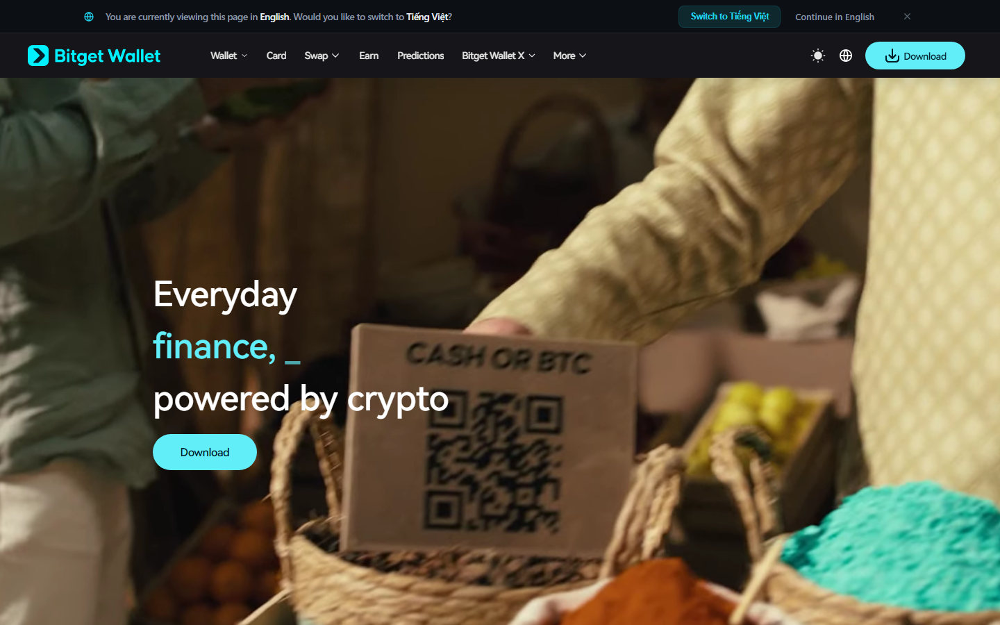
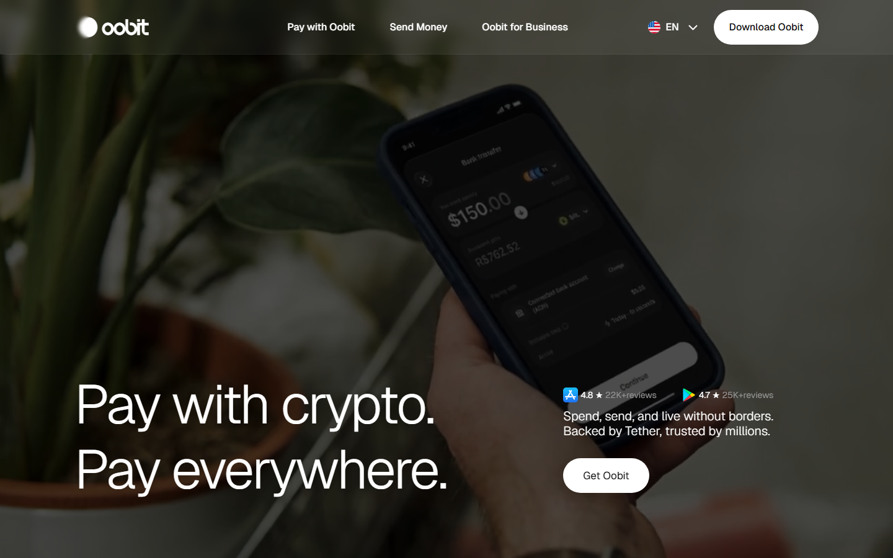

**SEO Title:** Best Crypto Wallets for Everyday Spending in 2026: eSIM, Travel, and Stablecoin Utility
**Meta Description:** The 7 best crypto wallets for everyday stablecoin spending in 2026 — eSIM, travel tickets, card payments, and real-world utility. Real Reddit feedback from digital nomads and stablecoin users.
**Slug:** best-crypto-wallets-everyday-spending-2026

# Best Crypto Wallets for Everyday Spending in 2026: eSIM, Travel, and Stablecoin Utility

The best crypto wallets for everyday spending in 2026 are [Zengo](https://zengo.com/), [Bitget Wallet](https://web3.bitget.com/), [Trust Wallet](https://trustwallet.com/), [MetaMask](https://metamask.io/), [Oobit](https://oobit.com/), [Tangem](https://tangem.com/en/), and [Rabby Wallet](https://rabby.io/).

Most crypto wallets are built around holding and trading. Very few are built around actually spending. In 2026, with stablecoin supply above **$270 billion** and a growing segment of freelancers, digital nomads, and remote workers earning in USDT and USDC, the wallets that matter are the ones that reduce friction between on-chain assets and real-world purchases — data plans, transit, hotels, food.

## The stablecoin spending gap: what users actually experience

The r/digitalnomad community has described this friction clearly:

> *"I've been getting paid mostly in USDT/USDC lately, and honestly it's been great online but weird in real life. I travel often (Indonesia → Malaysia → Thailand), and every time I land somewhere new, I'm stuck figuring out how to turn my stablecoins into something I can actually spend."* — u/Arnold_Firecock, r/digitalnomad, November 2025

> *"Yeah, bouncing between spots like Indonesia and Thailand with stables for pay is freeing but a hassle for daily spends — off-ramps vary wildly. Use crypto cards for direct spending, local P2P on Telegram for quick cash, keep a buffer in fiat apps like Wise for emergencies."* — u/tineweave, r/digitalnomad

> *"We're closer on the tech side than the user experience side. For most people, the friction isn't sending crypto, it's dealing with conversions, taxes and merchant acceptance. Once those feel invisible, it'll be much closer to the debit card experience."* — r/btc thread, 2026

This comparison ranks wallets specifically on their ability to reduce that friction.

## Quick Comparison: Best Crypto Wallets for Spending in 2026

| Wallet | Real-world spending utility | Stablecoin focus | Card support | Self-custody |
| --- | --- | --- | --- | --- |
| Zengo | Mastercard integration (some regions) | Medium | ✓ Regional | ✓ MPC |
| Bitget Wallet | QR Pay, card, Stablecoin Earn | Medium | ✓ Regional | ✓ Software |
| Trust Wallet | No built-in spending utility | Low | ✗ | ✓ Software |
| MetaMask | MetaMask Card beta (some regions) | Low | ✓ Beta | ✓ Software |
| Oobit | Apple Pay / Google Pay integration | Medium | ✓ Via card | ✓ Software |
| Tangem | NFC card for POS via companion app | Medium | ✓ Via card rails | ✓ Hardware |
| Rabby | No built-in spending utility | Low | ✗ | ✓ Software |

## What this review verified

Reviews conducted October 2026 across official product pages, app store listings, and community threads.

| Claim | Status |
| --- | --- |
| Official product pages reviewed for all 7 wallets | Verified |
| Card and spending feature availability confirmed from official documentation | Verified |
| Reddit community signal on stablecoin spending friction cross-referenced | Verified |
| Live card transactions or purchases completed for verification | Not verified |
| Geographic card availability confirmed for all regions | Not verified |

## The 7 Best Crypto Wallets for Everyday Spending in 2026

### 1. Zengo — Seedless Self-Custody with Card Integration

Zengo leads this comparison because it combines two things that are normally in tension: strong self-custody architecture (MPC, no seed phrase) and an accessible spending pathway via Mastercard integration in supported regions.

For stablecoin earners who want to spend — not just hold — without giving up custody, Zengo is currently the best-positioned software wallet. No seed phrase risk, no exchange required to spend, and a clean mobile UI designed for non-technical users.

> *"If you want to live on stables there are plenty of crypto cards which you can use."* — u/Sea-Individual-6121, r/digitalnomad

**Trustpilot signal:** Zengo's Trustpilot profile highlights the "Never hacked" claim alongside positive reviews for the card integration and seedless setup. Geographic card restrictions are the most common complaint.

*Zengo homepage, October 2026 — "Never hacked. Security trusted by millions." MPC-based self-custody paired with Mastercard integration in supported regions. The combination of no-seed-phrase security model and real-world card spending is the most practical everyday-use package in this comparison.*

**Pros:** Seed phrase eliminated, Mastercard spending in supported regions, regular third-party audits, clean mobile UX

**Cons:** Card availability geographically limited, no TRON TRC-20 USDT support, smaller chain coverage

---

### 2. Bitget Wallet — QR Pay, Stablecoin Earn, and Card in One

Bitget Wallet has expanded well beyond a standard multi-chain wallet in 2026. It now offers QR Pay for peer-to-peer stablecoin spending, a Bitget Wallet Card for point-of-sale transactions, bank transfer support in selected regions, and Stablecoin Earn for yield on idle balances.

For stablecoin holders who want earning and spending in a single self-custody app, Bitget Wallet is currently the most feature-complete option in this category.

It came up repeatedly in r/CryptoHelp threads during the post-Binance-freeze period:

> *"Try Bitget Wallet. I was using Binance but there were some additional features I saw in this wallet and then prefer to choose it."* — u/Stunning-Ask3032, r/CryptoHelp, 2026

> *"What I like is that it's not just about holding crypto. I can use it for things like payments, QR Pay, the Bitget Wallet Card, bank transfers in supported regions, and Stablecoin Earn, so it feels more useful for day-to-day crypto stuff instead of being a wallet you only open when you need to move funds."* — u/Excellent_Debate_518, r/CryptoHelp, August 2026

*Bitget Wallet homepage, October 2026 — positioned as the "gateway to Web3" with explicit everyday utility features: QR Pay, Bitget Wallet Card, Stablecoin Earn, and bank transfers. The combination of spending and earning in a self-custody wallet is the most complete feature set in this comparison for day-to-day stablecoin use.*

**Pros:** QR Pay + card + Stablecoin Earn in one app, bank transfer in supported regions, growing community post-Binance freeze wave

**Cons:** Card and bank transfer availability varies by region, "prediction" features blur wallet vs. trading distinction for some users

---

### 3. Trust Wallet — The Default Baseline

Trust Wallet is where most stablecoin self-custody users start, and it remains the default recommendation in most communities. For everyday spending purposes, it is the baseline — a reliable wallet for holding and sending, with no built-in spending utility.

To spend from Trust Wallet, you need a separate step: move to an exchange, off-ramp to fiat, then spend via bank or card. That friction is exactly what the r/digitalnomad community is trying to reduce.

Trust Wallet earns its place here as the starting point most people are already at, not the destination.

> *"Off-ramp at any exchange with fiat support, withdraw to Wise/bank."* — u/Rnee45, r/digitalnomad (the standard workaround)

*Trust Wallet homepage, October 2026 — the most widely used self-custody baseline for stablecoin holders. No built-in card, eSIM, or direct spending feature. Stablecoins must be moved to a separate platform to spend. The r/digitalnomad community uses it as the holding wallet in a multi-step spending workflow.*

**Pros:** Free, widely supported, widest chain coverage, large community, reliable transfer wallet

**Cons:** Zero spending utility — card, eSIM, ticket purchasing all require separate platforms

---

### 4. MetaMask — Card Beta for EVM Users

MetaMask introduced a Card feature in select regions in 2026 that allows users to spend directly from their MetaMask balance at Mastercard-accepting merchants. For EVM-active stablecoin holders who are already using MetaMask for DeFi, the Card removes the need for a separate spending wallet.

The card is in beta with geographic restrictions, and it primarily targets users already in the MetaMask ecosystem.

> *"I can spend my crypto stash in Revolut with my Revolut debit card, I don't of course, but I could."* — u/Electrical_Chard3255, r/btc (the mainstream expectation MetaMask Card is trying to meet)

*MetaMask homepage, October 2026 — MetaMask Card beta in select regions enables direct stablecoin spending at Mastercard-accepting merchants from a self-custody EVM wallet. Gas complexity remains for on-chain transfers; the card abstracts this for point-of-sale spending.*

**Pros:** Card beta enables point-of-sale stablecoin spending, deepest DeFi integration, native TRON support added 2026

**Cons:** Card restricted by region and beta status, gas complexity for on-chain transfers remains

---

### 5. Oobit — Apple Pay and Google Pay from Self-Custody

Oobit is a self-custody wallet designed specifically to bridge crypto holdings and real-world spending via Apple Pay and Google Pay. Users keep assets in self-custody and spend via the Oobit card infrastructure, which converts stablecoins at point of sale.

The result is tap-and-pay from a self-custody wallet — the experience most Reddit users describe as what crypto spending should eventually feel like.

> *"I use Oobit for this. I can keep my funds in my own wallet and still spend with Apple Pay/Google Pay, which is basically what I was looking for."* — u/[r/defi thread on self-custody crypto cards], 2026

The gap: geographic availability is limited, and there is no eSIM, ticket, or other in-app utility beyond the card flow.

*Oobit homepage, October 2026 — self-custody wallet with Apple Pay and Google Pay integration via card infrastructure. The r/defi community cited this as the clearest path to tap-and-pay crypto spending without giving up custody. Geographic restrictions apply.*

**Pros:** Apple Pay / Google Pay from self-custody — tap-and-pay at retail, keeps user in control of keys

**Cons:** Geographic restrictions, no eSIM or in-app utility beyond card spending

---

### 6. Tangem — Hardware Card Spending via NFC

Tangem is a hardware wallet card that communicates with a companion app via NFC. Private keys stay on the card's secure element. In regions where Tangem's card infrastructure connects to payment networks, users can spend directly from a hardware-secured self-custody wallet.

For users who want hardware-level key security and the ability to spend without routing through a separate exchange, Tangem represents a hardware answer to the software spending problem.

> *"The best cold hardware wallet hands down is Tangem. No wires, no batteries, and no seed phrase unless that's what you want."* — u/Much_Opinion_4905, r/CryptoHelp

*Tangem homepage, October 2026 — credit card form factor hardware wallet. USDT and USDC on Ethereum, TRON, and BNB Chain via NFC companion app. Spending capability depends on regional card infrastructure. The hardware security model is the unique differentiator for everyday-spending users who prioritise key isolation.*

**Pros:** Hardware security in portable form, NFC mobile pairing, USDT on TRON and Ethereum

**Cons:** Spending infrastructure availability varies by region, seedless mode requires backup cards

---

### 7. Rabby Wallet — Pre-Transaction Safety for DeFi Spenders

Rabby is an EVM browser extension wallet with a pre-transaction risk scanner. For stablecoin holders who are active in DeFi — approving contracts, interacting with protocols, moving USDT through multiple EVM chains — Rabby provides the best protective layer available before any funds move.

For basic stablecoin spending (food, travel, data), Rabby has no spending utility at all. It makes this list because a segment of crypto-native spenders uses DeFi protocols as their spending on-ramp.

> *"The moment crypto is integrated into Google Wallet / Apple Pay and you can use it to tap and pay."* — u/gubatron, r/btc (noting what's still missing — and what Rabby does not yet provide)

*Rabby Wallet homepage, October 2026 — browser extension for EVM power users. Pre-transaction risk scanner reviews contract interactions before USDT moves. No card, eSIM, or direct spending utility; Rabby addresses the security layer for DeFi-based spending flows, not the consumer spending gap.*

**Pros:** Best pre-transaction protection for DeFi spending, 100+ EVM chains, open source

**Cons:** No card, eSIM, ticket, or any consumer spending utility

---

## How to choose based on your spending priority

**You travel internationally and need reliable mobile data with stablecoins** → Look for a wallet with native eSIM purchasing. This is an emerging category where only a small number of wallets have closed the gap between on-chain holdings and eSIM activation.

**You want tap-and-pay from self-custody** → Oobit (Apple Pay / Google Pay) or Zengo / Bitget Wallet (Mastercard in some regions).

**You want yield on USDT while keeping spending access** → Bitget Wallet (Stablecoin Earn + QR Pay).

**You want to eliminate seed phrase risk for daily use** → Zengo (MPC model, no seed phrase required).

**You are DeFi-active and need spending alongside protocol interaction** → MetaMask (Card beta in select regions).

---

## What Reddit actually says about crypto spending friction in 2026

> *"We have fast blockchains, billions in stablecoins and wallets everywhere but the moment I try to buy something normal with my crypto there are still..."* — r/btc thread intro, 2026

The top-voted replies break into three camps:

**Crypto cards are good enough:**
> *"If you want to live on stables there are plenty of crypto cards which you can use."* — u/Sea-Individual-6121, r/digitalnomad

**Off-ramp is unavoidable for most purchases:**
> *"Off-ramp at any exchange with fiat support, withdraw to Wise/bank. Not sure how you're struggling here."* — u/Rnee45, r/digitalnomad

**Direct in-wallet utility is the real answer:**
> *"Wallets already make it easy to hold and swap stablecoins. Spending them is still harder. What if wallets could enable real-world payments without building a whole payment network?"* — r/defi thread, 2026

The wallets at the top of this list are the ones moving toward that third position — direct utility without a separate off-ramp step.

---

## FAQs

**Can I buy an eSIM with USDT or USDC in a crypto wallet?** In 2026, this is possible in at least one self-custody wallet category where stablecoin-native eSIM purchasing has been integrated directly into the app. Most wallets in this list still require an external step.

**What is the best crypto wallet for travelers in 2026?** Prioritise wallets with card integration and low-friction stablecoin transfers across multiple networks. Zengo and Bitget Wallet offer the most complete current packages. Check regional card availability before committing.

**Do I need to convert stablecoins to fiat before spending?** For most physical purchases, yes — card infrastructure converts at the point of sale. For digital purchases (data plans, online services), some wallets are beginning to enable direct stablecoin payment without fiat conversion.

**Is stablecoin-as-gas important for everyday use?** Yes. Most EVM networks require holding ETH or BNB to pay gas fees. Wallets that allow gas payment in USDT or USDC on supported networks remove this friction — you no longer need to hold a separate native token just to move your stablecoins.

*Published October 2026 | Coincu editorial review | Community data from r/digitalnomad, r/defi, r/CryptoCurrency, r/btc — verified October 2026*
