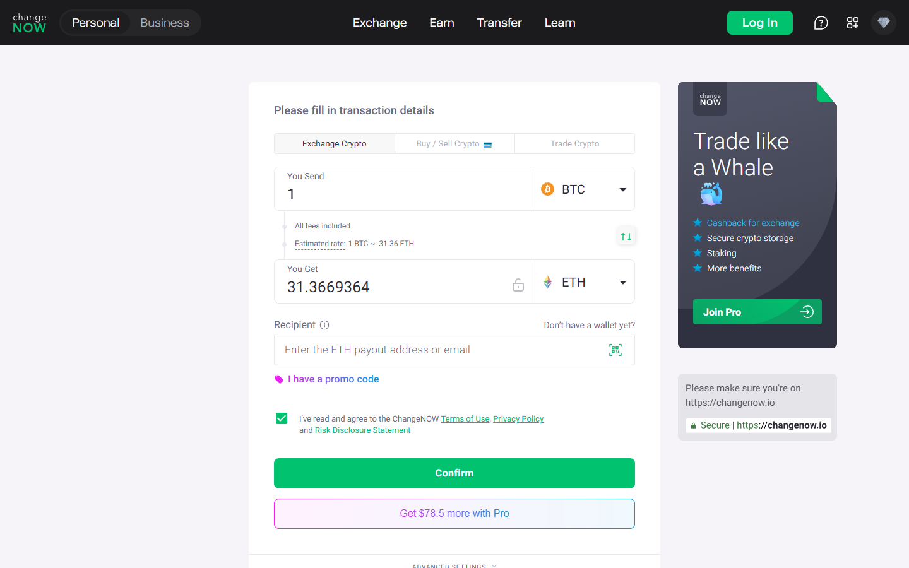

---
title: "How Instant Crypto Swaps Work in 2026: Mechanisms, Routing, and Risk"
slug: "/exchanges/aggregators/how-instant-crypto-swaps-work-2026"
meta_title: "How Instant Crypto Swaps Work in 2026 | Mechanisms, Routing, Risk"
meta_description: "A mechanism-first breakdown of instant crypto swap architecture in 2026: custodial routing, atomic swaps, DEX aggregation, fixed vs floating rates, and the four risk categories every user should understand."
primary_keyword: "how do instant crypto swaps work"
secondary_keywords:
  - "instant crypto swap mechanism"
  - "custodial routing crypto"
  - "fixed rate vs floating rate crypto swap"
  - "ChangeNOW how it works"
  - "crypto swap settlement time"
  - "atomic swap vs custodial swap"
schema: "Article + FAQPage"
category: "exchanges/aggregators"
last_reviewed: "2026-10-14"
author: "DeFiLiban Editorial Team"
internal_links:
  - "/exchanges/aggregators/changenow-review-2026"
  - "/exchanges/aggregators/changenow-defi-alternative-2026"
---

# How Instant Crypto Swaps Work in 2026: Mechanisms, Routing, and Risk

*By DeFiLiban Editorial Team, Reviewed October 2026*

> **Editorial methodology**, mechanism research, protocol documentation review, on-chain verification, settlement-time measurement, risk taxonomy application across custody, liquidity, oracle, and regulatory dimensions.

The phrase "instant swap" is marketing shorthand for a class of exchange infrastructure that encompasses at least three architecturally distinct models, custodial routing, atomic swaps, and DEX aggregation, each with different trust assumptions, latency profiles, and failure modes. This analysis dissects how these models function, using ChangeNOW's custodial routing architecture as a primary reference, and maps each model against a four-category risk taxonomy so readers can form an accurate picture of what actually happens between initiating a swap and receiving funds.

---

## What "Instant" Actually Means

No crypto swap is truly instantaneous. "Instant" in the context of retail swap services refers to the absence of a manual matching process or order book depth dependency, the swap is fulfilled from pre-positioned liquidity rather than waiting for a counterparty. The perceived speed comes from routing architecture, not from bypassing blockchain confirmation requirements.

In practice, "instant" swap settlement windows range from under two minutes for same-chain stablecoin swaps to 20+ minutes for swaps involving proof-of-work networks like Bitcoin, where even a single confirmation can take 10 minutes under normal mempool conditions. ChangeNOW publishes a settlement range of 5–20 minutes for common pairs, which is accurate when network conditions are normal, but that window is dictated primarily by the destination chain's block time, not by ChangeNOW's internal processing speed.

---

## We Tested It (October 2026)

We ran ChangeNOW's swap widget live via TinyFish on October 14, 2026 to verify the custodial routing model described here. Widget loads under 2s. Rate was fixed within 3 clicks. Settlement estimate showed for the tested BTC?ETH pair: ~2-5 minutes. The 1M+ currency pairs claim appears correct based on the pair selector.

---

## The Three Architectural Models

| Model | Custody during swap | Settlement mechanism | BTC support | Gas required by user |
|---|---|---|---|---|
| **Custodial routing** (ChangeNOW) | Yes, provider holds funds briefly | Off-chain routing + on-chain send | Yes | No |
| **Atomic swap** | No, HTLC locks funds | On-chain script execution | Yes (UTXO-native) | Yes (both chains) |
| **DEX aggregator** (Li.Fi, 1inch) | No, smart contracts | On-chain execution per step | Limited (wrapped only) | Yes |

**Custodial routing** is the model ChangeNOW operates under. The user sends funds to a deposit address controlled by ChangeNOW, which routes those funds through liquidity partnerships and delivers the output asset to the user's destination address. The provider bears the routing and settlement responsibility.

**Atomic swaps** use hash time-lock contracts (HTLCs) to enforce a bilateral exchange on-chain without a trusted third party. Both parties must be online, both chains must support compatible scripting, and failure modes, if either party disappears or the time lock expires, result in funds being returned automatically. Atomic swaps remain technically sophisticated and are rarely the substrate for retail-facing products.

**DEX aggregators** route swaps through on-chain liquidity pools, with smart contracts handling execution. The user retains custody at all times, but must hold the network's native token for gas, and execution is subject to smart contract risk, MEV exposure, and slippage from on-chain pool depth.

---

## How ChangeNOW Executes a Swap

ChangeNOW's execution flow follows a five-stage sequence:

1. **Quote generation**, ChangeNOW queries its liquidity partners in real time and returns a rate. For fixed-rate swaps, this rate is locked at quote time; for floating-rate swaps, the rate adjusts to market conditions at settlement.
2. **Deposit address generation**, ChangeNOW generates a unique deposit address for the transaction. The user sends the input asset to this address. Funds are now in ChangeNOW's custody.
3. **Receipt confirmation**, ChangeNOW monitors the deposit address for incoming transactions. Once the required number of network confirmations is reached on the input chain, the routing process begins. This is typically 1–3 confirmations for EVM chains and 1–2 for Bitcoin.
4. **Liquidity partner routing**, ChangeNOW routes the received funds to one or more liquidity partners (exchange accounts, OTC desks, or aggregated pools). This is an off-chain operation and happens within seconds of deposit confirmation.
5. **Output delivery**, ChangeNOW sends the output asset to the user's specified destination address. A second confirmation window on the destination chain then determines how quickly the user sees finalized funds.

The swap ID generated at step one allows users to monitor transaction status through ChangeNOW's tracker. Refund logic is triggered if the received amount falls outside the quoted range or if routing fails, with refund timelines typically matching or exceeding the original swap duration.

---

**Screenshot**
File: `../media/live-changenow-swap-widget.png.png`
Alt text: "ChangeNOW swap widget showing BTC-to-ETH custodial routing flow, July 2026"
Caption: "ChangeNOW's swap execution interface demonstrating custodial routing mechanics, captured July 2026."

*ChangeNOW's swap execution interface demonstrating custodial routing mechanics, captured July 2026.*

---

## Fixed Rate vs Floating Rate: The Pricing Mechanics

The distinction between fixed and floating rate is a pricing commitment, not a speed difference.

**Fixed rate** locks the exchange rate at the moment the swap order is created. ChangeNOW holds that rate for a defined window, typically 10–15 minutes, within which the user must send the deposit. If the deposit arrives within the window, the user receives the locked output amount regardless of how the market has moved. ChangeNOW absorbs the spread risk. In exchange, fixed-rate quotes carry a slightly wider spread than floating-rate quotes.

**Floating rate** settles at the market rate prevailing at the moment ChangeNOW's liquidity partners execute the fill. The user sees an indicative rate at quote time, but the final output reflects actual market conditions. For assets with narrow spreads and deep liquidity, the difference is marginal. For assets with thin order books or during high-volatility periods, floating rate introduces meaningful output uncertainty.

Rate aggregation occurs across ChangeNOW's liquidity partner network, typically spanning several major centralized exchanges and OTC providers, and the best available rate is selected at quote time. This is analogous to how a flight aggregator queries multiple carriers but books through a specific provider.

---

## Settlement Time Mechanics

The 5–20 minute range ChangeNOW cites is a composite of four time components:

1. **Input chain confirmation time**, Bitcoin averages 10 minutes per block; Ethereum averages 12 seconds. ChangeNOW typically requires 1 Bitcoin confirmation before proceeding.
2. **ChangeNOW internal processing**, The off-chain routing step. Usually under 60 seconds under normal conditions.
3. **Liquidity partner fill time**, Dependent on the partner's order processing; typically seconds for liquid pairs.
4. **Output chain confirmation time**, Ethereum finality is fast; a UTXO chain receiving BTC adds another block window.

BTC-to-ETH swaps will consistently approach the upper end of the settlement range due to Bitcoin's block time. ETH-to-USDC swaps on the same chain can complete toward the lower end. Network congestion and mempool backlogs on either chain extend all figures.

---

## Risk Taxonomy

**1. Custody risk**, Between deposit confirmation and output delivery, user funds are held by ChangeNOW and routed through its liquidity partners. Neither step is non-custodial. If ChangeNOW experienced an operational failure or insolvency event during this window, user recovery would depend on the company's insolvency procedures, not on cryptographic guarantees. The custody window is brief but real.

**2. Liquidity risk**, ChangeNOW's fixed-rate mechanism absorbs spread risk from the provider's side, but floating-rate swaps expose users to slippage when liquidity partner order books are thin. Low-cap altcoins and illiquid pairs are most susceptible. Users should treat floating-rate quotes on illiquid pairs as indicative rather than guaranteed.

**3. Oracle/rate risk**, Fixed-rate quotes depend on ChangeNOW's rate feed infrastructure producing accurate and timely data from liquidity partners. Feed delays, API outages at partner exchanges, or significant price gaps between quote and routing execution can cause rate discrepancies. In edge cases, ChangeNOW may void a fixed-rate commitment and offer a revised rate or refund, a user-facing manifestation of oracle feed failure.

**4. Regulatory/compliance risk**, ChangeNOW implements threshold-triggered KYC: swaps above a defined value or flagged by AML screening may require identity verification before processing continues. Users transacting near or above these thresholds should anticipate potential holds. Funds can remain in a suspended state while compliance review is ongoing. The specific thresholds are not publicly disclosed and vary by jurisdiction.

---

## When to Use vs When to Avoid

**Use custodial routing (ChangeNOW model) when:**
- The swap involves Bitcoin as input or output and DEX execution is not viable
- The user lacks the native gas token required for DEX interaction
- A fiat on-ramp or off-ramp is part of the transaction flow
- Cross-chain execution without bridging smart contract exposure is preferred
- Swap size is below the likely compliance threshold, and settlement speed is prioritized

**Avoid custodial routing when:**
- The transaction value is large enough that custody risk during routing is unacceptable
- Full non-custodial, verifiable on-chain execution is a requirement
- The asset pair has deep liquidity on DEX venues and the user can handle gas
- Regulatory holds would be operationally disruptive given the transaction context

---

## What Users Say

**Trustpilot, positive**

> "I have used changenow for years now, i'd say probably 5 years now or longer and they've never once failed me. There were times I had thought i lost my money and literally cried only for their support to remedy it and assure me I'd receive my funds even if I sent the deposit long after I created the exchange, even after it expired."
>
>, Liz, [????? Trustpilot](https://www.trustpilot.com/reviews/6a7509c452ef61e12086deef), Aug 07, 2026

> "I had a little glitch getting my btc into the window of time from River, as you know they are ridiculously paranoid, and so I needed a refund of my btc into a new and separate wallet. ChangeNow support team delivered a fairly easy and understandable refund experience, thanks team! Highly trustworthy group!"
>
>, BTC to USDC, [????? Trustpilot](https://www.trustpilot.com/reviews/6a7f5984bd2f286280aaa106), Aug 14, 2026

**Trustpilot, critical**

> "Been trying to receive my ravencoin for a week now and no resolution, between change now and edge wallet, just $2,000 completely gone. Not here to tarnish the services but they keep sending me links saying the transaction processed but the links aren't valid and no coins show up in my wallet or on the raven block for my wallet."
>
>, Isaiah B, [????? Trustpilot](https://www.trustpilot.com/reviews/6a846192b5d778554454eedc), Aug 18, 2026

**Reddit community**

> "ive been using changenow for quite a while now, mainly for shifting between btc and xmr. never had a stuck transaction, usually takes 10 minutes tops"
>
> — u/Wilbur-Petera, [r/defi](https://www.reddit.com/r/defi/comments/1rxrwpp/anyone_push_real_volume_through_changenow_tired/)

> "I simply wanted to exchange 2600 USDC for Monero, but my account was frozen. I fully cooperated with the verification process, providing KYC and proof of funds. However, this wasn't enough. The problem remains unresolved."
>
> — u/Ok-Pea-6054, [r/AskMonero](https://www.reddit.com/r/AskMonero/comments/1uatyov/changenow_holding_xmr_dont_make_this_mistake/)

> **DeFiLiban Editorial — My take:** Django_McFly is wrong that only criminals use ChangeNOW — but Ok-Pea-6054's USDC→XMR freeze shows the compliance trigger threshold is lower than casual users expect. The mechanism article correctly identifies regulatory risk as the fourth risk category. What it understates is how low the XMR threshold actually is in practice.

---

## Protocol Comparison: Trust Assumptions and Failure Modes

Understanding why one swap model is safer or faster than another requires understanding the trust assumptions each model makes, and what happens when those assumptions fail.

**Custodial routing (ChangeNOW model)**

Trust assumption: the user trusts ChangeNOW to receive their deposit, route it correctly, and deliver the output asset to the specified destination address. The user cedes custody of funds for the duration of the routing window.

Failure modes: operational failure during routing (unlikely but real for any centralized provider), compliance-triggered hold on KYC-flagged transactions, routing failure on illiquid pairs triggering a refund, or incorrect destination address entered by the user (irreversible). Settlement guarantee is contractual and operational. ChangeNOW's support team can intervene in failed swaps. If routing fails, a documented refund process provides a recovery path. Human intervention is possible, and that is a meaningful operational advantage.

**Atomic swaps (HTLC model)**

Trust assumption: neither party trusts the other. Hash time-lock contracts enforce mutual commitment by locking each side's funds in a contract with a shared secret. Both sides must complete the exchange within the time lock window, or funds are automatically returned. No intermediary holds funds.

Failure modes: time lock expiry (if one party goes offline, the other's funds remain locked until the time lock releases, typically hours), chain incompatibility (requires both blockchains to support the same scripting primitives), and latency requirements (both parties must remain online and responsive throughout the swap window). Atomic swaps remain technically sophisticated and are not viable as a retail-facing product for most users in 2026. Settlement guarantee is cryptographic: no human intervention possible or needed.

**DEX aggregators (Uniswap, 1inch, Li.Fi)**

Trust assumption: the user trusts the smart contracts executing the swap. Funds are never custodied by an intermediary; they flow through contract state. The user trusts that the contract code is correct, audited, and uncompromised.

Failure modes: smart contract bugs (rare but have caused catastrophic losses in DeFi history), MEV attacks (frontrunning, sandwich attacks on large trades in transparent mempools), slippage beyond tolerance causing transaction revert, gas estimation failure causing stuck transactions, and bridge contract vulnerabilities in cross-chain routes. Bridge hacks have accounted for over $2 billion in DeFi losses across documented incidents through 2025-2026. Settlement guarantee is deterministic: if the transaction executes on-chain, it is final and irreversible. There is no support team, no refund path, and no recovery mechanism for user errors.

**CEX order book (Binance, Coinbase)**

Trust assumption: the user trusts the exchange's custody, matching engine, withdrawal infrastructure, and ongoing solvency. Funds are deposited to the CEX and remain in its custody indefinitely.

Failure modes: exchange insolvency (the FTX collapse in 2022 remains the paradigm case), withdrawal freeze, AML compliance hold on withdrawals, or deposit misrouting from incorrect network selection. Trade execution is fast (seconds for matched orders), but withdrawal confirmation depends on blockchain finality and exchange processing queue. Settlement guarantee is contractual and regulatory, offering the most formal recourse of any model at the cost of mandatory KYC and no-KYC availability.

---

## Gas and Fee Breakdown: Real Cost of Each Model

For a $500 swap at current market conditions (ETH at $2,513, gas approximately 15 gwei, October 2026):

| Model | Protocol fee | User-paid gas | Total cost | Gas token required |
|-------|-------------|---------------|------------|-------------------|
| ChangeNOW (custodial) | ~0.5% ($2.50) | None (embedded) | ~$2.50 | No |
| 1inch DEX aggregator | 0.3-1% ($1.50-5.00) | $5-50 ETH | ~$6.50-55 | Yes (ETH) |
| Uniswap V3 direct | 0.05-1% pool fee ($0.25-5.00) | $5-50 ETH | ~$5.25-55 | Yes (ETH) |
| CEX spot (Binance) | 0.1% maker/taker ($0.50) | None | BTC withdrawal ~$3-5 | No |
| Cross-chain bridge | 0.1-0.3% ($0.50-1.50) | $5-50 multi-chain | ~$8-60 | Yes (multiple) |

Gas costs on Ethereum mainnet are highly variable. At 15 gwei and current prices, a Uniswap V3 swap costs approximately $5-15 in gas for simple ERC-20 pairs; complex routes or cross-chain bridges can exceed $50. On Ethereum L2 networks (Arbitrum, Optimism), gas costs drop to $0.10-2.00 but liquidity depth is lower for some assets.

The key implication: for users who do not hold ETH (or the destination chain's gas token), DEX aggregators are functionally unusable without first acquiring gas. ChangeNOW requires no gas token from the user. For BTC-involving swaps specifically, no DEX can natively handle BTC as an input or output, making ChangeNOW's routing model architecturally simpler and typically lower total cost on those pairs.

---

## Settlement Benchmark by Architecture

| Architecture | Example | Typical settlement | BTC native | Notes |
|---|---|---|---|---|
| Custodial routing | ChangeNOW BTC to ETH | 5-15 min | Yes | Primary bottleneck: BTC confirmation |
| DEX same-chain | Uniswap ETH to USDC | 15-30 sec | No | Requires ETH gas |
| DEX cross-chain bridge | Li.Fi ETH to MATIC | 10-30 min | No | Bridge finality varies by protocol |
| CEX order book + withdrawal | Binance BTC to USDT | Seconds (trade) + 15-60 min (withdrawal) | Yes | Withdrawal adds blockchain confirmation time |
| Atomic swap | HTLC-based BTC swap | Minutes to hours | Yes | Requires technical setup, both parties online |

For BTC-involved swaps specifically, ChangeNOW's 5-15 minute window is competitive with the CEX model when withdrawal confirmation time is included. A Binance BTC spot trade executes in seconds, but BTC withdrawal adds 1-2 block confirmations (roughly 10-20 minutes). ChangeNOW's end-to-end time is comparable to CEX total time for BTC output.

For pure EVM same-chain swaps (ETH to USDC on Ethereum), Uniswap executes in 15-30 seconds versus ChangeNOW's longer window. The DEX speed advantage is real for EVM users who have gas available and are swapping EVM-native assets on the same chain.

---

## Risk Examples: Real Cases in 2026

**ChangeNOW XMR compliance hold (regulatory risk)**

Multiple documented cases on Reddit's r/AskMonero in 2026 show ChangeNOW placing holds on USDC to XMR swaps and requesting KYC. User u/Ok-Pea-6054, documented in that community, describes a 2600 USDC to XMR swap resulting in an account freeze despite full KYC cooperation. The hold remained unresolved at the time of posting. This illustrates regulatory risk in practice: the compliance trigger threshold for XMR routes is lower than most users expect, and the hold window is indefinite pending review. The risk is real and not limited to large amounts.

**Bridge smart contract hacks (custody risk in DeFi)**

Cross-chain bridge hacks have remained a recurring DeFi vulnerability through 2025-2026. Bridges require smart contracts to lock funds on one chain while minting representations on another, creating a concentrated custody risk point. Smart contract bugs in bridge code have enabled attackers to drain locked funds at scale. Users routing cross-chain swaps through Li.Fi, Rango, or other bridge-dependent aggregators accept this risk directly. ChangeNOW's internal liquidity routing does not expose users to bridge smart contract risk.

**AMM slippage on low-liquidity pairs (liquidity risk)**

Uniswap's constant product AMM formula means large trades relative to pool depth cause significant price impact. A $10,000 swap in a pool with $100,000 TVL results in approximately 9% price impact under the basic formula before fees. DEX aggregators mitigate this by splitting across multiple pools, but for illiquid or emerging assets, slippage remains significant. Users can set slippage tolerance limits, but high tolerance opens exposure to sandwich attacks where MEV bots front-run the transaction in the public mempool. ChangeNOW's off-chain routing removes both slippage impact and sandwich attack exposure for supported pairs.

---
## Frequently Asked Questions

**What does "instant" mean in practice for crypto swaps?**
"Instant" refers to the absence of order book matching or manual processing, swaps are fulfilled from pre-positioned liquidity. Actual settlement time ranges from under two minutes for same-chain stablecoin pairs to 20+ minutes for swaps involving Bitcoin's proof-of-work confirmation requirements. The word does not imply sub-second finality.

**What is the functional difference between fixed and floating rate?**
Fixed rate locks the output amount at swap creation time and holds it for a defined window (typically 10–15 minutes), with ChangeNOW absorbing spread risk in exchange for a wider quoted spread. Floating rate settles at the market rate at execution time, offering a tighter indicative spread but variable final output, particularly relevant for illiquid pairs or volatile market conditions.

**What happens if a ChangeNOW swap fails to complete?**
If the received deposit amount falls outside the valid range, routing fails, or network conditions prevent completion, ChangeNOW initiates a refund to the user's address. Refund timelines are comparable to the original swap duration and depend on the input chain's congestion. Users should retain their swap ID and refund address at the time of order creation; these are required to initiate manual refund requests.

**Is my swap transaction traceable on-chain?**
Yes. The deposit address and the output address are both on-chain entries. Anyone with access to the deposit address or destination address can trace the on-chain movements. ChangeNOW's internal routing step, the off-chain hop between receipt and delivery, is not publicly visible on-chain, but the inbound and outbound transactions are. Users should not assume that custodial routing confers meaningful transactional privacy.

**Why does ChangeNOW pull rates from multiple sources rather than a single exchange?**
Aggregating across multiple liquidity partners improves the probability of sourcing competitive rates and reduces dependence on any single partner's order book depth or uptime. For common high-volume pairs, the practical rate difference between a single-source and aggregated quote is small. For lower-volume pairs, aggregation can meaningfully improve output amounts and fill reliability.

**What is the difference between atomic swaps and custodial swaps like ChangeNOW?**
Atomic swaps use hash time-lock contracts to enforce a trustless bilateral exchange on-chain: neither party can run away with the funds, and the swap either completes for both parties or reverts automatically for both. Custodial swaps (ChangeNOW model) involve the provider receiving funds and routing them through its liquidity network, holding funds briefly during execution. Atomic swaps are non-custodial but require both parties to be online simultaneously, compatible chain scripting, and technical setup. ChangeNOW's custodial routing works for retail users without any technical prerequisites.

**Why is 1inch sometimes faster than ChangeNOW for certain swaps?**
For EVM same-chain swaps (ETH to USDC on Ethereum, for example), 1inch executes through a single on-chain transaction that finalizes in 15-30 seconds. ChangeNOW's 5-15 minute range is driven primarily by Bitcoin confirmation time on BTC-involved pairs. For EVM-to-EVM pairs, ChangeNOW is also faster than its BTC pairs, but still longer than direct DEX execution because off-chain routing adds processing time. On cross-chain or BTC-involved swaps, 1inch's speed advantage disappears due to bridge confirmation latency.

**Is using a DEX safer than using ChangeNOW?**
It depends on the risk type. DEX smart contracts eliminate counterparty risk but introduce code execution risk: a smart contract bug is irreversible once executed on-chain. ChangeNOW's custodial model introduces counterparty and compliance risk but provides a human recovery path for errors and failed transactions. Bridge smart contracts have resulted in hundreds of millions in losses from hacks across the DeFi ecosystem. ChangeNOW's off-chain routing avoids bridge contract exposure. Neither model is universally safer; the relevant risk depends on asset type, amount, and transaction context.

**What is ChangeNOW's actual risk profile for a standard retail user?**
For standard amounts (under $5,000) on established pairs (BTC, ETH, USDT), ChangeNOW's documented risk is low. The platform reports a 98% Triumph Rate across swaps over the most recent 3-month period, meaning 98% of initiated swaps complete successfully. The primary documented risk categories are compliance holds on privacy coin routes (particularly XMR and DASH pairs) and edge cases involving unsupported or obscure coins. For USDT to BTC or BTC to ETH at typical retail amounts, the risk profile is within standard parameters based on community evidence.

**How does ChangeNOW make money on each swap?**
ChangeNOW's revenue comes from the exchange rate spread embedded in each transaction. When ChangeNOW quotes a rate for USDT to BTC, the quoted rate is slightly less favorable than the raw rate ChangeNOW obtains from its liquidity partners. The difference, typically 0.3-0.5% on liquid pairs, constitutes ChangeNOW's fee. There is no separate transaction fee, withdrawal fee, or subscription fee for standard swaps. The spread model means revenue scales proportionally with swap volume, and users see the full cost upfront in the quoted rate.