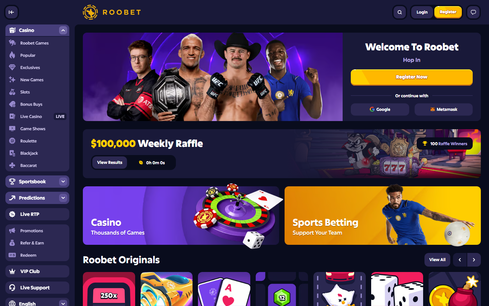

---
title: "Best No KYC Crypto Casinos 2026: Play Anonymously Without ID"
slug: "/gambling/best-no-kyc-crypto-casinos-2026"
meta_title: "Best No KYC Crypto Casinos 2026: Fully Anonymous Gambling Sites | Kanalcoin"
meta_description: "Best no KYC crypto casinos in 2026 ranked by anonymity level, withdrawal limits, game selection, and trust signals. Play without uploading your ID."
search_intent: "Commercial investigation"
primary_keyword: "no KYC crypto casino 2026"
secondary_keywords:
  - "anonymous crypto casino 2026"
  - "crypto casino no ID"
  - "no verification crypto gambling"
  - "play crypto casino without KYC"
category: "gambling"
author: "Nakamura Haruto"
last_reviewed: "2026-09-28"
schema:
  - "Article"
  - "ItemList"
  - "FAQPage"
internal_links:
  - "/asia/best-crypto-casinos-vietnam-2026"
  - "/gambling/stake-alternatives-2026"
  - "/gambling/best-crypto-casinos-october-2026"
---

# Best No KYC Crypto Casinos 2026: Play Anonymously Without Uploading Your ID

**Editorial note:** This article is for informational purposes only. KYC requirements can change at any time. Verify current platform policies before depositing. Online gambling laws vary by country — confirm legality in your jurisdiction before registering.

**Last reviewed:** September 28, 2026.

The best no KYC crypto casinos in 2026 are Roobet for complete anonymity at any withdrawal amount, Stake.com for no-KYC play below a volume threshold, BC.Game for the widest crypto range without mandatory verification, Rollbit for crypto-native anonymous play with a token reward system, and Metaspins for BTC-focused anonymous casino gaming. The right choice depends on how strictly you need anonymity maintained and at what deposit and withdrawal scale.

KYC — Know Your Customer — is identity verification required by platforms to comply with anti-money-laundering regulations. In traditional finance, KYC is mandatory. In crypto casinos, it varies: some require zero verification, others trigger it only at high withdrawal volumes, others require it upfront. For players in markets where gambling disclosure is sensitive, or who simply value financial privacy, the no-KYC tier matters.

| Casino | Anonymity level | Withdrawal without KYC | Score |
|---|---|---|---|
| Roobet | Full — no KYC ever | Unlimited | 4.5/5 |
| Stake.com | Threshold-based | Below platform limit | 4.3/5 |
| BC.Game | Threshold-based | Below platform limit | 4.2/5 |
| Rollbit | Threshold-based | Below platform limit | 4.1/5 |
| Metaspins | Full — BTC-focused | Unlimited in BTC | 3.9/5 |
| Cloudbet | Threshold-based | Below platform limit | 3.8/5 |
| Duelbits | Threshold-based | Below platform limit | 3.7/5 |

## What "no KYC" actually means at each platform

There are three distinct models in this list:

**Full no-KYC:** Roobet and Metaspins do not require identity verification at any withdrawal amount. No document uploads, no selfies, no proof of address. The anonymity is maintained regardless of withdrawal size.

**Threshold no-KYC:** Stake.com, BC.Game, Rollbit, and Cloudbet allow play and withdrawals without KYC below a platform-defined threshold. The threshold is not always publicly disclosed. Large, frequent, or flagged withdrawals trigger a verification request. Players who intend to withdraw above ,000 or repeatedly should anticipate verification.

**Signup no-KYC, verification on withdrawal:** Some platforms require no ID at signup but trigger full KYC before first withdrawal. This is misleading marketing — these platforms are excluded from this review.

---

## 7 Best No KYC Crypto Casinos Reviewed

### 1. Roobet — Full Anonymity, No KYC at Any Level

**Anonymity level: Maximum**

Roobet is the strictest no-KYC crypto casino in this review. Registration requires only a chosen username — no email address, no phone number, no identity document. No verification is triggered at any withdrawal level, based on community-verified experience through September 2026.

The trade-off is product breadth. Roobet's game library is smaller than Stake or BC.Game. Three supported cryptos: BTC, ETH, LTC. The sportsbook is limited — not a viable alternative to 1win or Stake for sports bettors. For players whose only requirement is maximum anonymity, this is the correct choice. For players who want anonymity plus sports depth, Roobet does not deliver.

| Detail | Value |
|---|---|
| KYC | Never required |
| Supported cryptos | BTC, ETH, LTC |
| Game library | Slots, crash, limited live casino |
| Sportsbook | Limited |
| Withdrawal limit without KYC | No stated limit |

**My take:** Roobet is for players who treat anonymity as a non-negotiable hard requirement and accept narrower product selection as the cost. If you need anonymous access with the largest possible game library, step down to BC.Game with threshold no-KYC.

---

### 2. Stake.com — No KYC Below Threshold, Deepest Product

**Anonymity level: Threshold-based**

Stake.com does not require KYC documentation for the majority of players. The threshold at which verification is triggered is not publicly stated and appears to vary by account activity, deposit pattern, and withdrawal frequency. Community reports suggest thresholds in the ,000–,000 range for triggering initial verification, but this is not confirmed.

What makes Stake relevant for anonymous players is the combination of no-KYC operation with the deepest game library and sports coverage in the market. For players who want anonymity for standard-volume play — deposits and withdrawals in the hundreds to low thousands — Stake.com provides the full platform experience without document uploads.

| Detail | Value |
|---|---|
| KYC | Triggered at high volume or flagged activity |
| Supported cryptos | BTC, ETH, LTC, XRP, TRX, DOGE, BNB, and others |
| Game library | 3,000+ including Stake Originals |
| Sportsbook | Full — 40+ sports, live betting |

**My take:** Stake is the right no-KYC choice for players who want a full platform experience and operate at standard volume levels. For very high-volume withdrawals, plan for verification.

---

### 3. BC.Game — No KYC with 150+ Cryptos

*BC.Game — 150+ cryptocurrencies accepted, no KYC required below threshold.*

**Anonymity level: Threshold-based**

BC.Game's no-KYC model is similar to Stake's — play and withdraw without documents below a threshold. The differentiator is the 150-plus crypto support. For Asian players holding SOL, TRX, BNB, or regional altcoins, BC.Game allows anonymous deposit-and-play without converting to BTC or ETH first.

The 9,000+ game library and multi-language support (Vietnamese, Thai) make BC.Game the best no-KYC option for Southeast Asian players who want product breadth alongside privacy.

| Detail | Value |
|---|---|
| KYC | Threshold-based |
| Supported cryptos | 150+ |
| Game library | 9,000+ games, 100+ providers |
| Sportsbook | Yes — secondary to casino |

**My take:** BC.Game is the best no-KYC option for players holding altcoins outside the BTC/ETH pair who want maximum game variety without document requirements.

---

### 4. Rollbit — No KYC with Token Rewards

**Anonymity level: Threshold-based**

Rollbit combines threshold no-KYC operation with an RLB token reward system. Anonymous players earn RLB tokens that generate revenue-share from platform activity. The casino also includes a crypto futures trading interface alongside slots and live casino.

For crypto-native players who want anonymity plus participation in platform economics, Rollbit is the most complete package in this review below the full-anonymity tier.

| Detail | Value |
|---|---|
| KYC | Threshold-based |
| Native token | RLB (revenue share) |
| Supported cryptos | BTC, ETH, SOL, LTC, USDT, and others |
| Sportsbook | Yes |

---

### 5. Metaspins — Full Anonymity, BTC-Focused

*Roobet — no email, no KYC, no ID at any withdrawal level.*

**Anonymity level: Maximum (BTC focused)**

Metaspins operates a full no-KYC model focused on Bitcoin-native users. No verification is required at any withdrawal level for BTC withdrawals. The platform accepts ETH and LTC as secondary options. The game library runs to 3,000+ slots and live casino titles.

Metaspins positions itself explicitly for privacy-conscious BTC users who do not want to interact with platforms that may require verification later. The product is narrower than Roobet's competitors but deeper than Roobet itself.

| Detail | Value |
|---|---|
| KYC | Never required |
| Supported cryptos | BTC (primary), ETH, LTC |
| Game library | 3,000+ slots, live casino |

---

### 6. Cloudbet — No KYC for High-Stakes with 50+ Cryptos

**Anonymity level: Threshold-based (higher limit)**

Cloudbet's threshold for triggering KYC is reported by community members to be higher than most platforms — typically triggering on withdrawals above ,000 or repeated high-value transactions. For high-stakes players who want anonymous operation at larger volumes than Stake allows, Cloudbet is the relevant option.

The 50-plus crypto support is second only to BC.Game among no-KYC casinos.

---

### 7. Duelbits — No KYC with Sports and Casino

**Anonymity level: Threshold-based**

Duelbits runs a combined sports betting and casino product without mandatory upfront KYC. The sportsbook covers major leagues including Champions League and NFL. For players who want anonymous sports betting alongside casino, Duelbits is the alternative to Stake for markets where Stake is geo-restricted.

---

## How to stay anonymous at crypto casinos: practical guide

**Use a privacy-focused wallet.** Deposit from a self-custody wallet (MetaMask, Exodus, hardware wallet) rather than from a KYC exchange like Coinbase or Kraken. Exchange withdrawals can be traced back to your verified identity.

**Use Monero (XMR) where accepted.** Monero transactions are not publicly traceable on-chain. BC.Game and Rollbit accept XMR. Depositing in XMR from a self-custody wallet provides the highest on-chain privacy.

**Avoid linking social accounts.** Some platforms offer social login (Google, Telegram). Do not use these if anonymity is the goal — they link platform activity to your social identity.

**Keep withdrawal amounts below platform thresholds.** For threshold no-KYC platforms (Stake, BC.Game), staying below the trigger threshold maintains anonymous operation. The threshold is not stated — community experience suggests conservative withdrawals under ,000 per transaction avoid triggers at most platforms.

**Do not use the same email across platforms.** If you use an email at all, use a separate privacy-focused address (ProtonMail, Tutanota) not linked to your real identity.

---

## No KYC vs full KYC: comparison

| Factor | No KYC casino | Full KYC casino |
|---|---|---|
| Signup time | Under 2 minutes | 10–30 minutes (document upload) |
| Privacy level | High to maximum | Low |
| Withdrawal speed | Typically fast | Can be slower during verification |
| Withdrawal limits | Threshold or unlimited | Higher limits after verification |
| Dispute recourse | Limited — no identity tied to account | Formal dispute process |
| Regulatory protection | Minimal | Higher in licensed jurisdictions |

---

## Red flags in "no KYC" marketing

Some platforms claim no-KYC but impose verification at withdrawal — effectively a full-KYC platform with deceptive marketing. Watch for:

- "No KYC at signup" — the qualifying phrase hides the withdrawal trigger
- Platforms that request "selfie verification" only when you try to withdraw above a small amount
- Platforms whose T&Cs include a clause requiring identity verification at their discretion

The platforms in this review — Roobet, Stake.com, BC.Game, Rollbit, Metaspins, Cloudbet, Duelbits — are included because community verification through September 2026 confirms no-KYC operation matching their stated policies. This is subject to change.

---

## What Users Say — Stake.com (no-KYC threshold)

**Trustpilot:** 3.9/5 from sample of 60 recent reviews (September 2026)

**Positive:**

> "Almost 2 years im used stake.com for my betting experience and i’ve got a new experience and fun
Absolutely profit we’ve got too
Thx you stake"
>
> — Juan Lucrovo, [5 stars, Trustpilot](https://www.trustpilot.com/reviews/6ab97d6a6457451f6dabce49) 2026-09-27

> "Stake is the best and biggest sports prediction market, rakebacks, bonuses, no fees and the ability to cash out makes this app my go to for sports prediction."
>
> — Zaheer Ali, [5 stars, Trustpilot](https://www.trustpilot.com/reviews/6ab9119c24f61b8cf223a803) 2026-09-27

**Critical:**

> "I made a deposit of 2,000 via bank transfer to a website called Stake.com. Although three days have passed, the amount I sent has still not been credited to my account on the site, and the transaction has not been completed.

When I contacted the site’s suppor"
>
> — Cem, [1 star, Trustpilot](https://www.trustpilot.com/reviews/6ab97542fd894951397ad2dc) 2026-09-27

> "Inr deposit not credited at account I do 10k and 15k say bank refund it but didn't showing on refund nor on stake it scam ane enquiry also showing close - ydTmPPUnAQLPrO3z"
>
> — Jray, [1 star, Trustpilot](https://www.trustpilot.com/reviews/6ab96abb7643b810e8acbbb8) 2026-09-27

**Reddit:**

> "TL/DR : **Enjoy the World Cup. Protect your money. Protect your peace. Protect your family. Betting companies do not need your help to make profit — but someone struggling with gambling may need your help to ask for supp"
>
> — u/Moug-10, [r/soccer](https://reddit.com/r/soccer/comments/1tvx7b7/before_the_world_cup_a_message_about_sports/) (446 points)

> "Mikayla opened a giant can of worms when she couldn't keep her mouth shut about Alix Earle and Reale Actives, so let's see if the truth is somewhere with these receipts. 

1. Reale Actives is a trademark owned by the ven"
>
> — u/carr1e, [r/MikaylaNogueira](https://reddit.com/r/MikaylaNogueira/comments/1s7wspi/imaginary_ventures_is_done_with_mikayla/) (187 points)

## FAQ

**Which crypto casino is completely anonymous in 2026?**
Roobet and Metaspins operate with no KYC at any withdrawal level — the strictest anonymity in this review.

**Does Stake.com require ID?**
Stake.com does not require ID for most players. Verification is triggered for high-volume accounts, flagged activity, or withdrawal amounts above an unstated threshold.

**Can I withdraw large amounts without KYC at crypto casinos?**
At full no-KYC platforms (Roobet, Metaspins), yes. At threshold platforms (Stake, BC.Game), large withdrawals trigger verification.

**Which no KYC casino accepts the most cryptocurrencies?**
BC.Game accepts 150+ cryptocurrencies without mandatory KYC.

**Is playing at a no KYC casino legal?**
KYC requirements are platform policies, not universal laws. The legality of gambling itself varies by jurisdiction. Verify your country's regulations before registering at any platform.

**Can I use Monero at no KYC casinos?**
BC.Game and Rollbit accept XMR. Monero combined with a no-KYC platform provides the highest combined on-chain and platform anonymity available.
