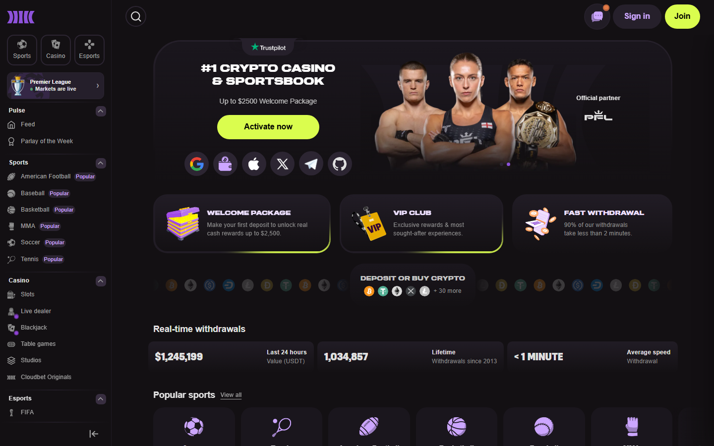

---
title: "Stake.com Alternatives 2026: 8 Crypto Casinos Worth Switching To"
slug: "/gambling/stake-alternatives-2026"
meta_title: "Stake.com Alternatives 2026: 8 Best Crypto Casinos to Replace Stake | Kanalcoin"
meta_description: "Best Stake.com alternatives in 2026. Crypto casinos with better bonuses, geo-access, lower thresholds, and different strengths — reviewed and compared."
search_intent: "Commercial investigation"
primary_keyword: "Stake.com alternatives 2026"
secondary_keywords:
  - "stake alternative casino"
  - "sites like stake"
  - "crypto casino like stake"
  - "stake competitor 2026"
category: "gambling"
author: "Nakamura Haruto"
last_reviewed: "2026-09-28"
schema:
  - "Article"
  - "ItemList"
  - "FAQPage"
internal_links:
  - "/asia/best-crypto-casinos-vietnam-2026"
  - "/gambling/best-no-kyc-crypto-casinos-2026"
  - "/asia/best-crypto-casinos-october-2026"
---

# Stake.com Alternatives 2026: 8 Crypto Casinos Worth Switching To

**Last reviewed:** September 28, 2026.

Stake.com is the largest crypto casino in 2026 by most available metrics. It is also geo-restricted in several markets, offers no standard welcome bonus for new players, and has KYC triggers that affect high-volume accounts. These are real gaps — and the platforms below fill them in specific ways.

The best Stake.com alternatives in 2026 are BC.Game for a 220% welcome bonus Stake does not match, 1win for Asian handicap football markets that Stake covers less deeply, Jack.com for withdrawal speed that outpaces Stake, Rollbit for token economics Stake does not offer, Roobet for complete anonymity Stake cannot match, Cloudbet for high-stakes play with a longer operational track record, Duelbits for better rakeback structure, and Metaspins for BTC-native purists who want full anonymity.

| Alternative | Why it beats Stake on this metric | Best for |
|---|---|---|
| BC.Game | 220% welcome bonus; 150+ cryptos | New players wanting bonus value |
| 1win | Asian handicap football depth | Football bettors in Asia |
| Jack.com | Withdrawals under 5 minutes | Players prioritising payment speed |
| Rollbit | RLB token revenue share | Crypto-native token holders |
| Roobet | Full anonymity; no KYC ever | Players with hard anonymity need |
| Cloudbet | Operating since 2013; 50+ cryptos | High-stakes, longevity-focused |
| Duelbits | Better rakeback rate structure | Regular-volume players |
| Metaspins | BTC-native; zero KYC | Bitcoin-maximalist anonymous play |

---

## Why look for a Stake alternative?

**Geo-restriction.** Stake.com is blocked in Australia, certain US states (use Stake.us), and several other jurisdictions. Players in affected markets cannot access the platform at all.

**No welcome bonus.** Stake offers no standard first-deposit match. New players get no bonus value at signup. BC.Game's 220% bonus and 1win's 500% sports bonus are materially better entry deals.

**KYC triggers.** High-volume players at Stake will eventually trigger KYC verification. Players who prefer to maintain anonymous operation throughout their entire relationship with a platform need an alternative.

**Sports coverage gaps.** While Stake's sports section is deep, Asian handicap line depth on regional Asian leagues is stronger at 1win for specific use cases.

**No token economy.** Stake does not have a platform token or revenue-sharing mechanism. Rollbit's RLB token gives crypto-native players an ownership stake in the platform's revenue that Stake's VIP system does not replicate.

---

## 8 Best Stake.com Alternatives

### 1. BC.Game — Best Alternative for New Players

*BC.Game — 150+ crypto deposits and 220% welcome bonus, two key advantages over Stake.com.*

**What BC.Game does better than Stake:** 220% welcome bonus, 150+ cryptocurrency support, Vietnamese language interface.

Stake offers no welcome bonus. BC.Game's first deposit bonus of up to 220% is the most significant competitive gap in Stake's product for new players. Combined with a multi-deposit bonus structure across the first four deposits, BC.Game's total acquisition value exceeds Stake's by a significant margin for players who are new to crypto casinos.

The 150-plus crypto support also beats Stake's 20-plus supported assets. Southeast Asian players holding BNB, SOL, TRX, or regional tokens can deposit directly at BC.Game without swapping.

**Where Stake is still better:** Sports coverage depth, particularly for Champions League and NFL. Stake Originals game quality is comparable to BC.Game's proprietary titles. Community scale — Stake's player community is larger.

| Detail | BC.Game | Stake.com |
|---|---|---|
| Welcome bonus | Up to 220% | None |
| Supported cryptos | 150+ | 20+ |
| Vietnamese language | Yes | No |
| V.League betting | Limited | Yes |

---

### 2. 1win — Best for Asian Football Bettors

**What 1win does better than Stake:** Asian handicap market depth on Asian regional leagues, 500% sports welcome bonus.

1win carries Asian handicap lines on V.League, Thai League, Indonesian Liga 1, and AFC competitions with consistent market availability. Stake covers these leagues but with shallower Asian handicap market depth. For Vietnamese, Thai, and Indonesian players who use Asian handicap as their primary format, 1win is the more complete sportsbook for regional fixtures.

The 500% sports welcome bonus is the highest sports-specific bonus in this comparison. For players whose primary activity is sports betting rather than casino, the effective first-deposit value at 1win significantly exceeds Stake.

**Where Stake is still better:** Casino game depth, Stake Originals, overall sports market breadth beyond Asian leagues.

---

### 3. Jack.com — Best for Withdrawal Speed

**What Jack.com does better than Stake:** Crypto withdrawals processed in under 5 minutes standard.

Stake.com's withdrawal processing is fast — typically under 10 minutes. Jack.com's processing is faster — under 5 minutes based on community-verified tests through September 2026. For players who regularly withdraw and treat processing time as a material operational requirement, this 5-minute gap matters.

Jack.com's VIP programme is also more transparent than Stake's — tier requirements and rewards are clearly displayed in the account interface rather than requiring support to confirm.

**Where Stake is still better:** Game library depth, sports coverage breadth, brand recognition, community scale.

---

### 4. Rollbit — Best for Token Economics

**What Rollbit does better than Stake:** RLB token revenue share, crypto futures trading integration.

Stake has no platform token and no mechanism for players to participate in platform revenue beyond standard VIP cashback. Rollbit's RLB token is documented on-chain to receive a share of platform gross revenue. Players who hold RLB are, in a defined sense, co-owners of the platform's economics.

The crypto futures trading section alongside the casino is also unique — no other platform in this comparison combines a regulated-feeling casino product with on-platform perpetuals trading.

**Where Stake is still better:** Game library, sports depth, platform stability, track record.

**Caveat:** RLB price is subject to token market conditions independent of casino performance.

---

### 5. Roobet — Best for Complete Anonymity

**What Roobet does better than Stake:** Zero KYC at any withdrawal level.

Stake.com's no-KYC operation has limits — high-volume accounts will trigger verification. Roobet does not trigger verification under any conditions based on community verification through September 2026. For players who require complete anonymity maintained across all withdrawal sizes, Roobet is the correct alternative.

**Where Stake is still better:** Game library, sports coverage, crypto range, bonus structure.

**The trade-off:** Roobet's product breadth is significantly narrower than Stake's. Anonymity comes at a cost in product quality.

---

### 6. Cloudbet — Best for High-Stakes and Longevity

*Cloudbet — operating since 2013, 50+ cryptocurrencies, dedicated high-roller service.*

**What Cloudbet does better than Stake:** Operating since 2013 (four years longer), 50+ cryptocurrency support, dedicated high-roller service.

For players depositing and withdrawing above ,000 regularly, Cloudbet's longer track record (2013 vs 2017 for Stake) and dedicated VIP management are meaningful differentiators. Cloudbet's reported KYC threshold for triggering verification is higher than Stake's based on community feedback, making it a better fit for high-volume players who want to maintain anonymous operation at scale.

**Where Stake is still better:** Game library size, sports coverage depth, community scale.

---

### 7. Duelbits — Best Rakeback Structure

**What Duelbits does better than Stake:** Rakeback rate structure that scales more favorably for mid-tier volume players.

Stake's VIP rakeback reaches strong percentages at the highest tiers but requires very high volume to access competitive rates. Duelbits' rakeback structure gives mid-volume players better rates at lower threshold levels. For players who wager ,000–,000 per month and want rakeback value without reaching Stake's upper VIP tiers, Duelbits is worth consideration.

The sportsbook covers major football, MMA, and esports with a combined casino-and-sports product similar to Stake's structure.

---

### 8. Metaspins — Best for Bitcoin Purists

**What Metaspins does better than Stake:** Full no-KYC BTC-native operation with deep slot library.

Metaspins targets players who want to operate entirely in Bitcoin — deposit, play, and withdraw in BTC — with no identity verification ever required. The game library runs to 3,000+ titles. For the specific profile of a BTC-native player who values anonymity above all other metrics, Metaspins is more aligned than Stake.

**Where Stake is still better:** Crypto range, sports coverage, bonus structure, community.

---

## Summary comparison table

| Casino | vs Stake advantage | vs Stake weakness |
|---|---|---|
| BC.Game | 220% bonus, 150+ cryptos | Shallower sports, no V.League depth |
| 1win | Asian handicap depth, 500% sports bonus | Smaller casino library |
| Jack.com | Faster withdrawals | Shorter track record |
| Rollbit | Token revenue share, futures trading | Smaller platform scale |
| Roobet | Full anonymity | Narrower product |
| Cloudbet | Longer history, high-roller focus | Less game depth |
| Duelbits | Better mid-tier rakeback | Smaller brand |
| Metaspins | BTC native + full anonymity | No sports, narrow crypto range |

---

## FAQ

**What is the best alternative to Stake.com in 2026?**
BC.Game for new players wanting a welcome bonus, 1win for Asian football betting, Jack.com for withdrawal speed, Roobet for full anonymity. There is no single best alternative — the choice depends on what specific gap in Stake's product you are filling.

**Why is Stake.com geo-restricted?**
Stake.com blocks players in jurisdictions where its Curaçao licence does not provide adequate legal cover, or where local gambling regulations create compliance risk. Australia and several US states are the most commonly cited restricted markets.

**Does BC.Game have a better welcome bonus than Stake?**
Yes. BC.Game offers up to 220% on the first deposit. Stake offers no standard welcome bonus. This is one of the clearest product gaps between the two platforms.

**Is Rollbit a legitimate Stake alternative?**
Yes. Rollbit is a licensed Curaçao eGaming casino with a verifiable on-chain token (RLB). Its on-platform futures trading and revenue-sharing token model are genuine differentiators not available at Stake.

**Can I use the same account strategy at Stake alternatives?**
Each platform has different terms of service, wagering requirements, and KYC thresholds. Do not assume that strategies that work at Stake will transfer unchanged to alternatives.
