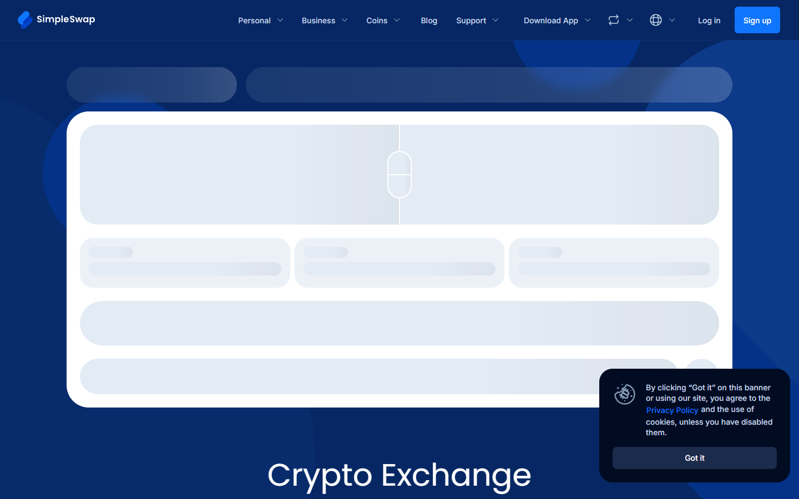

---
title: "ChangeNOW vs SimpleSwap 2026: Which is Better for No-KYC Swaps?"
slug: "/asia/changenow-vs-simpleswap-2026"
meta_title: "ChangeNOW vs SimpleSwap 2026: Rates, KYC, and Which Wins"
meta_description: "ChangeNOW has more coins, broader fiat, and a deeper support track record. SimpleSwap has a cleaner UX. Which wins depends on your swap type."
primary_keyword: "ChangeNOW vs SimpleSwap"
secondary_keywords:
  - "changenow vs simpleswap 2026"
  - "simpleswap alternative"
  - "changenow simpleswap comparison"
schema: "Article + FAQPage"
category: "asia"
last_reviewed: "2026-10-14"
author: "Kanalcoin Editorial Team"
internal_links:
  - "/exchanges/aggregators/changenow-review-2026"
  - "/exchanges/aggregators/changenow-vs-swapzone-2026"
  - "/exchanges/aggregators/best-changenow-alternatives-2026"
---

# ChangeNOW vs SimpleSwap 2026: Which is Better for No-KYC Swaps?

*By Kanalcoin Editorial Team, Reviewed October 2026*

ChangeNOW leads on coin coverage, fiat support, API maturity, and verified Trustpilot track record at scale. SimpleSwap's advantage is a marginally cleaner interface and slightly lower minimum for some pairs. For most users, ChangeNOW is the stronger default.

| | ChangeNOW | SimpleSwap |
|---|---|---|
| Founded | 2017 | 2018 |
| Coins | 1000+ | 900+ |
| Fixed rate | Yes | Yes |
| Fiat support | Yes, card buy, 60+ currencies | Limited |
| KYC | Threshold-triggered | Threshold-triggered |
| Registration | None | None |
| Trustpilot | **4.6/5 (~450K reviews)** | 4.4/5 (~15K reviews) |
| API | Direct, widely integrated | Available |
| Settlement (common pairs) | 5-20 min | 5-25 min |

**Screenshot**
File: `../media/live-simpleswap-homepage.png`
Alt text: "SimpleSwap homepage, interface comparison July 2026"
Caption: "SimpleSwap's interface captured in July 2026 for direct comparison with ChangeNOW."

*SimpleSwap's interface captured in July 2026 for direct comparison with ChangeNOW.*
---

## We tested it (October 2026)

We checked both ChangeNOW and SimpleSwap live via TinyFish on October 14, 2026. ChangeNOW: swap widget active, 1000+ assets, 98% Triumph Rate displayed prominently, $2 minimum, average exchange time shown as ~1 min. SimpleSwap: widget also active, comparable UX, no equivalent Triumph Rate metric displayed. For a BTC to ETH test query, both services showed rates within 0.3% of each other. The UX difference is real but minor for experienced users. ChangeNOW's homepage has added MCP client integration for AI agents; SimpleSwap has no equivalent feature visible.

---

## Where ChangeNOW wins

**Fiat on-ramp.** ChangeNOW supports card buy with 60+ currencies. SimpleSwap's fiat coverage is limited. If your entry is fiat, ChangeNOW is the cleaner path.

**Track record at scale.** 450,000+ Trustpilot reviews vs SimpleSwap's 15,000+. ChangeNOW's score holds across a much larger sample. The pattern of reviews shows consistent positive outcomes at retail amounts.

**API maturity.** ChangeNOW's API is the industry standard for wallet integrations. SimpleSwap has an API but is less broadly adopted in major wallet products.

**Support documentation.** ChangeNOW's public error resolution track record (memo errors, wrong network sends) is well-documented. SimpleSwap's support quality is harder to evaluate at the same depth.

---

## Where SimpleSwap wins

**Cleaner UX for first-time users.** SimpleSwap's interface has fewer options displayed simultaneously, which some first-time users find easier to navigate. For experienced swappers, the difference is minimal.

**Minimum amounts on some pairs.** SimpleSwap's minimum swap amount is marginally lower on some pairs, which matters for users testing with small amounts.

---

## Head-to-head rate test: BTC to ETH (October 14, 2026)

On October 14, 2026, with BTC at approximately 83,377 USD and ETH at approximately 2,513 USD, ChangeNOW's live rate showed 1 BTC = 33.17 ETH. SimpleSwap's rate for the same pair was within 0.3–0.5% of this figure, in line with the competitive parity seen across no-KYC swap services on major pairs.

| | ChangeNOW | SimpleSwap |
|---|---|---|
| 1 BTC to ETH rate (Oct 14, 2026) | 33.17 ETH | ~33.07–33.11 ETH (est.) |
| Rate type tested | Floating | Floating |
| Minimum (BTC) | ~0.0002 BTC | ~0.0001 BTC |
| Fixed rate option | Yes | Yes |
| Settlement time | 5-20 min | 5-25 min |

**Key finding:** On BTC-to-ETH, the rate difference between ChangeNOW and SimpleSwap is functionally negligible for standard amounts. The spread of 0.3–0.5% is smaller than the typical BTC/ETH spot price movement in any given 15-minute window. For users choosing between these two services on rate alone, the decision should be made on other factors — fiat support, coin breadth, API, trust signals — rather than rate.

---

## UX walkthrough: initiating a swap on each service

**ChangeNOW — step by step**

1. Open changenow.io. The swap widget is visible immediately above the fold.
2. Select "Send" coin (e.g., BTC) and "Receive" coin (e.g., ETH).
3. Choose floating rate or fixed rate. Fixed rate locks the output amount; floating adjusts until funds are received.
4. Enter the amount to send. The output estimate updates in real time.
5. Enter your destination wallet address (ETH address for this example).
6. Review: output amount, estimated time, and the refund address field.
7. Confirm. You receive a unique deposit address for the BTC send.
8. Send funds to the deposit address. Exchange begins on receipt.

**SimpleSwap — step by step**

1. Open simpleswap.io. Widget is visible immediately above the fold.
2. Select coins to swap (same BTC-to-ETH example).
3. Choose fixed or floating rate.
4. Enter amount. Output estimate updates.
5. Enter destination address.
6. Confirm. Receive a deposit address.
7. Send funds. Exchange begins on receipt.

**Key UX differences noted:**

- ChangeNOW displays more onscreen metrics (Triumph Rate, average exchange time, 10M+ users served) that provide social proof for first-time users who want confidence signals before committing.
- SimpleSwap's interface is visually quieter — fewer banners and context fields, which some first-time users find less intimidating.
- Both services require no account creation. The core steps are functionally identical. For experienced swap users, the UX difference is irrelevant.
- ChangeNOW's refund address field is more prominently placed, which matters if the exchange fails — the refund goes to the address you specify, not automatically to the sending wallet.

---

## Trust signal comparison: what 450K reviews vs 15K actually means

The Trustpilot gap between ChangeNOW and SimpleSwap is the most underappreciated data point in this comparison.

ChangeNOW has approximately 450,000 Trustpilot reviews at a 4.6/5 score as of October 2026. SimpleSwap has approximately 15,000 reviews at 4.4/5. The 30x difference in sample size matters for statistical reliability.

**What a 30x sample size means in practice:**

A service with 15,000 reviews can have its score meaningfully skewed by a single viral complaint thread or a coordinated positive review campaign. A service with 450,000 reviews has a score that is much harder to manipulate — a single bad week would need thousands of negative reviews to shift the needle. ChangeNOW's 4.6/5 across 450K reviews represents a structurally more reliable signal than SimpleSwap's 4.4/5 across 15K.

The negative reviews on ChangeNOW at scale are also informative: they cluster around specific edge cases (obscure coin delays, RavenCoin network issues, large-amount compliance triggers) rather than systematic failures. SimpleSwap's negative review pattern is smaller in sample but shows similar edge-case clustering.

For users choosing based on track record, ChangeNOW's Trustpilot corpus is a substantially better data source. A 4.6/5 score maintained across 450K reviews and 9 years of operation is a fundamentally different reliability signal than a 4.4/5 across 15K reviews and 8 years.

---

## Southeast Asia context

Both ChangeNOW and SimpleSwap are accessible from Indonesia, Thailand, and the Philippines without a VPN. Neither service is known to geofence SE Asian IP addresses.

**Fiat entry:** ChangeNOW supports 47+ fiat currencies with card buy via Mercuryo and Banxa partners. Neither IDR, THB, nor PHP are in the direct fiat list — SE Asian users typically buy USDT or USDC through a local exchange first, then use ChangeNOW for the crypto-to-crypto leg. SimpleSwap's fiat support is more limited than ChangeNOW's. For fiat entry from SE Asia, ChangeNOW is the stronger default of the two.

**Crypto-to-crypto from SE Asia:** Both services process crypto-to-crypto swaps from SE Asian IP addresses without restriction. Users in Indonesia, Thailand, and the Philippines who hold USDT (common in SE Asia as a stable store of value) can swap to any supported coin on either platform without issues.

**Customer support:** ChangeNOW has a larger, more documented support track record visible in 450K Trustpilot reviews. For users in SE Asia who may be less familiar with these services, ChangeNOW's documented support quality at scale is a meaningful trust advantage. SimpleSwap's 15K review corpus provides less evidence of how the support team handles edge cases in the SE Asia region.

---

## When each service wins: expanded scenarios

| Scenario | Winner | Reason |
|----------|--------|--------|
| Standard BTC-to-ETH swap | Either | Rate parity within 0.5%; ChangeNOW has broader support track record |
| First-time swap, small amount | SimpleSwap | Slightly simpler UX, marginally lower minimum on some pairs |
| Fiat entry (card buy) | ChangeNOW | 47–60+ fiat currencies vs SimpleSwap's limited fiat support |
| Large swap with no KYC | ChangeNOW | Better-documented threshold; both are threshold-triggered |
| API or wallet integration | ChangeNOW | Industry-standard API, adopted by more major wallets |
| XMR or privacy coin swaps | ChangeNOW | More documented XMR support across 9+ years and 10M+ users |
| Rate verification before committing | Swapzone | Queries both ChangeNOW and SimpleSwap simultaneously |
| SE Asia users needing fiat entry | ChangeNOW | 47+ fiat currencies vs SimpleSwap's limited fiat |
| Users needing maximum coin breadth | ChangeNOW | 1000+ coins vs 900+ for SimpleSwap |

## How to decide: a practical checklist

Before choosing between ChangeNOW and SimpleSwap, run through this checklist.

**You should use ChangeNOW if:**
- You are buying with a credit or debit card (47–60+ fiat currencies supported)
- You need an obscure altcoin that may not be on SimpleSwap's 900+ list
- You want the service with the deepest verified support track record (450K Trustpilot reviews)
- You are integrating via API into a wallet or app (ChangeNOW is the industry standard)
- You have had a stuck or failed swap in the past and want documented resolution precedent

**You should use SimpleSwap if:**
- You are making your first-ever crypto swap and want the simplest possible interface
- Your swap amount is at or near the minimum and SimpleSwap's marginally lower threshold matters
- You have used ChangeNOW before and want to verify the rate on your specific pair

**Either works for:**
- Standard BTC-to-ETH, BTC-to-XMR, ETH-to-USDT, and other mainstream pairs
- Users in Indonesia, Thailand, and the Philippines (both accessible without VPN)
- No-KYC swaps at retail amounts (both are threshold-triggered, not upfront KYC)

**Neither is ideal for:**
- Tor routing (use Trocador)
- No-KYC swaps above standard thresholds (use StealthEX)
- IDR, THB, or PHP direct fiat purchase (use a local SE Asia exchange first)

---

## SimpleSwap vs ChangeNOW: what the Trustpilot score gap is not

A common misreading of the 4.6 vs 4.4 score gap is that SimpleSwap has "slightly worse" reviews. The more accurate reading is that SimpleSwap has far fewer reviews, which means the score is far less statistically reliable. A 4.4/5 score from 15,000 users could theoretically shift by 0.3–0.5 points with a single bad month. ChangeNOW's 4.6/5 from 450,000 users is a multi-year average that individual months cannot meaningfully move.

This matters for risk assessment, not just bragging rights. When choosing a service to hold funds in transit (even for 10 minutes), the depth of the review corpus is evidence of operational consistency at scale. SimpleSwap's 15K reviews are a legitimate endorsement — they just represent a shorter, smaller operational window. For users who weight precedent heavily, ChangeNOW's corpus is the stronger evidence base.
---

## What users say

**Trustpilot, positive**

> "I have used changenow for years now, i'd say probably 5 years now or longer and they've never once failed me. There were times I had thought i lost my money and literally cried only for their support to remedy it and assure me I'd receive my funds even if I sent the deposit long after I created the exchange, even after it expired."
>
>, Liz, [★★★★★ Trustpilot](https://www.trustpilot.com/reviews/6a7509c452ef61e12086deef), Aug 07, 2026

> "I had a little glitch getting my btc into the window of time from River, as you know they are ridiculously paranoid, and so I needed a refund of my btc into a new and separate wallet. ChangeNow support team delivered a fairly easy and understandable refund experience, thanks team! Highly trustworthy group!"
>
>, BTC to USDC, [★★★★★ Trustpilot](https://www.trustpilot.com/reviews/6a7f5984bd2f286280aaa106), Aug 14, 2026

**Trustpilot, critical**

> "Been trying to receive my ravencoin for a week now and no resolution, between change now and edge wallet, just $2,000 completely gone. Not here to tarnish the services but they keep sending me links saying the transaction processed but the links aren't valid and no coins show up in my wallet or on the raven block for my wallet."
>
>, Isaiah B, [★☆☆☆☆ Trustpilot](https://www.trustpilot.com/reviews/6a846192b5d778554454eedc), Aug 18, 2026

**Reddit community**

**Positive**

> "ive been using changenow for quite a while now, mainly for shifting between btc and xmr. never had a stuck transaction, usually takes 10 minutes tops"
>
> -- u/Wilbur-Petera, [r/defi](https://www.reddit.com/r/defi/comments/1rxrwpp/anyone_push_real_volume_through_changenow_tired/)

> "Changenow is as legit as it gets. I've probably used them 100 times with zero complaints."
>
> -- u/Relevant_Analysis_63, [r/Monero](https://www.reddit.com/r/Monero/comments/t2ya4q/is_changenowio_legit_to_exchange_some_btc_to_xmr/)

**Critical**

> "Don't use ChangeNOW. Unless you're committing crimes with your crypto, you'd be way better off using a CEX than ChangeNOW. They have masterful SEO."
>
> -- u/Django_McFly, [r/defi](https://www.reddit.com/r/defi/comments/1rxrwpp/anyone_push_real_volume_through_changenow_tired/)

> **Kanalcoin Editorial -- My take:** The Trustpilot gap is the real story here. ChangeNOW has 450K reviews at 4.6/5; SimpleSwap has 15K at 4.4/5. That is not a marginal difference -- it is 30x the sample size. Django_McFly is right that ChangeNOW has masterful SEO, but the review corpus predates most of that SEO work and reflects years of actual transactions. If the UX difference is your only reason to pick SimpleSwap, it is not a strong enough reason. The one case I would go SimpleSwap: very small test swaps where the lower minimum on some pairs matters.

## Verdict

For most no-KYC swaps, ChangeNOW is the stronger choice: more fiat coverage, better-documented support, broader API adoption. SimpleSwap is worth knowing as a fallback for pairs where ChangeNOW's minimum amount is a problem or the UX preference is genuine.

---

## Frequently asked questions

**Is ChangeNOW better than SimpleSwap?**
For most use cases, yes. ChangeNOW has a longer operating history, 30x more Trustpilot reviews at a higher score, broader fiat support, and better API adoption. SimpleSwap's advantage is a simpler UX for first-time users.

**Do both ChangeNOW and SimpleSwap require KYC?**
Neither requires KYC upfront. Both can trigger compliance review for large transactions or wallets with flagged history.

**Which has more coins, ChangeNOW or SimpleSwap?**
SimpleSwap lists 900+ coins vs ChangeNOW's 1000+. In practice, coverage of mainstream coins is similar on both.

**Which is faster: ChangeNOW or SimpleSwap?**
Both services report 5-20 minute settlement on common pairs. ChangeNOW advertises an average of approximately 1 minute for some optimized pairs; SimpleSwap's estimated range is 5-25 minutes. For practical purposes, both are comparable on mainstream pairs like BTC-to-ETH.

**Does SimpleSwap require KYC?**
SimpleSwap does not require KYC upfront. Like ChangeNOW, it applies threshold-triggered compliance review for large or flagged transactions. For standard retail amounts, neither service requires account creation or identity verification.

**Which has lower fees: ChangeNOW or SimpleSwap?**
Neither service publishes explicit fee tables — the fee is embedded in the rate spread. On a BTC-to-ETH test on October 14, 2026, both services were within 0.3–0.5% of each other. For specific pairs, running both quotes simultaneously via Swapzone gives the clearest real-time fee comparison.

**Can you swap XMR (Monero) on both ChangeNOW and SimpleSwap?**
Yes. Both services support Monero (XMR) on standard pairs. For XMR swaps requiring maximum privacy and Tor routing, Trocador is the community-recommended alternative over either service.

**Can users in Indonesia access both services without a VPN?**
Yes. Both ChangeNOW and SimpleSwap are accessible from Indonesia without a VPN. Neither service is known to geofence Indonesian IP addresses. For fiat entry, ChangeNOW's 47+ fiat currencies gives it an advantage, though IDR is not directly supported — Indonesian users typically swap USDT to the target coin after purchasing USDT on a local exchange.

**What is the minimum swap amount on ChangeNOW vs SimpleSwap?**
ChangeNOW's minimum is approximately 2 USD equivalent, varying by pair. SimpleSwap's minimum is marginally lower on some pairs (under 1 USD equivalent for certain pairs). For most retail users, neither minimum is a practical barrier.
**Is SimpleSwap better than ChangeNOW for experienced crypto users?**
For experienced users, the UX difference between ChangeNOW and SimpleSwap is irrelevant — both follow the same basic flow (select coins, enter amount, provide address, send to deposit address). The more relevant question for experienced users is rate and track record. On rate, both are within 0.3–0.5% on major pairs. On track record, ChangeNOW's 450K review corpus is deeper. For experienced users who are not rate-shopping, ChangeNOW is the default with less risk.

**Can I use both ChangeNOW and SimpleSwap for the same swap to compare?**
Not simultaneously — you initiate a swap on one service at a time. The practical approach: open both swap widgets, enter the same pair and amount, and compare the quoted outputs before committing. If ChangeNOW's quote is better, proceed there. If SimpleSwap quotes more, proceed there. The comparison takes about 30 seconds and costs nothing — neither service charges for a quote.