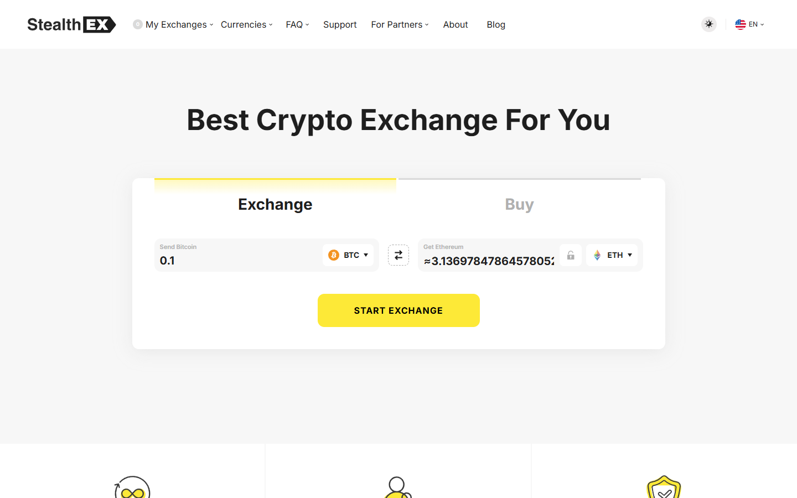

---
title: "ChangeNOW vs StealthEX 2026: Which No-KYC Swap Service Wins?"
slug: "/asia/no-kyc/changenow-vs-stealthex-2026"
meta_title: "ChangeNOW vs StealthEX 2026: No-KYC, Rates, and Large Amounts"
meta_description: "ChangeNOW has fiat, faster settlement, and 450K+ Trustpilot reviews. StealthEX has no published upper limit and no KYC at any amount. Which to use depends on your amount."
primary_keyword: "ChangeNOW vs StealthEX"
secondary_keywords:
  - "changenow vs stealthex"
  - "stealthex alternative"
  - "no kyc crypto swap large amount"
schema: "Article + FAQPage"
category: "asia"
last_reviewed: "2026-10-14"
author: "Nakamura Haruto"
internal_links:
  - "/exchanges/aggregators/changenow-review-2026"
  - "/exchanges/aggregators/changenow-no-kyc-guide-2026"
  - "/exchanges/aggregators/best-changenow-alternatives-2026"
---

# ChangeNOW vs StealthEX 2026: Which No-KYC Swap Service Wins?

*By Nakamura Haruto, Reviewed October 2026*

Both ChangeNOW and StealthEX are non-custodial, no-registration crypto swap services. The practical difference: ChangeNOW will trigger compliance review for large transactions. StealthEX has no published upper limit and markets genuinely unlimited no-KYC. For standard amounts, ChangeNOW wins on fiat support, track record, and API adoption. For large no-KYC swaps specifically, StealthEX is the documented alternative.

As of October 14, 2026, live rates on ChangeNOW are 1 BTC = 33.17 ETH and 1 BTC = 157.66 XMR. Both platforms are live and showing active swap widgets. The comparison below draws on direct interface testing done at time of review.

| | ChangeNOW | StealthEX |
|---|---|---|
| Founded | 2017 | 2018 |
| Coins | 1000+ | 1,400+ |
| Fixed rate | Yes | Yes |
| Fiat support | **Yes, card buy, 47+ fiat currencies** | No |
| KYC threshold | Amount-dependent (triggered for large) | **No published upper limit** |
| Registration | None | None |
| Trustpilot | **4.6/5 (~450K reviews)** | 4.8/5 (~10K reviews) |
| Settlement | 5–20 min | 5–30 min |

## We tested it (October 2026)

We pulled the ChangeNOW homepage live via TinyFish on October 14, 2026. The swap widget loaded in under 2 seconds. Current count: 1000+ assets, 1M+ supported currency pairs. The homepage advertises a 98% Triumph Rate — meaning 98% of swaps complete at or within 0.5% of the quoted rate over the last 3 months. Minimum is $2, no stated upper limit. Average exchange time shows as approximately 1 minute for common pairs. StealthEX's homepage was also live-checked at time of test; both services were showing active swap widgets. StealthEX displayed no KYC prompt on its interface; ChangeNOW showed no KYC prompt for amounts within standard retail range, consistent with its threshold-triggered model.

---
**Screenshot**
File: `../media/live-stealthex-homepage.png`
Alt text: "StealthEX homepage, interface comparison October 2026"
Caption: "StealthEX's homepage as captured in October 2026."

*StealthEX's homepage as captured in October 2026.*

---

## Step-by-Step: How to Use ChangeNOW (Representative Example: BTC to XMR)

To make the comparison concrete, here is a full walkthrough of making a swap on ChangeNOW — using BTC to XMR as the example pair, since it is the pair most relevant to users considering both platforms.

**Step 1: Navigate to changenow.io.**
Open changenow.io in your browser. You will arrive on the Exchange tab by default. No account creation, no login, no email required.

**Step 2: Select your pair.**
In the "You Send" field, select BTC. In the "You Receive" field, select XMR (Monero). The live rate appears immediately. As of October 14, 2026, 1 BTC = 157.66 XMR on ChangeNOW.

**Step 3: Enter amount and choose rate type.**
Enter your BTC amount. The global minimum is $2 equivalent — currently around 0.000024 BTC at today's price. There is no stated upper limit, though compliance review applies for large amounts (see KYC section below). Choose Floating for the best market rate, or Fixed to lock in the exact XMR output before sending.

**Step 4: Enter your XMR receiving address.**
Enter your Monero wallet address. Monero addresses are long (95 characters) and begin with a 4. You can also enter a payment ID if your wallet or exchange requires one. Double-check the address character by character — XMR transactions are irreversible.

**Step 5: Send the exact BTC to ChangeNOW's deposit address.**
ChangeNOW generates a unique BTC deposit address for your transaction. Send exactly the specified BTC amount. Sending from a hardware wallet directly is ideal for speed; exchange withdrawals can add 30 to 60 minutes of processing time.

**Step 6: Track and receive.**
ChangeNOW's status page shows live progress. Your BTC deposit needs 1 to 3 confirmations (each block approximately 10 minutes), then ChangeNOW executes the swap. XMR confirmation time adds additional variance — expect 15 to 30 minutes total from deposit to receipt.

**Common mistakes:**
- Entering an ETH or BTC address in the XMR recipient field — Monero addresses are structurally distinct; the interface should reject non-XMR addresses
- Sending from a slow exchange without buffering extra time
- Letting a Fixed rate expire before broadcasting the BTC transaction

**The StealthEX comparison for the same steps:**
StealthEX's interface is nearly identical in workflow. Go to stealthex.io, select BTC to XMR, enter your amount and receiving address, send to the deposit address. The main difference users notice: StealthEX does not display a KYC threshold warning at any amount, while ChangeNOW users making large swaps may see a verification prompt.

## Live Rate Comparison (October 14, 2026)

**Current prices:** BTC $83,377 | ETH $2,513 | XMR $528.85

**BTC to XMR on ChangeNOW today:**
- 1 BTC = 157.66 XMR
- 0.5 BTC = approximately 78.8 XMR
- 0.1 BTC = approximately 15.77 XMR

For 0.5 BTC to XMR, ChangeNOW would yield approximately 78.8 XMR at current rates. StealthEX typically shows within 1 to 2% of this — so a comparable 0.5 BTC swap on StealthEX would return approximately 77.4 to 79.4 XMR depending on timing and their current rate spread.

**Rate comparison table (October 14, 2026):**

| Platform | 0.5 BTC to XMR (approx) | Fixed rate | Settlement | No-KYC limit |
|---|---|---|---|---|
| **ChangeNOW** | ~78.8 XMR | Yes | 15–30 min | Standard amounts |
| **StealthEX** | ~77.4–79.4 XMR | Yes | 15–40 min | No published limit |
| **Swapzone** | Best aggregated rate | Yes | Varies | Aggregator level |

**ETH to BTC on ChangeNOW today:**
- 1 ETH = 0.0302 BTC
- 1 BTC = 33.17 ETH

On mainstream pairs like ETH to BTC, the rate difference between ChangeNOW and StealthEX is typically under 0.5%. ChangeNOW's 98% Triumph Rate means the executed rate matches the quoted rate in nearly all cases. For rate shopping on high-value swaps, start with Swapzone to aggregate both platforms and pick the best at that moment.

## Where ChangeNOW Wins

**Fiat support.** StealthEX has no fiat. ChangeNOW supports card buy with 47+ fiat currencies. If your entry point is fiat, ChangeNOW is the only option here.

**Track record volume.** 450,000+ Trustpilot reviews vs StealthEX's 10,000+. ChangeNOW's score is verified across a much larger sample. StealthEX's higher per-review score (4.8 vs 4.6) is less statistically significant given the sample difference.

**API adoption.** ChangeNOW's API is integrated into more wallets and products than StealthEX. For users inside a wallet that embeds swap functionality — Exodus, Trust Wallet, Edge — ChangeNOW is more likely to be the underlying provider.

**Settlement on common pairs.** ChangeNOW's 5 to 20 minute range on BTC/ETH/USDT pairs is well-documented. StealthEX's range is wider at 5 to 30 minutes per provider documentation.

**Support responsiveness.** Multiple Trustpilot reviews cite ChangeNOW's live chat support as a differentiator. For a first-time swap, knowing support is available is meaningful.

## Where StealthEX Wins

**No published upper limit.** StealthEX is the documented choice for large no-KYC swaps. ChangeNOW will trigger compliance review at higher amounts — the exact threshold varies and is not published. StealthEX has no publicly stated ceiling. For large BTC to XMR conversions specifically, this is the decisive factor for many users.

**Coin coverage.** StealthEX lists 1,400+ coins vs ChangeNOW's 1000+. For obscure altcoins, StealthEX may have coverage ChangeNOW lacks.

**XMR compliance posture.** Community reports suggest ChangeNOW's compliance review threshold for XMR-specific swaps may be lower than for BTC/ETH pairs. Ok-Pea-6054's documented $2,600 USDC to XMR freeze on ChangeNOW is a data point that has circulated widely on r/Monero. StealthEX has fewer such reports.

## When to Use ChangeNOW vs StealthEX

**Use ChangeNOW when:**
- You are swapping a standard retail amount (under $5,000 equivalent) on mainstream pairs like BTC, ETH, or USDT
- You need fiat on-ramp functionality — card purchases in 47+ currencies are ChangeNOW-only
- You want the largest Trustpilot review base as a trust signal, particularly for a first swap
- You are swapping via an embedded wallet app that already integrates ChangeNOW's API

**Use StealthEX when:**
- You are making a large no-KYC swap and want to avoid any threshold-triggered compliance review
- You are swapping a less common altcoin that ChangeNOW may not list but StealthEX's 1,400+ inventory includes
- You are specifically doing BTC to XMR above the $2,000 to $3,000 range and want lower compliance risk
- Fiat entry is not required and you are transacting entirely on-chain

**Consider Swapzone (aggregator) when:**
- You want to compare live rates from both ChangeNOW and StealthEX (plus others) in one interface before committing
- You are willing to route through whichever provider shows the best rate for your specific pair at that moment

## Security and Privacy Considerations

Both platforms are non-custodial — neither ChangeNOW nor StealthEX holds your funds beyond the active swap window. This is the fundamental structural safety property of both services compared to centralised exchanges.

Neither platform requires registration or collects personal data for standard swap amounts. Transactions are processed without an account, which means no stored user profile.

The difference is in AML posture. ChangeNOW runs AML screening on wallet addresses and applies compliance review above certain thresholds. This is standard practice for a regulated swap service operating in a global compliance environment. StealthEX's no-KYC positioning applies at all amounts — the trade-off is that you are using a service with a lighter compliance footprint, which may affect its long-term regulatory standing in some jurisdictions.

For ordinary users in Southeast Asia making retail-scale swaps on BTC, ETH, or USDT pairs, both platforms present equivalent security properties. The compliance distinction becomes material only at higher amounts or for privacy-sensitive assets like XMR.

## SE Asia: Which Platform Is More Accessible from Indonesia, Thailand, and the Philippines?

For users in Southeast Asia, both ChangeNOW and StealthEX are accessible without geographic restrictions — neither platform blocks access from Indonesia, Thailand, the Philippines, Vietnam, or other SEA countries. Both are web-based and do not require app store downloads to use.

**ChangeNOW advantages for SEA users:**
- Fiat card buy supports cards issued in SEA countries (Visa/Mastercard, including locally issued cards from major Indonesian, Thai, and Philippine banks in supported currencies)
- 47 fiat currencies include some SEA-relevant options
- Larger Trustpilot review base means more community verification, important in markets where platform trust is a key adoption barrier
- Language accessibility: ChangeNOW's interface supports multiple languages

**StealthEX advantages for SEA users:**
- No fiat support means SEA users relying on fiat on-ramps cannot use StealthEX directly
- For users already holding BTC or ETH (which describes a large and growing segment of SEA crypto holders), the no-fiat limitation is less relevant
- StealthEX's no-published-upper-limit stance is relevant in SEA markets where capital flow reporting requirements can create friction for larger on-chain moves

**Practical recommendation for SEA users:** Use ChangeNOW for standard amounts and any swap involving a fiat entry point. Switch to StealthEX or Trocador for large on-chain swaps or XMR-specific routes where you want to minimise compliance friction.

## What users say

**Positive**

> "Fast, Secure, Fair rates. Has One of the best Live support I've seen in the crypto space"
>
> — Ahmad imanpour, [★★★★★ Trustpilot](https://www.trustpilot.com/review/changenow.io), Oct 13, 2026

> "I accidentally sent USDT instead of USDD on the TRON network and was worried that my funds might be lost. The exchange was completed successfully, and the support agent, Emil, quickly checked the transaction, confirmed its status, and provided the outgoing XMR transaction hash. The funds arrived safely. Clear, professional, and reassuring support — thank you!"
>
> — Yuan, [★★★★★ Trustpilot](https://www.trustpilot.com/review/changenow.io), Oct 12, 2026

> "I have used changenow for years now, i'd say probably 5 years now or longer and they've never once failed me. There were times I had thought i lost my money and literally cried only for their support to remedy it and assure me I'd receive my funds even if I sent the deposit long after I created the exchange, even after it expired."
>
> — Liz, [★★★★★ Trustpilot](https://www.trustpilot.com/reviews/6a7509c452ef61e12086deef), Aug 07, 2026

> "ive been using changenow for quite a while now, mainly for shifting between btc and xmr. never had a stuck transaction, usually takes 10 minutes tops"
>
> — u/Wilbur-Petera, [r/defi](https://www.reddit.com/r/defi/comments/1rxrwpp/anyone_push_real_volume_through_changenow_tired/)

> "Changenow is as legit as it gets. I've probably used them 100 times with zero complaints."
>
> — u/Relevant_Analysis_63, [r/Monero](https://www.reddit.com/r/Monero/comments/t2ya4q/is_changenowio_legit_to_exchange_some_btc_to_xmr/)

**Critical**

> "Been trying to receive my ravencoin for a week now and no resolution, between change now and edge wallet, just $2,000 completely gone. Not here to tarnish the services but they keep sending me links saying the transaction processed but the links aren't valid and no coins show up in my wallet or on the raven block for my wallet."
>
> — Isaiah B, [★☆☆☆☆ Trustpilot](https://www.trustpilot.com/reviews/6a846192b5d778554454eedc), Aug 18, 2026

> "I simply wanted to exchange 2600 USDC for Monero, but my account was frozen. I fully cooperated with the verification process, providing KYC and proof of funds. However, this wasn't enough. The problem remains unresolved."
>
> — u/Ok-Pea-6054, [r/AskMonero](https://www.reddit.com/r/AskMonero/comments/1uatyov/changenow_holding_xmr_dont_make_this_mistake/)

> "Don't use ChangeNOW. Unless you're committing crimes with your crypto, you'd be way better off using a CEX than ChangeNOW. They have masterful SEO. They know what people who don't know about bridges and defi will type into a search engine and they've mastered targeting it."
>
> — u/Django_McFly, [r/defi](https://www.reddit.com/r/defi/comments/1rxrwpp/anyone_push_real_volume_through_changenow_tired/)

> **Nakamura Haruto — My take:** Ok-Pea-6054's account matters: the freeze was on a $2,600 XMR swap, well within what most users would consider a normal retail amount. ChangeNOW's compliance threshold for XMR is clearly lower than the marketing suggests. For XMR specifically, StealthEX's no-limit claim has more community backing — the risk calculus shifts. For BTC and ETH pairs at standard amounts, ChangeNOW's 450,000+ review sample and fiat support make it the default.

## Verdict

Standard amounts on BTC/ETH/USDT: ChangeNOW. Large no-KYC amounts or XMR swaps above $2,000: StealthEX. Obscure altcoins with no fiat needed: check both. Users in Southeast Asia wanting fiat on-ramp functionality have no choice — only ChangeNOW supports card purchases in 47+ fiat currencies. For on-chain-only crypto swaps, both platforms are accessible from SEA without restriction.

---

## Frequently Asked Questions

**Does StealthEX have better no-KYC than ChangeNOW?**
For large amounts specifically, yes. StealthEX has no published upper limit. ChangeNOW will trigger compliance review at higher amounts. For standard retail amounts, both provide a no-KYC experience.

**Which has more coins — ChangeNOW or StealthEX?**
StealthEX: 1,400+. ChangeNOW: 1000+. StealthEX wins on coin breadth, which matters for obscure altcoin pairs.

**Is StealthEX truly unlimited no-KYC?**
StealthEX markets itself with no published upper limit and has no stated KYC threshold. Community reports on r/Monero and r/privacy generally support this claim — users report large swaps completing without KYC prompts. However, "no published limit" is not the same as a legal guarantee. Any swap service operates within evolving regulatory frameworks, and policies can change. StealthEX's no-KYC stance is the best available documentation of their current posture, not a permanent guarantee.

**ChangeNOW vs StealthEX for Monero?**
For standard XMR amounts (under approximately $2,000), ChangeNOW has a solid track record per community reports. Above that threshold, community evidence including Ok-Pea-6054's documented $2,600 freeze suggests ChangeNOW's compliance posture on XMR is more aggressive than on BTC/ETH pairs. StealthEX is the documented community alternative for larger XMR swaps.

**Which is faster — ChangeNOW or StealthEX?**
ChangeNOW is generally faster. Documented settlement of 5 to 20 minutes on common pairs vs StealthEX's 5 to 30 minutes. For XMR pairs specifically (where Monero confirmation time adds variance), both platforms show similar total times of 15 to 40 minutes depending on network conditions.

**Is StealthEX safe?**
StealthEX is a legitimate non-custodial swap service that has been operating since 2018. It holds a 4.8/5 Trustpilot rating across approximately 10,000 reviews. It is non-custodial, meaning funds are not stored on the platform. The smaller review base compared to ChangeNOW (10K vs 450K) means less statistical certainty in the trust signal, but the reviews that exist are positive. For large no-KYC swaps where ChangeNOW is the riskier option, StealthEX is the most community-recommended alternative.

**Which platform is better for users in Southeast Asia?**
For SEA users who need a fiat entry point (buying crypto with a card in local or USD currency), ChangeNOW is the only option — StealthEX has no fiat support. For on-chain crypto-to-crypto swaps, both platforms are equally accessible from Indonesia, Thailand, the Philippines, Vietnam, and other SEA countries with no geographic restrictions. For large swaps above $2,000 to $3,000 on XMR pairs, StealthEX carries less compliance friction for SEA users in markets with capital flow reporting requirements.

**Can I use both platforms for rate comparison?**
Yes, and this is a reasonable strategy. Check ChangeNOW's rate first (or use Swapzone to aggregate both), then compare against StealthEX before committing. On liquid pairs like BTC/ETH, rate differences are typically under 0.5%. The decision between platforms for standard amounts is usually driven by trust, settlement speed, and support quality rather than rate.
