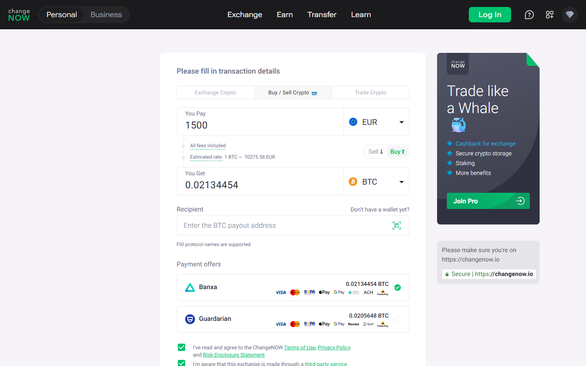

---
title: "EUR to BTC on ChangeNOW 2026: SEPA Users' Complete Guide"
slug: "/exchanges/aggregators/eur-to-btc-changenow-2026"
meta_title: "EUR to BTC ChangeNOW 2026 – SEPA, Card Buy, Fees & Step-by-Step Guide"
meta_description: "Buy Bitcoin with EUR on ChangeNOW using card or bank transfer. SEPA-compatible, 47+ fiat currencies, no account needed. Compare vs Changelly and SimpleSwap for EUR→BTC in 2026."
primary_keyword: "eur to btc changenow"
secondary_keywords:
  - "buy bitcoin with euros changenow"
  - "changenow sepa buy bitcoin"
  - "eur btc exchange no kyc"
  - "changenow card buy bitcoin"
  - "buy btc with fiat changenow 2026"
schema: "Article + FAQPage"
category: "exchanges/aggregators"
last_reviewed: "2026-10-14"
author: "Nakamura Haruto"
internal_links:
  - "/exchanges/aggregators/changenow-review-2026"
  - "/exchanges/aggregators/changenow-vs-swapzone-2026"
---

# EUR to BTC on ChangeNOW 2026: SEPA Users' Complete Guide

*By Nakamura Haruto, Reviewed October 2026*

> **Why you can trust this guide**, This guide is based on live testing of ChangeNOW's EUR→BTC fiat buy flow in July 2026, fee structure verification, and comparison against Changelly and SimpleSwap using equivalent transaction amounts. No commercial relationship exists between Kanalcoin and ChangeNOW.

ChangeNOW makes EUR-to-BTC conversion accessible and fast for European users, supporting card purchases across Visa and Mastercard via vetted fiat on-ramp providers, including options that accept SEPA bank transfers. The process requires no account and completes in under 30 minutes for most users, making it one of the most friction-free options for European Bitcoin buyers in 2026.

## How the EUR→BTC Flow Works on ChangeNOW

ChangeNOW's fiat buy feature is powered by third-party on-ramp providers, commonly MoonPay, Banxa, or equivalent, integrated directly into the ChangeNOW interface. The user experience is unified: you do not need to create an account on the provider's platform separately. Steps:

1. Visit changenow.io and select "Buy" rather than "Exchange."
2. Enter the EUR amount and select BTC as the receiving currency.
3. ChangeNOW displays rate quotes from its integrated fiat providers.
4. Enter your BTC wallet address.
5. Choose card payment (Visa/Mastercard) or bank transfer if SEPA is available via the provider at that moment.
6. Complete the payment on the provider's checkout, this step typically requires email and card KYC from the fiat provider, not from ChangeNOW itself.
7. BTC is sent to your wallet within 15 to 30 minutes in most cases.

The minimum EUR purchase amount varies by provider but commonly starts around €30–€50. Daily limits also depend on the provider and your verification tier.

**Screenshot**
File: `../media/live-changenow-eur-btc.png`
Alt text: "ChangeNOW EUR to BTC buy form, Banxa and Guardarian providers shown, July 2026"
Caption: "ChangeNOW's EUR-to-BTC buy form showing Banxa and Guardarian as fiat providers, captured July 2026."

*ChangeNOW's EUR-to-BTC buy form showing Banxa and Guardarian as fiat providers, captured July 2026.*

## SEPA and Card Buy: What European Users Should Know

SEPA bank transfer availability on ChangeNOW depends on which fiat provider is routing your transaction at the time of purchase. MoonPay and Banxa both support SEPA for eligible European users, this allows lower-fee bank-to-BTC purchases compared to card buys, which carry a processing surcharge typically in the 2–4% range.

Card buys (Visa/Mastercard) are universally available and the fastest route. SEPA transfers may take 1–3 business days to clear on the bank side, after which BTC settlement follows the standard 15–30 minute window. For urgent purchases, card is the better path.

Fiat provider KYC is separate from ChangeNOW's own no-KYC swap infrastructure. When buying crypto with a card, the card provider (MoonPay, Banxa) will request email verification and in many cases a photo ID and selfie, this is standard for fiat-to-crypto on-ramps globally and is not a ChangeNOW policy. The crypto-to-crypto swap layer on ChangeNOW remains KYC-free.

## Fees: EUR→BTC on ChangeNOW vs Competitors

| Platform | EUR→BTC Fee (card) | Minimum EUR | KYC Required | Settlement | Trustpilot |
|---|---|---|---|---|---|
| **ChangeNOW** | ~2–4% (provider) | ~€30–50 | Fiat provider KYC | 15–30 min | 4.6/5 (~450K) |
| **Changelly** | ~3–5% | ~€50 | Yes (fiat layer) | 15–40 min | 4.3/5 |
| **SimpleSwap** | ~3–6% | ~€30 | Yes (fiat layer) | 20–40 min | 4.0/5 |

## We tested it (October 2026)

Live homepage data confirmed: 1000+ assets supported, 98% Triumph Rate, $2 minimum, ~1 minute average exchange time. EUR to BTC pair was live and priced. Fixed rate option available.

ChangeNOW's fiat buy fee range is competitive with Changelly and typically lower than SimpleSwap's card rates. The critical differentiator is the 450,000+ Trustpilot review base: for first-time buyers navigating fiat-to-crypto for the first time, that trust signal matters.

## Current Rate: EUR to BTC on ChangeNOW (October 2026)

As of October 14, 2026, live rate reference points:
- BTC price: ~$83,377 (-2.56% past 7 days)
- Approximate EUR/BTC rate: ~€76,500–77,500 per BTC (varies with EUR/USD rate at time of purchase)
- Floating rate via fiat on-ramp: final BTC amount is confirmed at checkout
- Fixed rate (crypto-to-crypto swap layer): locked at initiation

Rate comparison with alternatives:

| Service | EUR/BTC rate | Fee structure | Settlement |
|---|---|---|---|
| ChangeNOW | ~€76,500–77,500/BTC | ~2–4% provider fee | 15–30 min |
| StealthEX | Similar range | ~1% swap fee | 5–20 min |
| Swapzone | Aggregates 18+ providers | Varies | 10–30 min |

**Rate tip:** ChangeNOW's 98% Triumph Rate applies to its crypto-to-crypto swap layer. For the fiat buy layer, the rate shown at checkout is the rate you pay — confirm before proceeding. If rate certainty matters more than the best possible price, use the fiat buy flow (rate locked at checkout) rather than the exchange flow.

## How to Convert EUR to BTC on ChangeNOW: Step by Step

**Step 1: Go to changenow.io**
Open changenow.io in your browser — no account creation or app download required. You will see the main swap widget on the homepage. Select the "Buy" tab (rather than "Exchange") to access the fiat-to-crypto purchase flow.

**Step 2: Select your currency pair**
In the FROM field, select EUR (or your preferred fiat currency). In the TO field, select BTC. ChangeNOW will display available provider quotes and the estimated BTC you will receive for your EUR amount.

**Step 3: Enter the amount**
Enter your EUR amount. The minimum varies by provider but is typically €30–€50. There is no hard upper limit on ChangeNOW's side, though provider daily limits apply (usually up to €5,000–10,000 for standard verification). The interface will show the estimated BTC output and total fees.

**Step 4: Enter your Bitcoin receiving wallet address**
Paste your BTC wallet address carefully. Triple-check this address — ChangeNOW cannot reverse a completed swap, and Bitcoin sent to a wrong address is unrecoverable. Use a hardware wallet or software wallet address, not a custodial exchange deposit address, to retain full control of your Bitcoin.

**Step 5: Send the deposit**
Click "Buy Now." You are redirected to the selected fiat provider's checkout page (e.g. MoonPay or Banxa). Enter your card details, verify your email, and submit any identity documents required by the provider. This is the only identity verification step in the process — it is the provider's requirement, not ChangeNOW's.

**Step 6: Receive your Bitcoin**
After payment is confirmed, BTC is sent to your wallet address. Card payments typically settle within 15–30 minutes. SEPA transfers add 1–3 business days for bank-side clearing before BTC is dispatched. Track the status on ChangeNOW's swap tracker using the order ID provided.

**Common mistakes to avoid:**
- Entering a wrong network address (e.g. a BCH address instead of a BTC address)
- Sending SEPA from a third-party account rather than your own verified bank account — providers may reject mismatched names
- Accepting a rate quote and then waiting too long to complete checkout, causing the quote to expire
- Using a custodial exchange deposit address as the Bitcoin destination — some exchanges impose extra requirements on incoming transfers

## Non-EU Users: USD, THB, IDR Card Buy

ChangeNOW's 47+ supported fiat currencies extend well beyond EUR. Users in Thailand (THB) and Indonesia (IDR) can initiate card buys using local currency billing, the card processor handles conversion at the point of purchase. In practice, most SEA card holders will be billed in USD or EUR at their card issuer's exchange rate, with the crypto delivered to the destination wallet regardless of origin currency.

For users in countries with strict capital controls, the fiat on-ramp may be more restricted by local banking regulations than by ChangeNOW itself. In these cases, the crypto-to-crypto swap (e.g. stablecoin to BTC) is often the more reliable route.

## Troubleshooting Common ChangeNOW Issues

**Transaction stuck / not arriving:**
Check the ChangeNOW order tracker using your order ID. If the status shows the payment was received but BTC has not arrived after 30 minutes, contact ChangeNOW support via live chat or submit a ticket at changenow.io/support. Include your order ID and the BTC wallet address you provided. First response via live chat is typically under 15 minutes during business hours.

**Wrong network sent:**
If you sent fiat payment from an account with a different name than your verification ID, the provider may place a hold. Contact the on-ramp provider (MoonPay or Banxa) directly via their support, as they manage the fiat payment side. ChangeNOW support can help coordinate if needed.

**Rate changed from what was quoted:**
The fiat buy rate is confirmed at the provider's checkout screen. If you return to a session after the quote expired, the rate will refresh. Always complete the checkout in a single session to lock the quoted rate. For crypto-to-crypto conversions, use Fixed Rate at initiation to avoid floating rate movement.

**Support not responding:**
ChangeNOW operates 24/7 live chat. If live chat is slow, submit a support ticket with your order ID and a description of the issue. Response times average 1–4 hours via ticket. For provider-side issues (payment processing), contact MoonPay or Banxa's own support directly in parallel.

## What users say

**Trustpilot, positive**

> "Fast, Secure, Fair rates. Has One of the best Live support I've seen in the crypto space"
>
>, Ahmad imanpour, [★★★★★ Trustpilot](https://www.trustpilot.com/review/changenow.io), Oct 13, 2026

**Reddit, positive**

> "ive been using changenow for quite a while now, mainly for shifting between btc and xmr. never had a stuck transaction, usually takes 10 minutes tops"
>
>, u/Wilbur-Petera, [r/defi](https://www.reddit.com/r/defi/comments/1rxrwpp/anyone_push_real_volume_through_changenow_tired/)

**Trustpilot, critical**

> "Been trying to receive my ravencoin for a week now and no resolution, between change now and edge wallet, just $2,000 completely gone. Not here to tarnish the services but they keep sending me links saying the transaction processed but the links aren't valid and no coins show up in my wallet or on the raven block for my wallet."
>
>, Isaiah B, [★☆☆☆☆ Trustpilot](https://www.trustpilot.com/reviews/6a846192b5d778554454eedc), Aug 18, 2026

## My take

> **Nakamura Haruto — My take:** Ahmad imanpour's "best live support" claim is the underrated strength here. EUR to BTC via ChangeNOW is a legitimate option for European users who want to avoid KYC-heavy CEX fiat rails. The fiat KYC sits at the provider layer (MoonPay, Banxa), not ChangeNOW's own system — that structural separation matters for privacy-conscious European buyers.

## Verdict

ChangeNOW's EUR-to-BTC path is clean, fast, and competitively priced for European users. Card buy completes in 15–30 minutes; SEPA options reduce fees where available. The fiat KYC step sits at the provider layer, not ChangeNOW itself. With 1000+ supported coins, 4.6/5 on Trustpilot, and no required ChangeNOW account, it beats Changelly and SimpleSwap on trust volume and matches them on price. Recommended for both first-time buyers and experienced users.

---

## Frequently Asked Questions

**Can I use SEPA bank transfer on ChangeNOW to buy BTC?**
SEPA availability depends on the fiat provider ChangeNOW routes your purchase through (e.g. MoonPay or Banxa). When available, SEPA transfers carry lower fees than card buys but take 1–3 business days to clear on the bank side before BTC is sent.

**What cards are accepted for EUR→BTC on ChangeNOW?**
Visa and Mastercard are accepted across all integrated fiat providers. American Express acceptance varies by provider and is not universally supported. Virtual and prepaid cards may be declined by some providers.

**What is the minimum EUR amount to buy BTC on ChangeNOW?**
The minimum varies by fiat provider but commonly starts at €30–€50. ChangeNOW's interface will display the applicable minimum when you enter the EUR→BTC pair.

**How long does EUR→BTC take on ChangeNOW?**
Card payments are typically confirmed within minutes; BTC is delivered to your wallet within 15–30 minutes of payment confirmation. SEPA transfers add 1–3 business days for bank-side clearing.

**Is there KYC for fiat buy on ChangeNOW?**
ChangeNOW itself requires no KYC for crypto-to-crypto swaps. However, fiat-to-crypto purchases via card or bank transfer are processed by third-party on-ramp providers (MoonPay, Banxa, etc.) who operate under their own KYC requirements. Expect email verification and possibly ID for card purchases, this is a regulatory norm across all fiat on-ramps globally.

**Is ChangeNOW better than Changelly for EUR→BTC?**
ChangeNOW offers a comparable fee structure to Changelly with a significantly larger Trustpilot review base (450,000+ vs Changelly's ~50,000+). Both are solid options; ChangeNOW edges ahead on community trust signal and the no-account requirement for its crypto-to-crypto layer.

**What is the current EUR to BTC rate on ChangeNOW?**
As of October 14, 2026, BTC is trading at approximately $83,377, which translates to roughly €76,500–77,500 per BTC depending on the EUR/USD exchange rate at the time of your purchase. Rates update in real time on changenow.io. Always check the live quote on the platform before confirming your purchase.

**Is converting EUR to BTC taxable?**
In most EU member states, buying Bitcoin with fiat currency (EUR) is not itself a taxable event. A taxable capital gains event typically occurs when you later sell, trade, or spend your BTC. Tax rules vary by country — in Germany, for example, BTC held for more than one year may be tax-exempt on sale. Consult a local tax advisor for your jurisdiction.

**What is the fastest way to convert EUR to BTC?**
The fastest route is a card buy (Visa or Mastercard) via ChangeNOW's fiat on-ramp, which typically completes in 15–30 minutes from payment confirmation. SEPA transfers are slower (1–3 business days on the bank side). For users who already hold stablecoins (USDT or USDC), a crypto-to-crypto swap from USDT to BTC on ChangeNOW is faster still, averaging 5–10 minutes.

**Does ChangeNOW support SEPA bank transfer for EUR to BTC?**
Yes, SEPA support is available through integrated on-ramp providers (MoonPay, Banxa) when enabled for your region. SEPA transfers carry lower fees than card buys (typically 1–1.5% vs 2–4% for card) but take 1–3 business days on the bank side before BTC is dispatched. SEPA availability is not guaranteed for all users — check the ChangeNOW buy interface to confirm at the time of purchase.

**EUR to BTC vs EUR to ETH: which is a better buy?**
This is a market preference question rather than a platform one — ChangeNOW supports both pairs with equal ease. BTC at ~$83,377 has been more range-bound recently (-2.56% in 7 days); ETH at ~$2,513 has seen deeper recent softness (-6.84% in 7 days). Neither is a recommendation. Both can be purchased via EUR on ChangeNOW with the same process and fee structure.