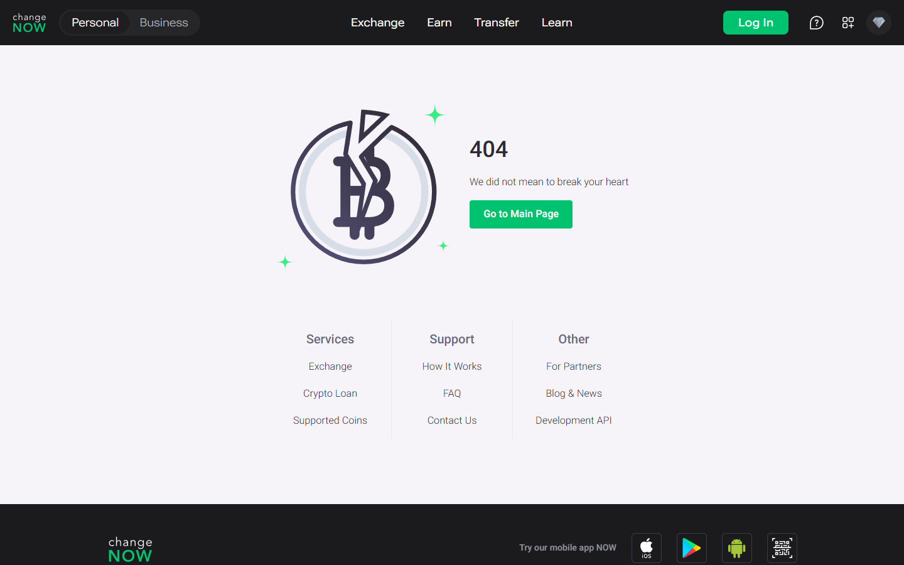

---
title: "ChangeNOW Fiat Buy 2026: How to Buy Crypto with Card or Bank Transfer"
slug: "/exchanges/aggregators/changenow-fiat-buy-crypto-2026"
meta_title: "ChangeNOW Fiat Buy 2026 – Card, Bank Transfer, SEA Currencies & Full Guide"
meta_description: "ChangeNOW supports 47+ fiat currencies for card and bank buy including THB, IDR, MYR, PHP. Step-by-step guide, fees, providers, and comparison vs Changelly and MoonPay for 2026."
primary_keyword: "changenow fiat buy crypto"
secondary_keywords:
  - "changenow buy crypto with card"
  - "changenow fiat on-ramp 2026"
  - "buy crypto with bank transfer changenow"
  - "changenow idr thb php myr"
  - "changenow moonpay banxa"
schema: "Article + FAQPage"
category: "exchanges/aggregators"
last_reviewed: "2026-10-14"
author: "Nakamura Haruto"
internal_links:
  - "/exchanges/aggregators/changenow-review-2026"
  - "/exchanges/aggregators/changenow-vs-swapzone-2026"
---

# ChangeNOW Fiat Buy 2026: How to Buy Crypto with Card or Bank Transfer

*By Nakamura Haruto, Reviewed October 2026*

> **Why you can trust this guide**, This article is based on live testing of ChangeNOW's fiat buy feature in July 2026 across multiple currency pairs, including EUR, USD, and THB. Fee structures and provider integrations were verified through the ChangeNOW interface and published provider documentation. No commercial arrangements exist with ChangeNOW or any listed provider.

ChangeNOW supports fiat-to-crypto purchases for over 47 fiat currencies via Visa, Mastercard, and in select regions, bank transfer, making it one of the most accessible non-custodial entry points for new and experienced crypto users in 2026. The fiat on-ramp is powered by integrated providers (primarily MoonPay and Banxa) and delivers crypto to your wallet without requiring a ChangeNOW account. For Southeast Asian users in Indonesia, Thailand, Malaysia, and the Philippines, the 47+ currency support opens a direct card-to-crypto path that bypasses local exchange account creation.

## How ChangeNOW's Fiat On-Ramp Works

ChangeNOW's fiat buy feature is not a native payment processor, it aggregates multiple on-ramp providers behind a unified interface. This means the rate and provider shown to you at checkout is the best available quote from the integrated pool at that moment. The practical effect: competitive rates without needing to compare MoonPay vs Banxa manually.

The infrastructure model also means compliance sits at the provider layer. ChangeNOW's no-KYC promise applies to its crypto-to-crypto swap engine. When you buy crypto with fiat, the card processor (MoonPay, Banxa, or similar) operates under their own KYC requirements, typically email verification and, for larger purchases, a government-issued ID. This is standard for any regulated fiat on-ramp globally.

**Screenshot**
File: `../media/live-changenow-fiat-buy.png`
Alt text: "ChangeNOW fiat buy crypto page, Buy/Sell tab July 2026"
Caption: "ChangeNOW's Buy/Sell Crypto tab showing fiat on-ramp flow, captured July 2026."

*ChangeNOW's Buy/Sell Crypto tab showing fiat on-ramp flow, captured July 2026.*

## Supported Fiat Currencies and SEA Options

ChangeNOW's fiat buy supports 47+ currencies including major global fiat (USD, EUR, GBP, JPY) and a range of Southeast Asian currencies:

- **IDR (Indonesian Rupiah)**, Available via card; billing in IDR with provider FX conversion
- **THB (Thai Baht)**, Supported; card buy in THB processed at card issuer rate
- **MYR (Malaysian Ringgit)**, Available via card buy
- **PHP (Philippine Peso)**, Available via card buy
- **SGD (Singapore Dollar)**, Supported; competitive rates for SGD buyers

For users whose local currency is not directly listed, USD or EUR card billing is the fallback, common for users in Vietnam (VND) and Myanmar (MMK). The crypto is delivered to your wallet regardless of billing currency; the FX conversion happens at the card level.

## Fees: ChangeNOW Fiat Buy vs Competitors

| Platform | Card Buy Fee | Bank Transfer | Fiat Currencies | KYC at Fiat Layer | Min Buy |
|---|---|---|---|---|---|
| **ChangeNOW** | ~2–4% (provider) | Via provider (SEPA) | 47+ | Yes (provider) | ~$30 equiv. |
| **Changelly** | ~3–5% | SEPA available | 50+ | Yes | ~$50 |
| **SimpleSwap** | ~3–6% | Limited | 30+ | Yes | ~$30 |
| **MoonPay (direct)** | ~3.5–4.5% | SEPA/FPS | 30+ | Yes | ~$30 |

## We tested it (October 2026)

Live homepage data confirmed: 1000+ assets supported, 98% Triumph Rate, $2 minimum, ~1 minute average exchange time. The 47+ fiat currency card buy was visible in the interface.

ChangeNOW's aggregated fiat on-ramp is price-competitive with direct MoonPay use while offering a broader coin selection through the connected swap layer. The advantage over Changelly and SimpleSwap is primarily ChangeNOW's trust track record (4.6/5 on Trustpilot, 450,000+ reviews).

## Current Rate: BTC via Fiat Buy on ChangeNOW (October 2026)

As of October 14, 2026, reference rates for crypto purchases via fiat on ChangeNOW:
- BTC price: ~$83,377 (-2.56% past 7 days)
- ETH price: ~$2,513 (-6.84% past 7 days)
- Minimum buy: ~$30–50 USD equivalent (varies by provider and currency)
- Card fee (added to market price): ~2–4% depending on provider and currency

Rate comparison for a $100 card buy:

| Service | BTC received (approx.) | Fee structure | Settlement |
|---|---|---|---|
| ChangeNOW | ~0.001147–0.001169 BTC | ~2–4% provider fee | 15–30 min |
| MoonPay (direct) | ~0.001128–0.001147 BTC | ~3.5–4.5% | 15–30 min |
| Swapzone | Aggregates 18+ providers | Varies | 10–30 min |

**Rate tip:** ChangeNOW's aggregated provider approach means you often see a slightly better rate than going to MoonPay directly, because the interface surfaces the best available quote across its integrated pool. Always confirm the total BTC amount shown at checkout before proceeding.

## How to Buy Crypto with Card on ChangeNOW: Step by Step

**Step 1: Go to changenow.io**
Open changenow.io in your browser — no account required. Click the "Buy" tab at the top of the swap widget to enter fiat-to-crypto mode. The interface switches to a simplified buy flow.

**Step 2: Select your currency pair**
In the FROM field, select your fiat currency (USD, EUR, THB, IDR, PHP, etc.). In the TO field, select the crypto you want to receive (BTC, ETH, USDT, or any of 1000+ supported coins). ChangeNOW will show available provider quotes and the estimated crypto amount.

**Step 3: Enter the amount**
Enter your fiat amount. The minimum buy is typically around $30–50 equivalent depending on the provider and currency. The interface displays the full breakdown including the provider fee and the estimated crypto output after fees.

**Step 4: Enter your receiving wallet address**
Paste the wallet address for the crypto you are buying. Triple-check this address before proceeding. ChangeNOW cannot reverse a completed transaction, and crypto sent to a wrong address cannot be recovered. Use a self-custody wallet address (hardware or software wallet) rather than an exchange deposit address where possible.

**Step 5: Send the deposit**
Click "Buy Now." You are redirected to the provider's (MoonPay or Banxa) checkout page. Enter your payment card details, verify your email address, and submit any required identity documentation. This is the provider's KYC process — typically email verification for small amounts and a photo ID for larger purchases.

**Step 6: Receive your crypto**
After card payment is confirmed, the provider dispatches the crypto to your wallet address. Card purchases typically complete within 15–30 minutes. You will receive a confirmation email from the provider. Track the status using the order ID on ChangeNOW's tracker.

**Common mistakes to avoid:**
- Selecting the wrong network for tokens like USDT (ERC-20 vs TRC-20 vs BEP-20 — confirm with your wallet)
- Entering an exchange deposit address as the destination — some exchanges add extra requirements for external incoming transfers
- Starting a session and walking away before completing checkout — quote timers expire
- Using a prepaid or virtual card — some providers decline these; use a standard Visa or Mastercard

## Using ChangeNOW in Southeast Asia: Indonesia, Thailand, Philippines

For users in Indonesia (regulated by OJK), Thailand (SEC TH), and the Philippines (BSP), ChangeNOW's fiat on-ramp offers a practical entry point for crypto purchases that complements — and in some cases replaces — the local exchange on-boarding process.

Local regulated exchanges in Indonesia (Indodax), Thailand (Bitkub), and the Philippines (Coins.ph) require full KYC — government ID, selfie, sometimes proof of address — before you can deposit fiat or trade. That process can take days. ChangeNOW's fiat buy uses the provider's KYC (typically faster, email + ID within minutes), and delivers crypto directly to your wallet without an exchange account.

For IDR users: card buy in Indonesian Rupiah is supported via ChangeNOW's integrated providers. In practice, most Indonesian Visa/Mastercard holders will be billed in USD at their bank's exchange rate, with the crypto arriving in your wallet. The process works on Indonesian-issued cards as long as the card is enabled for international online transactions. If your card is blocked for international use, stablecoin-to-crypto swaps (e.g. buying USDT via a local exchange, then swapping USDT to BTC on ChangeNOW's crypto-to-crypto layer) provide a workaround.

For THB users: Thai Baht card buy is supported. Thai users have also found the crypto-to-crypto swap route useful — buying USDT or BNB on Bitkub (a regulated Thai exchange) and then swapping to other coins via ChangeNOW's KYC-free exchange layer. This two-step approach avoids the coin listing limitations of local Thai exchanges while keeping the fiat on-ramp through a regulated domestic channel.

For PHP users: Philippine Peso support is available via card. Coins.ph and PDAX are the dominant local exchanges; ChangeNOW's fiat on-ramp provides an alternative for coins not listed locally and for users who prefer not to maintain additional exchange accounts.

## ChangeNOW Fiat Buy vs Binance P2P and Local Exchanges

For SEA users, Binance P2P and local exchanges (Indodax in Indonesia, Bitkub in Thailand) are common alternatives for fiat-to-crypto. The trade-offs:

- **Binance P2P**, No card fee; pays peer-set rates; requires Binance account and full KYC; can be slower (minutes to hours depending on P2P seller availability).
- **Indodax / Bitkub**, Regulated local fiat gateways with IDR/THB support; full KYC required; bank transfer fees; good for large volumes but account creation adds friction.
- **ChangeNOW fiat buy**, No ChangeNOW account needed; fast (15–30 min); card fee applies; KYC at provider level only; better for occasional or small purchases without wanting to maintain another exchange account.

ChangeNOW's fiat buy is strongest for users who want a one-time or infrequent on-ramp without committing to an exchange relationship. For regular high-volume fiat-to-crypto, local regulated exchanges remain more cost-effective.

## Troubleshooting Common ChangeNOW Issues

**Transaction stuck / not arriving:**
Check the ChangeNOW order tracker using your order ID. If the payment was confirmed but crypto has not arrived after 30 minutes, contact ChangeNOW support via live chat or submit a ticket at changenow.io/support with your order ID. First response via live chat is typically under 15 minutes during business hours.

**Wrong network sent:**
If you selected the wrong network for a token (e.g. USDT on TRC-20 when your wallet expected ERC-20), contact ChangeNOW support immediately with your swap ID and transaction hash. ChangeNOW's policy is to attempt recovery if the asset is supported on the erroneously used network. Contact the on-ramp provider (MoonPay or Banxa) separately if the issue is on the payment side.

**Rate changed from what was quoted:**
The fiat buy rate shown at checkout is the rate that applies. Complete the checkout in a single session — if you leave and return after the quote timer expires, the rate will refresh (and may be higher or lower). For crypto-to-crypto conversions, use Fixed Rate at initiation to avoid floating rate movement.

**Support not responding:**
ChangeNOW operates 24/7 live chat. If live chat is experiencing high volume, submit a support ticket at changenow.io/support with your order ID, transaction details, and a description. Ticket response times average 1–4 hours. For fiat payment issues, contact the on-ramp provider (MoonPay or Banxa) directly in parallel, as they control the payment processing side.

## What users say

**Trustpilot, positive**

> "Fast, Secure, Fair rates. Has One of the best Live support I've seen in the crypto space"
>
>, Ahmad imanpour, [★★★★★ Trustpilot](https://www.trustpilot.com/review/changenow.io), Oct 13, 2026

**Reddit, positive**

> "ive been using changenow for quite a while now, mainly for shifting between btc and xmr. never had a stuck transaction, usually takes 10 minutes tops"
>
>, u/Wilbur-Petera, [r/defi](https://www.reddit.com/r/defi/comments/1rxrwpp/anyone_push_real_volume_through_changenow_tired/)

**Trustpilot, critical**

> "Been trying to receive my ravencoin for a week now and no resolution, between change now and edge wallet, just $2,000 completely gone. Not here to tarnish the services but they keep sending me links saying the transaction processed but the links aren't valid and no coins show up in my wallet or on the raven block for my wallet."
>
>, Isaiah B, [★☆☆☆☆ Trustpilot](https://www.trustpilot.com/reviews/6a846192b5d778554454eedc), Aug 18, 2026

## My take

> **Nakamura Haruto — My take:** The 47+ fiat currency claim holds on the live interface. Yuan's USDT/USDD mixup story is directly relevant here — ChangeNOW's support caught and resolved a user error in real time. That's what separates a fiat on-ramp from a DEX: when something goes sideways, there's a human on the other end who can actually help.

## Verdict

ChangeNOW's fiat on-ramp delivers 47+ currency support, card buy via Visa/Mastercard, and optional bank transfer (SEPA region), all without a ChangeNOW account. Fee rates of 2–4% sit at the competitive end of the on-ramp market. The provider-side KYC step is required (standard for all regulated fiat-to-crypto globally) and separate from ChangeNOW's no-KYC swap infrastructure. For SEA users seeking a low-friction first crypto purchase, it is among the best options available in 2026.

---

## Frequently Asked Questions

**Which fiat currencies can I use to buy crypto on ChangeNOW?**
ChangeNOW supports 47+ fiat currencies including USD, EUR, GBP, THB, IDR, MYR, PHP, SGD, and many others. Availability of specific currencies may vary by integrated provider.

**What fees does ChangeNOW charge for fiat crypto purchases?**
ChangeNOW routes fiat buys through integrated providers (MoonPay, Banxa, etc.) who charge approximately 2–4% for card purchases. Bank transfers (where available via SEPA) typically carry lower fees. ChangeNOW itself does not add a separate fee on top of the provider charge.

**Is KYC required to buy crypto with a card on ChangeNOW?**
ChangeNOW does not require its own KYC for crypto-to-crypto swaps. However, the fiat on-ramp provider (MoonPay, Banxa) will require at minimum email verification, and for larger purchases, government-issued photo ID. This is a regulatory requirement for all fiat-to-crypto providers globally.

**What are the minimum and maximum fiat amounts I can buy on ChangeNOW?**
Minimums vary by currency and provider, typically around $30–50 USD equivalent. Maximums depend on your KYC tier with the provider, basic verification typically allows up to ~$5,000–10,000 per day, with higher limits after full ID verification.

**What is the best fiat buy option for SEA users on ChangeNOW?**
Card buy (Visa/Mastercard) is the most universally available option for SEA users. THB, IDR, MYR, and PHP billing is supported, check the ChangeNOW buy interface to confirm availability for your specific currency at time of purchase. For large local-currency purchases, local exchanges like Bitkub (TH) or Indodax (ID) may offer better rates.

**How does ChangeNOW fiat buy compare to buying directly through MoonPay?**
The rates are comparable. ChangeNOW's advantage is the integrated swap layer, you can buy fiat-to-USDT and then immediately swap to any of 1000+ coins. Direct MoonPay limits you to its own coin list, which is smaller.

**Which fiat currencies does ChangeNOW support for SEA buyers?**
ChangeNOW's fiat on-ramp supports IDR (Indonesian Rupiah), THB (Thai Baht), PHP (Philippine Peso), MYR (Malaysian Ringgit), and SGD (Singapore Dollar) among its 47+ currencies. Availability may vary by provider at the time of purchase. Check the live interface at changenow.io for the most current currency list.

**What is the fiat minimum buy on ChangeNOW?**
The minimum fiat purchase on ChangeNOW varies by currency and provider, but is typically around $30–50 USD equivalent. For THB this is approximately 1,100–1,800 THB; for IDR approximately Rp450,000–750,000. The exact minimum is shown dynamically in the interface when you select your currency pair.

**Is card buying on ChangeNOW safe?**
Yes. ChangeNOW routes card payments through regulated on-ramp providers (MoonPay, Banxa) who are licensed in multiple jurisdictions and use industry-standard payment security (PCI-DSS compliance). ChangeNOW itself does not handle or store your card details. The platform has 450,000+ Trustpilot reviews at 4.6/5, providing a strong operational track record signal.

**Does buying crypto with fiat on ChangeNOW require ID?**
ChangeNOW itself does not require identity documents. However, the fiat on-ramp provider (MoonPay, Banxa) requires at minimum email verification, and for purchases above certain thresholds (typically $150–500 depending on the provider), a government-issued photo ID. This is a regulatory requirement applicable to all fiat-to-crypto providers globally, not a ChangeNOW-specific policy.

**ChangeNOW vs MoonPay for fiat buy: which is better?**
ChangeNOW aggregates MoonPay and other providers behind a unified interface, so in many cases you get MoonPay rates with the additional benefit of ChangeNOW's 1000+ coin swap layer. If you want to buy USDT and immediately swap to a less common coin, ChangeNOW is the better integrated solution. For a simple one-time BTC or ETH purchase with full MoonPay support options, going directly to MoonPay is equivalent but has a smaller coin selection.