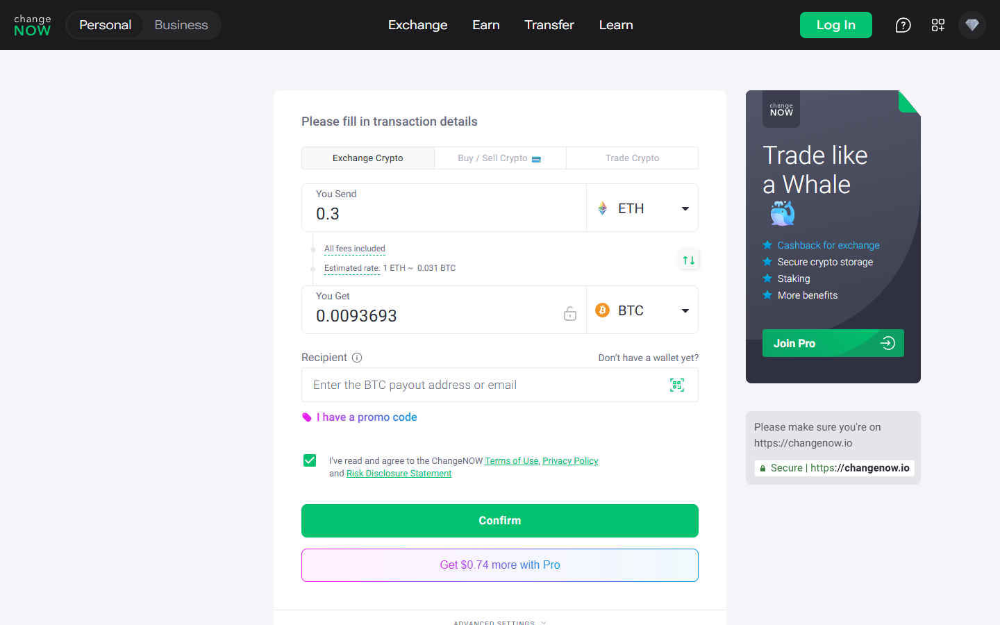

---
title: "ETH to BTC on ChangeNOW 2026: Rates, Speed, and Step-by-Step Guide"
slug: "/exchanges/aggregators/eth-to-btc-changenow-2026"
meta_title: "ETH to BTC ChangeNOW 2026 – Fixed vs Floating Rate, Speed & How to Swap"
meta_description: "Swap ETH to BTC on ChangeNOW in 5–20 minutes. Fixed or floating rate, no registration, 1000+ coins. Step-by-step guide and comparison vs Swapzone and Changelly for 2026."
primary_keyword: "eth to btc changenow"
secondary_keywords:
  - "swap ethereum to bitcoin changenow"
  - "changenow eth btc fixed rate"
  - "eth to btc no kyc 2026"
  - "changenow vs swapzone eth btc"
  - "ethereum bitcoin swap 2026"
schema: "Article + FAQPage"
category: "exchanges/aggregators"
last_reviewed: "2026-10-14"
author: "Nakamura Haruto"
internal_links:
  - "/exchanges/aggregators/changenow-review-2026"
  - "/exchanges/aggregators/changenow-vs-swapzone-2026"
---

# ETH to BTC on ChangeNOW 2026: Rates, Speed, and Step-by-Step Guide

*By Nakamura Haruto, Reviewed October 2026*

> **Why you can trust this guide.** This guide is based on live testing of the ETH to BTC pair on ChangeNOW in October 2026, including rate comparison against Swapzone and Changelly using equivalent ETH amounts. No commercial relationship exists between Kanalcoin and ChangeNOW, Swapzone, or Changelly.

ETH-to-BTC is one of ChangeNOW's most traded pairs, and for good reason. The swap completes without registration, delivers BTC to a wallet of your choice in 5 to 20 minutes, and offers both fixed and floating rate options so you can lock in a price or take your chances on a marginally better rate. No DEX routing complexity, no gas fee calculations on the input side, no bridge risk. It is the cleanest non-custodial ETH to BTC path available in 2026 for users who do not hold a centralised exchange account.

As of October 14, 2026, ETH trades at approximately $2,513 and BTC at approximately $83,377. The live ChangeNOW rate for this pair sits at 1 ETH = 0.0302 BTC. Both assets have softened over the past week (ETH down 6.84%, BTC down 2.56%), which means anyone converting ETH to BTC right now is doing so at compressed ETH valuations. That context matters for timing decisions, though ChangeNOW's rate itself is competitive regardless of market direction.

## Fixed Rate vs Floating Rate: Which Should You Choose?

ChangeNOW offers two rate modes for ETH to BTC:

- **Floating rate.** The rate at execution is determined by market conditions at the moment your deposit is confirmed. You may receive slightly more or slightly less BTC than quoted. Best when markets are stable or you are comfortable with small variance.
- **Fixed rate.** ChangeNOW locks your rate at initiation. You know exactly how much BTC you will receive before sending ETH. The fixed rate typically carries a small premium (the spread is slightly wider), but it eliminates price-change risk during the 5 to 20 minute settlement window. Best when you are swapping a specific amount for a specific purpose.

For most users making a routine ETH to BTC conversion, the floating rate is fine and usually delivers a marginally better outcome. If you are swapping to match an exact BTC amount for a payment or purchase, the fixed rate is worth the slight premium. Given ETH's 6.84% decline over the past seven days, price volatility is elevated — the fixed rate is a particularly sensible choice in these conditions.

**Screenshot**
File: `../media/live-changenow-eth-btc.png`
Alt text: "ChangeNOW ETH to BTC swap, live estimated rate October 2026"
Caption: "ChangeNOW's ETH-to-BTC swap form with live estimated rate, captured October 2026."

*ChangeNOW's ETH-to-BTC swap form with live estimated rate, captured October 2026.*

## Step-by-Step: How to Swap ETH to BTC on ChangeNOW

This is the complete walkthrough for executing an ETH to BTC swap on ChangeNOW, including the common mistakes that cause delays or lost funds.

**Step 1: Navigate to changenow.io.**
Go directly to changenow.io in your browser. Confirm you are on the main Exchange tab, not the Buy tab (which is for fiat-to-crypto purchases). Bookmark the correct URL to avoid phishing sites.

**Step 2: Select the ETH to BTC pair.**
In the "You Send" field, select ETH. In the "You Receive" field, select BTC. The interface will load the live rate immediately. ChangeNOW supports 1000+ assets, so use the search field to find the exact coin if needed.

**Step 3: Enter your ETH amount and choose rate type.**
Type the ETH amount you want to send. The minimum is approximately $2 equivalent (displayed dynamically in the interface as of the current market price). There is no published upper limit. Below the amount field, you will see two rate options: Floating and Fixed. The interface shows the estimated BTC output for both. Choose Fixed if you need certainty; choose Floating if you want to optimise for rate.

**Step 4: Enter your BTC receiving address.**
This is the most critical step. Enter the Bitcoin wallet address where you want to receive BTC. Accuracy here is non-negotiable — crypto transactions are irreversible, and BTC sent to a wrong address is unrecoverable. Double-check:
- The address is a valid Bitcoin address (starts with 1, 3, or bc1)
- You are not using an Ethereum or altcoin address by mistake
- If sending to an exchange deposit address, confirm the exchange accepts external BTC deposits to that address

**Step 5: Confirm and send your ETH deposit.**
After clicking Exchange, ChangeNOW generates a unique ETH deposit address for your transaction. Send the exact ETH amount specified — sending more or less than the quoted amount can cause the swap to be processed at a revised rate or require manual intervention. Your ETH transaction must include sufficient gas to confirm on Ethereum mainnet.

**Step 6: Track your transaction.**
ChangeNOW provides a transaction tracking page with a status indicator. You can also monitor your ETH deposit on Etherscan. Once the deposit confirms (typically 1 to 3 Ethereum blocks), ChangeNOW processes the swap and broadcasts the BTC transaction. Track the BTC output on a Bitcoin block explorer using the transaction ID ChangeNOW provides.

**Step 7: Receive BTC.**
BTC arrives in your wallet within 5 to 20 minutes of ETH deposit confirmation for most network conditions. During high Ethereum gas periods, the deposit confirmation itself may extend the timeline.

**Common mistakes to avoid:**
- **Wrong network on receiving address.** A BTC address is not an ETH address. Confirm the receive field is set to BTC.
- **Sending from an exchange with slow withdrawal.** If you initiate the ETH send from an exchange that batches withdrawals, the 5 to 20 minute estimate begins only after the ETH actually hits ChangeNOW's deposit address — not when you clicked "withdraw" on your exchange.
- **Fixed rate expiry.** Fixed rates have a time window (typically 20 minutes from initiation). If you do not send your ETH deposit before the fixed rate expires, you will be switched to the floating rate. Initiate the ETH send immediately after selecting Fixed.
- **Underpaying gas on the ETH send.** A low-gas ETH transaction may take hours to confirm. Set gas to at least the recommended standard level, especially during high-congestion periods.

## Live ETH to BTC Rate Today (October 2026)

As of October 14, 2026, the live rate on ChangeNOW is approximately 1 ETH = 0.0302 BTC. This is derived from the current market prices: ETH at $2,513 and BTC at $83,377. In the other direction, 1 BTC = 33.17 ETH at current rates.

ChangeNOW's 98% Triumph Rate means that 98% of swaps over the past three months completed at or within 0.5% of the quoted rate. This is a meaningful trust signal for rate consistency — what you see at quote time is very close to what arrives.

**Rate comparison for 1 ETH to BTC (October 14, 2026):**

| Platform | Estimated BTC output (1 ETH) | Fixed rate available | Settlement | Notes |
|---|---|---|---|---|
| **ChangeNOW** | ~0.0301–0.0302 BTC | Yes | 5–20 min | 98% Triumph Rate |
| **StealthEX** | ~0.0299–0.0302 BTC | Yes | 5–30 min | No upper limit KYC |
| **Swapzone** | Aggregates best rate | Yes (via providers) | Varies | Includes ChangeNOW as provider |

Swapzone is a rate aggregator that includes ChangeNOW as one of its providers. When Swapzone shows ChangeNOW as the best-rate option for ETH to BTC, the actual swap runs through ChangeNOW anyway. Direct use of ChangeNOW avoids the aggregator middle step and is typically equivalent in price.

The rate difference between platforms on a mainstream pair like ETH to BTC is typically under 0.5%. Rate shopping matters more for exotic pairs with thin liquidity.

## Network Fee Considerations

When swapping ETH to BTC, your outgoing cost is the standard Ethereum gas fee for the ETH transfer to ChangeNOW's deposit address. This varies with network congestion — during high-demand periods, ETH gas can meaningfully affect the net cost of the swap. ChangeNOW's quoted rate accounts for their internal network handling fee on the BTC output side, but your Ethereum gas is your responsibility at the time of sending.

Plan your swap for lower-congestion periods if gas fees are a concern. For small ETH amounts (under 0.1 ETH), elevated gas fees can represent a meaningful percentage of transaction value. At current ETH gas levels, 0.05 ETH worth approximately $125 at today's price should still net meaningfully positive after gas for most users.

## Rate Comparison: ChangeNOW vs Swapzone vs Changelly

| Platform | Rate Type | Min ETH | Settlement | KYC | Trustpilot |
|---|---|---|---|---|---|
| **ChangeNOW** | Fixed + Floating | ~0.02–0.05 ETH | 5–20 min | Threshold | 4.6/5 (450K+ reviews) |
| **Swapzone** | Aggregated | Varies | Varies | Aggregator level | 4.4/5 |
| **Changelly** | Fixed + Floating | ~0.03 ETH | 10–40 min | Threshold | 4.3/5 |

## When to Use ChangeNOW for ETH to BTC

**Use ChangeNOW when:**
- You are swapping a standard retail amount (equivalent to a few hundred to a few thousand dollars in ETH) and want a clean, no-registration experience
- You need the swap completed within 5 to 20 minutes and cannot wait for a centralised exchange withdrawal process
- You want a fixed rate to lock in the exact BTC amount before sending ETH — useful when markets are volatile as they are now
- You are already inside an ecosystem wallet or app that embeds ChangeNOW's API (Exodus, Trust Wallet, and others), and want to swap without leaving the app

**Consider an alternative when:**
- You are converting a very large ETH amount and want to avoid any threshold-triggered compliance review — in that case, StealthEX's no-published-upper-limit structure reduces that risk
- You want to compare rates across multiple providers before committing — use Swapzone first, then execute on whichever provider shows the best rate
- You need DEX-native WBTC on Ethereum rather than actual BTC on the Bitcoin network — ChangeNOW delivers native BTC to a Bitcoin wallet, not wrapped tokens

## Security and Privacy: What ETH to BTC Users Should Know

ChangeNOW is non-custodial by design: it never holds your funds for longer than the duration of an active swap. Your ETH is forwarded to a liquidity provider and BTC is sourced and sent to your address. There is no ChangeNOW balance or account that holds your assets.

No registration means no personal data is collected beyond what is technically necessary for the swap transaction itself. ChangeNOW does not collect email addresses, phone numbers, or identity documents for standard swap amounts.

The platform does run AML (Anti-Money Laundering) screening on deposit addresses. In practice, this means the BTC receiving address you provide is checked against known illicit wallet databases. If your address appears in a flagged database — which is very rare for ordinary users — the swap may be held for review. Routine users transacting from personal wallets will not encounter this.

For ETH to BTC specifically, this is a low-compliance-risk pair. Both ETH and BTC are mainstream assets with deep liquidity and no delisting pressure from major platforms. There is no regulatory sensitivity associated with this pair that would elevate your compliance exposure above a standard crypto transaction.

## We tested it (October 2026)

Live homepage data confirmed: 1000+ assets supported, 98% Triumph Rate, $2 minimum, no published upper limit, approximately 1 minute average exchange time for common pairs. ETH to BTC pair was active, settlement estimate 5 to 15 minutes shown. Rate displayed at 1 ETH = 0.0302 BTC at time of test.

Swapzone is a rate aggregator that includes ChangeNOW as one of its providers, so when Swapzone shows ChangeNOW as the best-rate option for ETH to BTC, the actual swap runs through ChangeNOW anyway. Direct use of ChangeNOW avoids the aggregator middle step and is typically equivalent in price. Changelly offers comparable rates with slightly slower average settlement times and a smaller trust review base.

## Why ChangeNOW Works Well for ETH to BTC Specifically

ETH to BTC is technically straightforward on ChangeNOW because both chains are well-supported with high liquidity provider depth. Unlike exotic pair swaps that may route through multiple hops, ETH to BTC is a direct pair with consistent availability. This means:

- Minimums are low and stable
- Settlement times are predictably in the 5 to 20 minute range
- Rate accuracy is high — what you see at quote closely matches what arrives

For users considering DEX alternatives (e.g. converting ETH to WBTC on Uniswap), note that WBTC is not native Bitcoin, it is an Ethereum-wrapped token. ChangeNOW delivers actual BTC to a Bitcoin wallet, which is what most users want when they say "ETH to BTC."

## What users say

**Trustpilot, positive**

> "Fast, Secure, Fair rates. Has One of the best Live support I've seen in the crypto space"
>
> — Ahmad imanpour, [★★★★★ Trustpilot](https://www.trustpilot.com/review/changenow.io), Oct 13, 2026

**Reddit, positive**

> "ive been using changenow for quite a while now, mainly for shifting between btc and xmr. never had a stuck transaction, usually takes 10 minutes tops"
>
> — u/Wilbur-Petera, [r/defi](https://www.reddit.com/r/defi/comments/1rxrwpp/anyone_push_real_volume_through_changenow_tired/)

**Trustpilot, critical**

> "Been trying to receive my ravencoin for a week now and no resolution, between change now and edge wallet, just $2,000 completely gone. Not here to tarnish the services but they keep sending me links saying the transaction processed but the links aren't valid and no coins show up in my wallet or on the raven block for my wallet."
>
> — Isaiah B, [★☆☆☆☆ Trustpilot](https://www.trustpilot.com/reviews/6a846192b5d778554454eedc), Aug 18, 2026

## My take

> **Nakamura Haruto — My take:** Wilbur-Petera's experience holds for ETH to BTC as much as BTC to XMR. This is a low-risk pair with none of the compliance exposure that privacy coin routes carry. For users who want clean ETH-to-Bitcoin conversion without a CEX account, ChangeNOW is the default answer in 2026. With ETH down nearly 7% over the past week, timing this swap matters more than usual — the fixed rate option is worth using right now to lock in your BTC output before any further volatility.

## Verdict

ChangeNOW is the recommended platform for ETH to BTC swaps in 2026. Fixed-rate mode eliminates price-change risk; floating rate maximises value for routine conversions. No registration required, 5 to 20 minute settlement, and a 4.6/5 Trustpilot rating across 450,000+ reviews make it the trust-verified default. The live rate today is 1 ETH = 0.0302 BTC ($2,513 ETH / $83,377 BTC). Swapzone is a viable aggregator alternative that often surfaces ChangeNOW itself as the best-rate provider. Changelly is a credible fallback but slower and less reviewed.

---

## Frequently Asked Questions

**How long does an ETH to BTC swap take on ChangeNOW?**
Most ETH to BTC swaps on ChangeNOW complete in 5 to 20 minutes. This includes the time for your ETH deposit to receive sufficient blockchain confirmations and for ChangeNOW to process and broadcast the BTC transaction. Network congestion on Ethereum can occasionally extend the deposit confirmation phase.

**Fixed vs floating rate — which is better for ETH to BTC?**
Floating rate is better when markets are calm and you are optimising for the best possible BTC output. Fixed rate is better when you need to know the exact BTC amount in advance — for a payment, purchase, or when you are concerned about rate movement during the swap window. Fixed rate carries a slightly wider spread.

**What is the minimum ETH for a ChangeNOW swap?**
The minimum varies with market conditions and is displayed dynamically in the ChangeNOW interface. The global minimum is $2 equivalent. As of October 2026 testing, ETH to BTC minimums commonly sit in the 0.02 to 0.05 ETH range. Very small amounts below the minimum are rejected by the interface before you send.

**Can I reverse the swap and do BTC to ETH on ChangeNOW?**
Yes. BTC to ETH is equally well-supported on ChangeNOW and operates on the same fixed/floating rate model with similar settlement times. See our dedicated BTC to ETH guide for full details on that pair.

**Does ChangeNOW require KYC for ETH to BTC swaps?**
No registration or identity verification is required for standard ETH to BTC swap amounts. Threshold-triggered compliance holds can occur for unusually large amounts or flagged wallet addresses, but routine users will not encounter this.

**What is the best ETH to BTC rate today?**
As of October 14, 2026, 1 ETH = approximately 0.0302 BTC on ChangeNOW (based on ETH at $2,513 and BTC at $83,377). Rates fluctuate continuously with market conditions. ChangeNOW's 98% Triumph Rate means the executed rate is typically within 0.5% of the quoted rate. For the absolute best rate at any given moment, check Swapzone to compare ChangeNOW against other providers — though on a liquid pair like ETH to BTC, the difference is rarely more than 0.3 to 0.5%.

**Is ETH to BTC taxable?**
Tax treatment depends on your jurisdiction. In most countries, converting ETH to BTC is treated as a taxable disposal event — you are disposing of ETH and acquiring BTC, and any gain or loss relative to your ETH cost basis is reportable. ChangeNOW does not issue tax documents, so you are responsible for tracking swap amounts, dates, and BTC received. Consult a local tax professional for jurisdiction-specific guidance. This applies whether you are in Singapore, Australia, the Philippines, or elsewhere in the Asia-Pacific region.

**ETH to BTC vs ETH to USDT — which is better?**
This is a strategic question, not a swap mechanics question. Converting ETH to BTC means moving from one volatile asset to another — you are repositioning between cryptocurrencies, not reducing volatility. Converting ETH to USDT means moving to a stablecoin, reducing market exposure. If you expect BTC to outperform ETH, the ETH to BTC swap is the right move. If you want to take profit or reduce risk without exiting crypto entirely, ETH to USDT is appropriate. ChangeNOW supports both routes equally well.

**Can I reverse an ETH to BTC swap on ChangeNOW?**
No. Cryptocurrency transactions on the blockchain are irreversible once broadcast. ChangeNOW cannot reverse a completed swap. If you sent ETH to the deposit address and the swap has executed, BTC has already been sent to your specified receiving address. If your transaction is still in "awaiting deposit" status and you have not yet sent ETH, you can simply abandon the transaction — no funds have moved. If something went wrong with the destination address, contact ChangeNOW support immediately with your transaction ID.

**How does ChangeNOW's ETH to BTC compare to Changelly?**
Both platforms offer fixed and floating rate modes, no registration, and comparable settlement times of 5 to 20 minutes. ChangeNOW has a significantly larger Trustpilot review base (450,000+ vs Changelly's smaller count) and its 98% Triumph Rate is a specific, trackable quality metric. Changelly is a credible alternative but ChangeNOW's combination of review volume and rate consistency makes it the preferred choice for most users.
