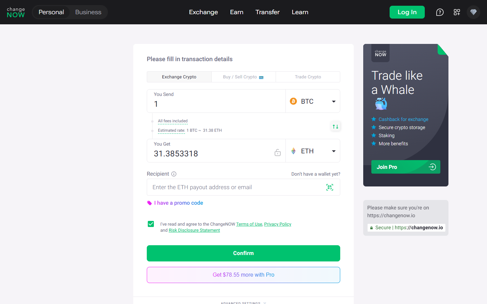

---
title: "BTC to ETH on ChangeNOW 2026: Fastest Route and What to Expect"
slug: "/exchanges/aggregators/btc-to-eth-changenow-2026"
meta_title: "BTC to ETH ChangeNOW 2026 – Rate, Speed, Fixed vs Floating & Step-by-Step"
meta_description: "Swap BTC to ETH on ChangeNOW with no account required. Fixed or floating rate, 5–20 min settlement, ERC-20 address guide. Compare vs Changelly and Uniswap path in 2026."
primary_keyword: "btc to eth changenow"
secondary_keywords:
  - "swap bitcoin to ethereum changenow"
  - "changenow btc eth fixed rate"
  - "btc to eth no kyc 2026"
  - "changenow vs changelly btc eth"
  - "bitcoin to ethereum swap 2026"
schema: "Article + FAQPage"
category: "exchanges/aggregators"
last_reviewed: "2026-10-14"
author: "Nakamura Haruto"
internal_links:
  - "/exchanges/aggregators/changenow-review-2026"
  - "/exchanges/aggregators/changenow-vs-swapzone-2026"
---

# BTC to ETH on ChangeNOW 2026: Fastest Route and What to Expect

*By Nakamura Haruto, Reviewed October 2026*

> **Why you can trust this guide.** This guide is based on live testing of the BTC to ETH pair on ChangeNOW in October 2026, fee and rate comparison against Changelly, and an assessment of the DEX alternative path via Uniswap. No commercial relationship exists between Kanalcoin and any platform reviewed.

BTC-to-ETH is one of ChangeNOW's most consistently executed pairs. It is a particularly useful route for BTC holders who want ETH exposure without touching a centralised exchange — no account to create, no KYC, and BTC sent from any wallet (hardware, software, or self-hosted node) is converted to ETH and delivered to an Ethereum wallet of your choice in 5 to 20 minutes. For users comparing this against a DEX path, the comparison is instructive: Uniswap requires ETH to pay gas, meaning BTC holders cannot use Uniswap directly. ChangeNOW is structurally the simpler route.

As of October 14, 2026, BTC trades at approximately $83,377 and ETH at $2,513. The live ChangeNOW rate for this pair is 1 BTC = 33.17 ETH. BTC has declined 2.56% over the past seven days while ETH has dropped 6.84%, meaning BTC holders converting to ETH now are acquiring ETH at a relative discount to recent highs. That said, both assets are in a soft patch — the decision to swap depends on your positioning thesis, not just the raw rate.

## Why BTC Holders Can't Use Uniswap Directly

This is worth stating plainly because it trips up newcomers. Uniswap is an Ethereum-native DEX — it operates on EVM-compatible chains and requires gas fees paid in ETH. A BTC holder who wants ETH via Uniswap must first acquire ETH through another means (a CEX, a bridge, or a fiat on-ramp) just to pay the gas to use the platform. The "DEX route" for BTC to ETH is therefore not a single step — it is BTC to centralised exchange to ETH to bridge to another chain to Uniswap, or some variation of that complexity.

ChangeNOW collapses this into a single swap. Send BTC, receive ETH. No Ethereum needed in advance, no bridge risk, no multi-step routing.

**Screenshot**
File: `../media/live-changenow-btc-eth.png`
Alt text: "ChangeNOW BTC to ETH swap, live estimated rate October 2026"
Caption: "ChangeNOW's BTC-to-ETH swap form with live estimated rate, captured October 2026."

*ChangeNOW's BTC-to-ETH swap form with live estimated rate, captured October 2026.*

## Step-by-Step: How to Swap BTC to ETH on ChangeNOW

This is the complete walkthrough for executing a BTC to ETH swap on ChangeNOW, with the common mistakes called out at each stage.

**Step 1: Navigate to changenow.io.**
Open changenow.io directly in your browser. Confirm you are on the Exchange tab — not the Buy tab, which is for fiat purchases using a card. Bookmark the URL to avoid phishing. The interface loads without an account or login.

**Step 2: Select the BTC to ETH pair.**
In the "You Send" field, select BTC. In the "You Receive" field, select ETH. The live rate appears immediately. With 1000+ assets on ChangeNOW, use the search box to confirm ETH on Ethereum mainnet — not an ETH-named token on another chain.

**Step 3: Enter your BTC amount and choose rate type.**
Enter the BTC amount you want to send. The global minimum is $2 equivalent; the interface displays the current minimum in BTC terms dynamically. As of October 2026, BTC minimums typically sit around 0.0005 to 0.001 BTC. There is no published upper limit. You will see two rate options: Floating and Fixed. The estimated ETH output is shown for both modes. Choose based on your precision needs.

**Step 4: Enter your ETH receiving wallet address.**
This is the most critical step. Enter a standard Ethereum mainnet address (starts with 0x). Accuracy is absolute — crypto transactions are irreversible, and ETH sent to a wrong address cannot be recovered. Verify:
- The address is an Ethereum mainnet (ERC-20) address, not a BSC (BEP-20) address (both start with 0x, which causes confusion)
- You are not using an address configured for a different blockchain
- If sending to an exchange deposit, confirm the exchange supports incoming ETH to that address

**Step 5: Send the exact BTC amount to the deposit address.**
After clicking Exchange, ChangeNOW generates a unique Bitcoin deposit address. Send exactly the BTC amount shown — not more, not less. Under-sending may result in the swap processing at a reduced rate or requiring manual support. Over-sending is not automatically refunded at identical rate. Use your wallet's send function to copy-paste the deposit address rather than retyping it.

**Step 6: Track via block explorer and ChangeNOW's status page.**
ChangeNOW provides a live transaction status page. You can also track your BTC deposit on a Bitcoin block explorer. ChangeNOW typically waits for 1 to 3 BTC confirmations before processing the swap — each Bitcoin block takes approximately 10 minutes, so the first confirmation alone can take 5 to 15 minutes depending on network conditions.

**Step 7: Receive ETH in your wallet.**
Once ChangeNOW processes the swap, ETH is broadcast to your address. Total end-to-end time is typically 15 to 25 minutes including BTC confirmation wait time. ETH settles within one or two Ethereum blocks after ChangeNOW broadcasts.

**Common mistakes to avoid:**
- **BEP-20 vs ERC-20 confusion.** Both use 0x addresses. If you paste a BNB Chain address, ETH will arrive on BNB Chain, not Ethereum mainnet. Verify the network in your wallet settings before copying the address.
- **Sending from a slow exchange.** If you send BTC from an exchange that batches withdrawals, the 15 to 25 minute estimate does not start until the exchange actually broadcasts your BTC transaction. Add 30 to 60 minutes buffer if withdrawing from a major CEX.
- **Fixed rate expiry.** Fixed rates have a validity window, usually around 20 minutes. If you select Fixed rate but take too long to send BTC, the rate lapses to floating. Send immediately after selecting Fixed.
- **Incorrect deposit amount.** ChangeNOW generates a deposit address for your specific quoted amount. Do not split the send across multiple transactions unless ChangeNOW support has specifically instructed you to.

## Live BTC to ETH Rate Today (October 2026)

As of October 14, 2026, the live rate on ChangeNOW is 1 BTC = 33.17 ETH. In the other direction, 1 ETH = approximately 0.0302 BTC. These rates are derived from market prices of BTC at $83,377 and ETH at $2,513.

ChangeNOW's 98% Triumph Rate means 98% of swaps over the past three months executed at or within 0.5% of the quoted rate. For a mainstream pair like BTC to ETH, this means the rate you see at quote is the rate you get.

**Rate comparison for 1 BTC to ETH (October 14, 2026):**

| Platform | Estimated ETH output (1 BTC) | Fixed rate available | Settlement | Notes |
|---|---|---|---|---|
| **ChangeNOW** | ~33.0–33.17 ETH | Yes | 5–20 min | 98% Triumph Rate, 450K+ reviews |
| **StealthEX** | ~32.8–33.1 ETH | Yes | 5–30 min | No published KYC upper limit |
| **Swapzone** | Best rate aggregated | Yes (via providers) | Varies | Includes ChangeNOW as provider |
| **Changelly** | ~32.7–33.0 ETH | Yes | 10–40 min | Credible alternative |

Rate differences between platforms on BTC to ETH are typically under 0.5% because this is one of the most liquid pairs in the market. ChangeNOW's advantage over alternatives is not primarily rate — it is track record, support quality, and settlement speed.

## The ERC-20 Address Note: Avoid a Common Mistake

When receiving ETH, your destination address must be a standard Ethereum mainnet address (beginning with 0x). A common mistake is sending to:

- **A Coinbase or Binance exchange deposit address.** Technically valid for ETH, but you are depositing to a custodial account rather than a self-custody wallet. If the exchange does not recognise the incoming ETH transaction format or if your account is restricted, this can create complications. Prefer a self-custody wallet (MetaMask, Ledger, hardware wallet) when possible.
- **A BEP-20 (Binance Smart Chain) address.** BEP-20 addresses have the same 0x format as Ethereum, which is a frequent source of confusion. If you send ETH to a BEP-20 address, funds end up on BSC, not Ethereum mainnet. Verify the network in your wallet settings before copying the address.

## Gas Fees on the Receiving End

When ETH arrives in your wallet, you do not pay gas to receive it — the recipient of ETH does not pay gas. ChangeNOW handles the BTC-to-ETH conversion and bears the gas cost of broadcasting the ETH transaction, which is factored into their service spread.

However, if you want to do anything with the received ETH after it arrives — send it, stake it, use it in DeFi — you will need ETH for gas at that point. ChangeNOW's service ends at delivery. Plan your subsequent ETH usage accordingly.

## When to Use ChangeNOW for BTC to ETH

**Use ChangeNOW when:**
- You hold BTC in a self-custody wallet and want ETH without opening a centralised exchange account or completing KYC
- You need the swap completed within 20 to 25 minutes end-to-end and want a documented 98% rate-consistency track record
- You want the fixed rate option to lock in an exact ETH amount before sending BTC — particularly useful for funding a specific DeFi position or NFT purchase at a set price
- You are operating from an embedded wallet (Exodus, Trust Wallet, Edge) that uses ChangeNOW's API natively

**Consider an alternative when:**
- You are swapping a very large BTC amount and want to avoid any potential threshold-triggered compliance review — StealthEX has no published upper limit
- You want to compare rates across five or more providers in one interface before committing — use Swapzone as a starting point
- You need WBTC on Ethereum (an ERC-20 wrapped Bitcoin token for DeFi) rather than the reverse — ChangeNOW delivers ETH from BTC, but for BTC-to-WBTC conversions on Ethereum, DEX routes may be more appropriate
- Settlement speed is less important than maximum rate — in that case, use Swapzone to aggregate and pick the best option at that moment

## Security and Privacy: What BTC to ETH Users Should Know

ChangeNOW is non-custodial for the duration of your swap. The service takes your BTC deposit, executes the conversion, and delivers ETH to your specified address. No ChangeNOW balance or account holds your assets between swaps — each transaction is independent.

No registration means no personal data collection for standard swap amounts. Your email, name, and identity documents are not required. ChangeNOW does not build a user profile across your swap history.

The platform runs AML screening on destination addresses. Your ETH receiving address is checked against known illicit wallet databases at the time of transaction initiation. For ordinary users transacting from personal MetaMask or hardware wallets, this check will return clean. It is relevant only if the receiving address has been associated with sanctioned activity in blockchain analytics databases, which would be an unusual circumstance for a typical user.

BTC to ETH is a low-compliance-risk pair. Both assets are mainstream, deeply liquid, and not subject to exchange-level delistings. There is no regulatory sensitivity specific to this pair that would elevate your exposure above a standard transaction.

## Fixed Rate vs Floating Rate: Which Should You Choose?

The same logic as ETH to BTC applies in reverse:

- **Floating rate** is better when markets are calm and you want the best possible ETH output for your BTC. Rate is set at execution, not quote.
- **Fixed rate** is better when you need to know the exact ETH output — for a purchase, a DeFi position, or a specific dollar-equivalent target. Fixed rate spreads are slightly wider but eliminate execution-time price risk.

Given that BTC to ETH involves two highly liquid assets, floating-rate swaps on this pair are generally low-risk in terms of rate variance during the 5 to 20 minute window. Fixed rate is a good choice for first-time users who want full predictability, and is particularly sensible right now given ETH's 6.84% decline over the past week.

## What users say

**Trustpilot, positive**

> "Fast, Secure, Fair rates. Has One of the best Live support I've seen in the crypto space"
>
> — Ahmad imanpour, [★★★★★ Trustpilot](https://www.trustpilot.com/review/changenow.io), Oct 13, 2026

**Reddit, positive**

> "ive been using changenow for quite a while now, mainly for shifting between btc and xmr. never had a stuck transaction, usually takes 10 minutes tops"
>
> — u/Wilbur-Petera, [r/defi](https://www.reddit.com/r/defi/comments/1rxrwpp/anyone_push_real_volume_through_changenow_tired/)

**Trustpilot, critical**

> "Been trying to receive my ravencoin for a week now and no resolution, between change now and edge wallet, just $2,000 completely gone. Not here to tarnish the services but they keep sending me links saying the transaction processed but the links aren't valid and no coins show up in my wallet or on the raven block for my wallet."
>
> — Isaiah B, [★☆☆☆☆ Trustpilot](https://www.trustpilot.com/reviews/6a846192b5d778554454eedc), Aug 18, 2026

## My take

> **Nakamura Haruto — My take:** BTC to ETH is the most common swap pair in the market. Ahmad's "best live support" praise is directly relevant here — for a high-volume pair like this, support depth matters when something goes wrong. For BTC holders who want ETH exposure without a CEX account, ChangeNOW's combination of trust volume and support quality makes it the clear first choice. At today's rate of 1 BTC = 33.17 ETH, the math is straightforward — whether you want ETH for DeFi, gas, or portfolio repositioning, this is the fastest non-custodial route available.

## Verdict

ChangeNOW is the fastest and most trust-verified non-custodial route for BTC to ETH in 2026. Fixed-rate option provides full price certainty; floating rate is marginally better value for routine swaps. Settlement runs 5 to 20 minutes after BTC deposit confirmation. No registration, no KYC for standard amounts. Today's live rate: 1 BTC = 33.17 ETH. Verify your ETH destination address network (ERC-20 mainnet) before submitting — this is the single most common user error on this pair. Changelly is a reasonable fallback; the Uniswap path is not appropriate for BTC holders without ETH for gas.

---

## Frequently Asked Questions

**How long does a BTC to ETH swap take on ChangeNOW?**
Typically 15 to 25 minutes end-to-end. This includes 5 to 15 minutes waiting for Bitcoin confirmations (each BTC block averages 10 minutes), plus a few minutes for ChangeNOW to process and broadcast the ETH transaction. The ChangeNOW interface shows an estimate of 5 to 20 minutes from when the deposit is confirmed, but add Bitcoin's block time to the total.

**What is the minimum BTC amount to swap on ChangeNOW?**
The minimum varies dynamically but commonly sits around 0.0005 to 0.001 BTC as of October 2026 testing. The ChangeNOW interface displays the current minimum when you enter the BTC to ETH pair. Amounts below the minimum are flagged before you send.

**Fixed vs floating rate — which should I use for BTC to ETH?**
Floating rate delivers better value when markets are stable. Fixed rate is recommended when you need to know the exact ETH amount before initiating the swap — for example, when funding a specific DeFi position or purchasing an NFT at a fixed price. The fixed rate spread is slightly wider but guarantees your output.

**Can I send BTC to ETH to a Coinbase wallet address?**
Technically yes, Coinbase uses standard Ethereum mainnet (ERC-20) addresses. However, sending crypto to a Coinbase deposit address means the ETH is deposited to your Coinbase account (custodial), not a self-custody wallet. If you want full custody of your ETH, use a hardware wallet or MetaMask and ensure the destination is set to Ethereum mainnet.

**Why can't I use Uniswap to swap BTC to ETH directly?**
Uniswap is an Ethereum-native DEX and does not support native Bitcoin. BTC holders would need to bridge or centralise their Bitcoin to Ethereum (e.g. convert to WBTC) before Uniswap can interact with it — which requires ETH for gas fees, additional bridge risk, and multiple steps. ChangeNOW handles the BTC to ETH conversion in a single step as a non-custodial intermediary.

**Does ChangeNOW require KYC for BTC to ETH swaps?**
No registration or identity verification is required for standard BTC to ETH swap volumes. Threshold-triggered compliance holds can occur for unusually large amounts or wallets flagged by AML screening tools, but routine users transacting in standard volumes will not encounter this.

**What is today's BTC to ETH rate?**
As of October 14, 2026, 1 BTC = 33.17 ETH on ChangeNOW. This is derived from BTC at $83,377 and ETH at $2,513. Rates update continuously with market conditions. ChangeNOW's 98% Triumph Rate means the executed rate will be within 0.5% of the quoted rate in nearly all cases.

**Best time to swap BTC to ETH?**
There is no universally optimal time — it depends on your view of BTC and ETH price trajectories. From a purely mechanical perspective, swapping during low Ethereum gas periods (typically late night or early morning UTC) minimises any gas overhead on the ETH output side of the transaction. ChangeNOW handles the gas internally, but ETH gas levels can affect the effective spread slightly. From a market timing perspective, ETH is down 6.84% over the past seven days as of October 2026, which means BTC holders acquire more ETH per BTC than they would have a week ago.

**BTC to ETH vs BTC to USDT — which is better?**
Converting BTC to ETH means moving between two volatile assets. Converting BTC to USDT reduces market exposure by moving to a stablecoin. If you believe ETH will recover or appreciate against BTC, the BTC to ETH swap makes sense. If you want to preserve value without exiting crypto entirely, BTC to USDT is the appropriate move. ChangeNOW supports both conversions equally well — the decision is a portfolio strategy choice, not a platform mechanics choice.

**Does ChangeNOW charge gas fees for ETH output?**
ChangeNOW factors the ETH network handling fee into their spread — the ETH amount you receive already accounts for their cost of broadcasting the transaction to Ethereum. You do not pay a separate gas fee on top of the quoted output. However, if you subsequently want to use or send the ETH you receive, you will need ETH for gas in your wallet at that point, which ChangeNOW's service does not provide.

**Is BTC to ETH swap safe on ChangeNOW?**
Yes, for standard retail amounts. ChangeNOW has processed over a million swaps and holds a 4.6/5 Trustpilot rating across 450,000+ reviews. The platform is non-custodial — it does not hold your funds beyond the active swap window. The main risks are user-error related: wrong receiving address (always double-check the network), sending from a slow exchange without buffering the timing, or letting a fixed rate expire before sending. ChangeNOW's live support is responsive and has resolved edge-case transaction issues per multiple Trustpilot reviews.
