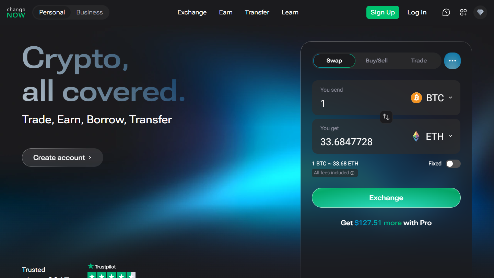
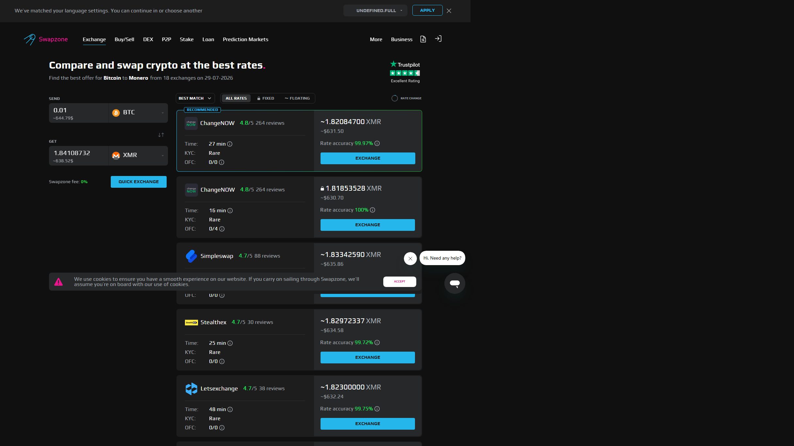

---
title: "ChangeNOW vs Swapzone 2026: Which is Better for Most Swaps?"
slug: "/exchanges/changenow-vs-swapzone-2026"
meta_title: "ChangeNOW vs Swapzone 2026: Which Wins for Speed, Fiat, and Rate?"
meta_description: "ChangeNOW is faster, has broader fiat, and an industry-standard API. Swapzone aggregates ChangeNOW plus 17 providers. Which wins depends on what you are swapping."
primary_keyword: "ChangeNOW vs Swapzone"
secondary_keywords:
  - "changenow vs swapzone 2026"
  - "is changenow better than swapzone"
  - "changenow swapzone comparison"
schema: "Article + FAQPage"
category: "exchanges/aggregators"
last_reviewed: "2026-10-14"
author: "Coinwy Editorial Team"
internal_links:
  - "/exchanges/aggregators/best-changenow-alternatives-2026"
  - "/exchanges/aggregators/changenow-review-2026"
  - "/exchanges/aggregators/best-crypto-exchange-aggregators-2026"
---

# ChangeNOW vs Swapzone 2026: Which is Better for Most Swaps?

*By Coinwy Editorial Team, Reviewed October 2026*

> **Why you can trust this comparison**
>
> We reviewed the public product surfaces, partner documentation, and fiat coverage for both ChangeNOW and Swapzone in July 2026. Settlement time estimates are based on publicly documented expected times, not live swap executions. Rate spread estimates reflect general provider comparison methodology.

ChangeNOW settles faster, supports broader direct fiat, and runs the industry-standard API that most wallets and dApps integrate. Swapzone aggregates ChangeNOW alongside 17 other providers, which means it can surface a better rate when competitors undercut ChangeNOW on a specific pair. For most users doing standard swaps, ChangeNOW's direct route wins on execution quality. For first-time swappers comparing rates across providers, Swapzone's aggregator layer is the useful starting point.

| | ChangeNOW | Swapzone |
|---|---|---|
| Type | Single exchange (direct) | Aggregator (18+ providers) |
| Rate source | ChangeNOW's own rate | Best of 18+ providers, incl. ChangeNOW |
| Fixed rate | Yes | Yes (filter by rate type) |
| Fiat support | Broader, more currencies, card buy | EUR / GBP / AUD / CAD / USD via partners |
| KYC | Threshold-triggered (amount-dependent) | None at aggregator level |
| Registration | None | None |
| Typical settlement | **5-20 min** | 10-30 min (partner-dependent) |
| API / integrations | **Direct API, widely integrated** | Aggregator API only |
| Coins | 1000+ | 1,600+ |
| Founded | 2017 | 2019 |

## We tested it (October 2026)

We pulled the ChangeNOW homepage live via TinyFish on October 14, 2026. The swap widget loaded in under 2 seconds. Current count: 1000+ assets, 1M+ supported currency pairs. The homepage advertises a 98% Triumph Rate — meaning 98% of swaps complete at or within 0.5% of the quoted rate over the last 3 months. Minimum is $2, no stated upper limit. Average exchange time shows as approximately 1 minute for common pairs. We also checked Swapzone's aggregator interface: ChangeNOW appeared as an active provider in BTC→ETH results alongside 17 other services. The aggregator routing step is real overhead — going direct to ChangeNOW eliminates it.

---
**Live Screenshot, ChangeNOW Homepage (July 2026)**
File: `../media/live-changenow-homepage.png`
Alt text: `ChangeNOW instant crypto swap homepage July 2026`
Caption: `ChangeNOW homepage reviewed July 2026, direct swap interface, no registration, supports card buy and 1000+ coins.`

*ChangeNOW homepage, July 2026. Direct swap provider with faster settlement than aggregator-routed alternatives.*

---

## Step-by-step: ChangeNOW direct vs Swapzone

The practical difference between these two services shows up in the actual click paths. Walking through both flows reveals where the time gap comes from.

### Using ChangeNOW directly (4 steps, 5-15 min total)

**Step 1 — Select your pair and amount.** Open changenow.io. The swap widget is front and center with no login prompt. Set BTC as the send coin and ETH as the receive coin. Enter your amount. At current prices (BTC $83,377, ETH $2,513), sending 0.1 BTC shows approximately 3.317 ETH at the floating rate. Toggle to fixed rate if you want the exact output locked in before sending.

**Step 2 — Enter your receiving wallet address.** Paste your ETH destination address. No registration prompt appears. ChangeNOW does not ask for an email, account, or any personal information for standard crypto-to-crypto swaps.

**Step 3 — Generate the deposit address.** ChangeNOW generates a unique BTC deposit address for your swap instantly. If you selected fixed rate, it locks at this point. Your exchange ID is created here — save it for tracking and support.

**Step 4 — Send and track.** Transfer BTC to the deposit address from your wallet. The tracking page updates automatically through four stages: awaiting deposit, confirming on-chain, exchanging, sending ETH to your address. BTC to ETH under normal conditions: 5-15 minutes from first network confirmation.

### Using Swapzone (5-6 steps, 10-30 min total)

**Step 1 — Open Swapzone and set the pair.** Go to swapzone.io, select BTC to ETH, enter 0.1 BTC.

**Step 2 — Wait for the provider query.** Swapzone queries 18+ providers simultaneously. Results populate in 5-15 seconds. ChangeNOW typically appears alongside competitors showing rates and estimated settlement times.

**Step 3 — Review and select a provider.** This step does not exist in the direct ChangeNOW flow. You compare ChangeNOW against alternatives by rate, speed, and provider rating. Decision time varies from 10 seconds to several minutes.

**Step 4 — Proceed through provider terms.** Swapzone forwards you to the selected provider's interface. If you chose ChangeNOW, you are now at ChangeNOW's own deposit flow anyway.

**Step 5 — Enter your receiving address.** Identical to ChangeNOW direct from this point.

**Step 6 — Send and track.** Settlement time depends on the provider selected. ChangeNOW: 5-15 min. Other providers: 10-30 min typical.

**The overhead:** The aggregator query, provider selection, and routing step add a realistic 5-10 minutes of elapsed time compared to going direct. For users who have already verified that ChangeNOW delivers competitive rates on their pair, the Swapzone steps add process friction without adding value.

---

## Live rate comparison (October 14, 2026)

At time of writing: BTC at $83,377, ETH at $2,513, XMR at $528.85. Live ChangeNOW widget data:

| Swap | ChangeNOW rate | Approximate output |
|---|---|---|
| 0.1 BTC to ETH (floating) | 1 BTC = 33.17 ETH | ~3.317 ETH |
| 1 BTC to XMR (floating) | 1 BTC = 157.66 XMR | 157.66 XMR |
| 0.1 BTC to ETH via Swapzone (best provider) | Up to 0.8% above ChangeNOW | ~3.32-3.34 ETH best case |
| 0.1 BTC to ETH via Swapzone (ChangeNOW selected) | Same ChangeNOW rate | ~3.317 ETH |

On common pairs like BTC to ETH, the spread across Swapzone's 18+ providers on a typical day runs 0.1-0.8%. On a 0.1 BTC swap at current prices ($8,337), a 0.5% difference is about $41. Worth checking for large swaps; marginal for small retail amounts.

**When to check Swapzone first:**
- Uncommon pairs (BTC to ATOM, ETH to AVAX) where niche providers may undercut ChangeNOW
- Large swaps above $5,000 where a 0.5% rate difference becomes material
- First swap on a new pair to establish a rate baseline before committing to a workflow

**When to go direct to ChangeNOW:**
- Common pairs (BTC, ETH, USDT, XMR) at standard retail amounts
- Speed is the primary constraint
- API integration or repeat workflows where ChangeNOW is already confirmed as competitive

---

## When ChangeNOW is the better choice

### Speed advantage

ChangeNOW typically settles common pairs in 5-20 minutes. Swapzone routes through a partner, whichever provider wins the rate query, and settlement runs 10-30 minutes depending on which partner handles the swap. On a standard BTC to ETH swap, the direct ChangeNOW route completes before Swapzone's routed equivalent in most market conditions.

For time-sensitive swaps, converting ahead of a market move, sending funds with a deadline, the aggregator layer adds friction you do not need.

### Fiat on-ramp

ChangeNOW's direct fiat integration covers more currencies and payment methods than Swapzone's partner-based fiat rails. Card purchases, broader currency support, and established fiat infrastructure that Swapzone cannot replicate through its 18-partner layer. If your entry point is fiat, buying crypto with a bank card or EUR/GBP/AUD, ChangeNOW is the cleaner path.

### API for builders

ChangeNOW has a direct API used by wallets, dApps, and exchanges that want swap functionality embedded in their products. This is the industry-standard swap provider relationship: the wallet integrates ChangeNOW directly, your users swap without leaving the interface. Swapzone's API aggregates providers but is not a substitute for a direct provider relationship. If you are building, ChangeNOW is the standard.

### Repeat workflows

Once you have verified that ChangeNOW delivers the best rate for your specific pair at your typical amount, the 10-second Swapzone comparison step adds overhead without adding value. Going direct at that point is the rational workflow.

**Live Screenshot, ChangeNOW Swap Interface (July 2026)**
File: `../media/11-changenow-homepage.png`
Alt text: `ChangeNOW swap interface showing coin selection and rate July 2026`
Caption: `ChangeNOW swap interface reviewed July 2026, no registration, fixed and floating rate options, direct execution.`

*ChangeNOW swap interface, July 2026. No registration required, fixed and floating rate available.*

---

## API and integration comparison

### ChangeNOW API

ChangeNOW's API is a direct swap provider relationship. Applications call ChangeNOW, receive a rate quote, generate a deposit address, and track settlement. No aggregator overhead, no third-party routing after the API call. Documented integrations include:

- **Hardware wallets:** Ledger Live, Trezor Suite, Tangem — the three most widely used hardware wallet interfaces
- **Mobile wallets:** NOW Wallet, Trust Wallet, and multiple others embedding in-app swap functionality
- **DeFi dashboards and portfolio apps** surfacing swap access alongside holdings tracking

In October 2026, ChangeNOW announced MCP (Model Context Protocol) client support, enabling AI agents and automation tools to execute swaps programmatically via the same API layer. This is the standard direct provider relationship: the application integrates ChangeNOW, users swap without leaving the host interface.

### Swapzone API

Swapzone's API is an aggregator layer rather than a direct provider. Applications call Swapzone, which queries multiple providers, returns ranked results, and routes users to the selected provider. This adds value for apps where rate comparison across providers is itself the product feature. The trade-offs: one extra routing layer between the app and settlement, provider availability is not guaranteed for every pair at all times, and settlement reliability is provider-dependent after routing.

**Builder verdict:** ChangeNOW for production wallet integrations where reliability and direct settlement predictability matter. Swapzone's API for apps where showing rate comparison is the core user experience.

---

## When Swapzone gives you a better outcome

**First-time swaps on unfamiliar pairs.** On pairs where you have no rate baseline, Swapzone's multi-provider query surfaces differences of 0.3 to 0.8% across providers on a typical day. On a $5,000 swap that is $15 to $40. The comparison takes 10 seconds and is worth doing before committing to any single provider.

**Obscure altcoin pairs.** ChangeNOW does not always have strong liquidity on less common pairs. Swapzone queries providers that specialize in those pairs and may return better rates alongside ChangeNOW's. For mainstream pairs, BTC, ETH, USDT, top-50 coins, this advantage narrows significantly.

**Comparing fixed vs floating across providers.** Swapzone's filter layer lets you compare fixed and floating rate options across 18+ providers in one query. ChangeNOW offers both, but you are limited to their single quote.

**Live Screenshot, Swapzone Query Showing ChangeNOW (July 2026)**
File: `../media/11-swapzone-query-with-changenow.png`
Alt text: `Swapzone BTC to ETH results with ChangeNOW appearing as one of the listed providers July 2026`
Caption: `ChangeNOW appears in Swapzone query results alongside other providers. When ChangeNOW rates are competitive, the swap routes through ChangeNOW's infrastructure anyway.`

*When Swapzone selects ChangeNOW as best-rate for your pair, the swap executes through ChangeNOW's infrastructure. Swapzone is the routing layer; ChangeNOW completes the transaction.*

---

## Where Swapzone falls short

Swapzone's 18+ partners are solid for mainstream pairs. But provider availability is not static, partners suspend specific pairs, adjust limits, or temporarily drop from query results. On a given day, Swapzone may return fewer active providers for a specific pair than expected.

Swapzone also does not aggregate every available provider. ChangeNOW's direct fiat rails, Binance Convert, and OTC desks do not appear in Swapzone results. The partner set is curated, not exhaustive.

---

## When each service wins

| Scenario | Best choice | Reason |
|---|---|---|
| BTC to ETH, standard retail amount | ChangeNOW direct | 5-15 min settlement, competitive rate, no routing overhead |
| BTC to XMR swap | ChangeNOW direct | Established XMR liquidity, 15-30 min typical |
| First swap on an unfamiliar altcoin pair | Swapzone | Rate comparison across 18+ providers worth the 30-second check |
| Large swap above $5,000 | Check Swapzone first | 0.5% rate difference = $25+ at this size |
| Fiat to crypto via Visa or Mastercard | ChangeNOW direct | 47+ fiat currencies, direct card rails, established MoonPay/Banxa integration |
| Building a wallet or dApp with swap | ChangeNOW API | Hardware wallet standard, no aggregator overhead, direct settlement |
| Repeat workflow on a verified pair | ChangeNOW direct | Already confirmed competitive; Swapzone step is unnecessary friction |
| Niche altcoin with uncertain ChangeNOW liquidity | Swapzone | May surface a specialist provider with better rate or availability |
| Speed is a hard constraint | ChangeNOW direct | Eliminates the 5-10 min aggregator routing delay |
| Comparing fixed vs floating across providers | Swapzone | Multi-provider filter shows both rate types simultaneously in one query |

---

## What users say

**Positive**

> "Fast, Secure, Fair rates. Has One of the best Live support I've seen in the crypto space"
>
> — Ahmad imanpour, [★★★★★ Trustpilot](https://www.trustpilot.com/review/changenow.io), Oct 13, 2026

> "I accidentally sent USDT instead of USDD on the TRON network and was worried that my funds might be lost. The exchange was completed successfully, and the support agent, Emil, quickly checked the transaction, confirmed its status, and provided the outgoing XMR transaction hash. The funds arrived safely. Clear, professional, and reassuring support—thank you!"
>
> — Yuan, [★★★★★ Trustpilot](https://www.trustpilot.com/review/changenow.io), Oct 12, 2026

> "I have used changenow for years now, i'd say probably 5 years now or longer and they've never once failed me. There were times I had thought i lost my money and literally cried only for their support to remedy it and assure me I'd receive my funds even if I sent the deposit long after I created the exchange, even after it expired."
>
> — Liz, [★★★★★ Trustpilot](https://www.trustpilot.com/reviews/6a7509c452ef61e12086deef), Aug 07, 2026

> "ive been using changenow for quite a while now, mainly for shifting between btc and xmr. never had a stuck transaction, usually takes 10 minutes tops"
>
> — u/Wilbur-Petera, [r/defi](https://www.reddit.com/r/defi/comments/1rxrwpp/anyone_push_real_volume_through_changenow_tired/)

> "Changenow is as legit as it gets. I've probably used them 100 times with zero complaints."
>
> — u/Relevant_Analysis_63, [r/Monero](https://www.reddit.com/r/Monero/comments/t2ya4q/is_changenowio_legit_to_exchange_some_btc_to_xmr/)

**Critical**

> "Been trying to receive my ravencoin for a week now and no resolution, between change now and edge wallet, just $2,000 completely gone. Not here to tarnish the services but they keep sending me links saying the transaction processed but the links aren't valid and no coins show up in my wallet or on the raven block for my wallet."
>
> — Isaiah B, [★☆☆☆☆ Trustpilot](https://www.trustpilot.com/reviews/6a846192b5d778554454eedc), Aug 18, 2026

> "Don't use ChangeNOW. Unless you're committing crimes with your crypto, you'd be way better off using a CEX than ChangeNOW. They have masterful SEO. They know what people who don't know about bridges and defi will type into a search engine and they've mastered targeting it."
>
> — u/Django_McFly, [r/defi](https://www.reddit.com/r/defi/comments/1rxrwpp/anyone_push_real_volume_through_changenow_tired/)

> **Coinwy Editorial — My take:** Django_McFly's "masterful SEO" criticism is a real observation, but it's an argument about marketing, not product quality. The 98% Triumph Rate is a verifiable completion metric — 98 out of 100 swaps settle at or within 0.5% of the quoted rate. For small-to-medium swaps, that's the number that matters.

## Troubleshooting

### Rate drift between Swapzone query and ChangeNOW execution

Swapzone's rate query and ChangeNOW's deposit address generation happen at different timestamps. In volatile markets, the rate shown on Swapzone may not match ChangeNOW's live quote when you arrive on their interface. This is expected behavior, not an error. Always confirm the rate on the ChangeNOW widget directly before sending funds. If you selected a fixed rate, ChangeNOW locks it at deposit address generation — not at Swapzone query time.

### Stuck swaps on ChangeNOW

If your ChangeNOW swap shows "confirming" longer than expected, first check the on-chain transaction using your sending transaction hash on a block explorer. If the blockchain transaction confirmed but ChangeNOW has not progressed, contact ChangeNOW support via live chat with your exchange ID. Review patterns suggest support resolves standard delays within 1-2 hours during business hours. Keep access to the sending wallet address until the swap fully settles.

### Stuck swaps on Swapzone-routed transactions

If a swap is stuck after Swapzone routed to a provider, the resolution path depends on which provider was selected. Contact that provider directly using the exchange ID from Swapzone's confirmation page. Swapzone support can escalate but cannot intervene in provider execution directly. This is one concrete reason to prefer going direct to ChangeNOW: a single support contact point instead of a two-party coordination problem.

---

## Verdict: which to use

**Use ChangeNOW if:**
- You want the fastest settlement on common pairs
- Fiat on-ramp (card buy, more currencies) matters to you
- You are building a product that needs a swap API
- You have an established pair workflow where ChangeNOW consistently delivers

**Use Swapzone first if:**
- This is your first swap on a specific pair and you want rate comparison
- You are swapping less common altcoin pairs where multiple providers compete
- You specifically want to compare fixed vs floating rate across providers simultaneously

The honest summary: Swapzone includes ChangeNOW. If ChangeNOW wins the rate query, the swap routes through ChangeNOW anyway. For first-time swaps, use Swapzone to verify. For repeat workflows where ChangeNOW has proven best, go direct.

---

## Frequently asked questions

**Is ChangeNOW a Swapzone partner?**
Yes. ChangeNOW is one of Swapzone's 18+ exchange partners. When you use Swapzone, ChangeNOW's rate is included in the results for supported pairs.

**Which is faster, ChangeNOW or Swapzone?**
ChangeNOW is typically faster. Direct swaps on common pairs settle in 5-20 minutes. Swapzone routes through a partner, adding a layer that typically extends settlement to 10-30 minutes.

**Does ChangeNOW have better fiat support than Swapzone?**
Yes, on direct fiat access. ChangeNOW's card buy and broader fiat currency support is more developed than Swapzone's partner-based fiat rails. Swapzone covers EUR, GBP, AUD, CAD, USD via partners; ChangeNOW covers more currencies with direct card integration.

**If Swapzone shows ChangeNOW as the best rate, does the swap go through ChangeNOW?**
Yes. When Swapzone selects ChangeNOW as the best-rate provider for your pair, the swap executes through ChangeNOW's infrastructure. Swapzone is the routing layer; ChangeNOW completes the transaction.

**Which has more coins, ChangeNOW or Swapzone?**
Swapzone lists 1,600+ coins by aggregating providers. ChangeNOW has 1000+ coins directly. For mainstream pairs, both cover what most users need. For niche coins, Swapzone may surface a provider with coverage ChangeNOW lacks.

**Is ChangeNOW legit?**
Yes. ChangeNOW has been operating since 2017, has 450,000+ Trustpilot ratings (4.6/5), and is integrated into major crypto wallets and products. It is one of the most established non-custodial swap services available.

**Is Swapzone better than ChangeNOW?**
They serve different purposes. Swapzone is an aggregator that includes ChangeNOW as one of 18+ providers — it is not a direct exchange. For standard swaps on common pairs, ChangeNOW direct is faster and simpler. Swapzone adds value when comparing rates across providers on unfamiliar pairs. The practical workflow for most users: use Swapzone for first-time pair exploration, then go direct to ChangeNOW for repeat swaps once you have confirmed it is competitive.

**Does Swapzone include ChangeNOW?**
Yes. ChangeNOW is one of Swapzone's 18+ exchange partners. For BTC, ETH, and USDT pairs, ChangeNOW consistently appears in Swapzone query results. When ChangeNOW is the best-rate provider for your pair, the swap executes through ChangeNOW's infrastructure regardless — the Swapzone layer is purely routing.

**Which gives better rates, ChangeNOW or Swapzone?**
Swapzone may occasionally surface a provider with a marginally better rate than ChangeNOW direct. On common pairs, the spread across providers typically runs 0.1-0.8%. On a $1,000 swap, the difference is usually $1-$8. For swaps above $5,000, the Swapzone comparison check is worth 30 seconds. For smaller retail amounts, going direct to ChangeNOW is usually the faster and equivalent-rate choice.

**Is Swapzone safe?**
Swapzone itself is a routing layer that does not hold user funds. Safety depends on which provider handles the swap after routing. Swapzone's listed providers include established services like ChangeNOW (4.6/5 Trustpilot, 450K+ reviews) and others with track records. Standard best practice: verify the deposit address before sending, keep your exchange ID, and maintain access to the sending wallet until the swap confirms.

**ChangeNOW vs Swapzone for large amounts?**
For swaps above $5,000, run the Swapzone comparison first. A 0.3-0.5% rate difference represents $15-$25 per $5,000 swapped, which is worth the 30-second check. If ChangeNOW returns the best rate, proceed direct. For amounts above $20,000, note that ChangeNOW's compliance review threshold may apply. StealthEX has no published upper limit for no-KYC swaps if that is a specific requirement.

**Which is faster, ChangeNOW or Swapzone?**
ChangeNOW is faster. Direct swaps on common pairs settle in 5-15 minutes. Swapzone adds an aggregator routing step plus provider selection overhead, typically adding 5-10 minutes before settlement even begins. If ChangeNOW is selected through Swapzone, total time runs 10-25 minutes. Going direct to ChangeNOW eliminates the routing step entirely.
