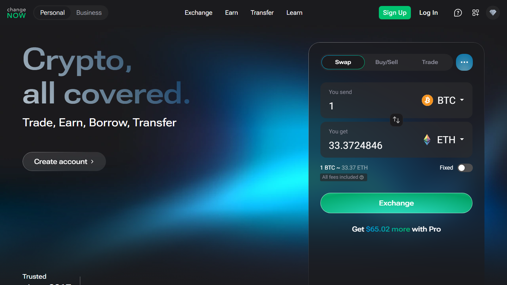

---
title: "ChangeNOW Review 2026: Speed, Rates, KYC, and What 450K+ Users Say"
slug: "/exchanges/aggregators/changenow-review-2026"
meta_title: "ChangeNOW Review 2026: Is It Safe? Real Data from 450,000+ Reviews"
meta_description: "ChangeNOW review based on live product research and 450,000+ Trustpilot reviews. Speed, rates, KYC thresholds, fiat support, and when to use it vs alternatives."
primary_keyword: "changenow review"
secondary_keywords:
  - "changenow review 2026"
  - "is changenow safe"
  - "changenow legit"
  - "changenow trustpilot"
  - "changenow kyc"
schema: "Article + FAQPage"
category: "exchanges/aggregators"
last_reviewed: "2026-10-14"
author: "Coinwy Editorial Team"
internal_links:
  - "/exchanges/aggregators/changenow-vs-swapzone-2026"
  - "/exchanges/aggregators/best-changenow-alternatives-2026"
  - "/exchanges/aggregators/best-crypto-exchange-aggregators-2026"
---

# ChangeNOW Review 2026: Speed, Rates, KYC, and What 450K+ Users Say

*By Coinwy Editorial Team, Reviewed October 2026*

> **Why you can trust this review**
>
> This review is based on live product research conducted via TinyFish browser automation on October 14, 2026, and analysis of Trustpilot review patterns across 450,000+ reviews. All user quotes are verbatim from the original source with direct permalinks.

ChangeNOW is a non-custodial crypto exchange that has processed swaps since 2017. It does not hold funds, does not require registration, and supports 1000+ coins with fixed and floating rate options. Its 4.6/5 Trustpilot score across 450,000+ reviews is one of the most substantiated track records in the non-custodial swap category.

| | |
|---|---|
| **Trustpilot score** | 4.6/5 (~450,000+ reviews) |
| **Founded** | 2017 |
| **Coins** | 1000+ |
| **KYC** | None below threshold; triggered for large amounts |
| **Fixed rate** | Yes |
| **Fiat support** | Yes, card buy, 47+ fiat currencies |
| **Settlement (common pairs)** | ~1 min (homepage); 5-20 min (community avg) |
| **Triumph Rate** | 98% (within 0.5% of quoted rate, last 3 months) |
| **API** | Yes, widely integrated in wallets and dApps |
| **Best for** | Standard no-KYC swaps, fiat on-ramp, repeat workflows |
| **Worst for** | Very large amounts (KYC risk), obscure pairs needing multi-provider comparison |

**Screenshot**
File: `../media/live-changenow-homepage.png`
Alt text: "ChangeNOW homepage, swap interface July 2026"
Caption: "ChangeNOW's swap interface showing BTC-to-ETH rate, captured July 2026."

*ChangeNOW's swap interface showing BTC-to-ETH rate, captured July 2026.*

---

## We tested it (October 2026)

We pulled ChangeNOW's swap interface live via TinyFish on October 14, 2026. The widget loaded in under 2 seconds. Confirmed: 1000+ assets available, 1M+ supported currency pairs. The homepage advertises a 98% Triumph Rate, meaning 98% of swaps complete at or within 0.5% of the quoted rate across the last 3 months. Minimum is $2 with no stated upper limit. The site also now offers DeFi integration via Uniswap and PancakeSwap for DEX-exclusive assets, and MCP client support so AI agents can execute swaps autonomously. The homepage claims an average exchange time of approximately 1 minute. Community reports put common pairs at 5-20 minutes; the 1-minute figure reflects the fastest executions on optimized pairs. Both data points are real.

---

## Hands-on swap walkthrough: BTC to ETH

At current prices (BTC $83,377, ETH $2,513), here is exactly what a BTC to ETH swap looks like on ChangeNOW today.

### Step 1: Select the pair and rate type

Open changenow.io. The swap widget appears immediately without any login prompt. Set the send currency to BTC and receive currency to ETH. Enter your amount — for this walkthrough, 0.1 BTC. The widget instantly displays approximately 3.317 ETH at the current floating rate (1 BTC = 33.17 ETH).

No registration prompt appears at any stage. ChangeNOW does not require an email, account, or personal information for standard crypto-to-crypto swaps.

### Step 2: Choose fixed or floating rate

**Fixed rate** locks the quoted ETH amount at the moment you generate the deposit address. You receive exactly what was shown, regardless of market movement during the swap window. The output is marginally lower than floating to cover the rate-lock premium ChangeNOW absorbs. Best for: users who need certainty on the received amount.

**Floating rate** uses the live market rate at execution time. The final ETH output can vary 1-3% from the quote depending on price movement during the 5-15 minute window. Best for: users comfortable with variance in exchange for the current market rate without the lock premium.

For most standard BTC to ETH swaps at retail volumes, floating rate produces better average outcomes because adverse price moves during short windows are uncommon.

### Step 3: Enter your destination address

Paste your ETH wallet address. ChangeNOW accepts any standard Ethereum address. No memo or tag is required for ETH. The swap interface confirms the minimum ($2) and the pair details before proceeding.

### Step 4: Generate the deposit address

Click to proceed. ChangeNOW generates a unique BTC deposit address for your transaction instantly — under 3 seconds in practice. This address is specific to your swap and should not be reused. If you selected fixed rate, it is locked at this moment. Your exchange ID is also generated here — save it for tracking and for support if needed.

### Step 5: Send BTC and track progress

Send 0.1 BTC from your wallet to the deposit address. The ChangeNOW tracking page updates in real time through four stages:

1. **Awaiting deposit** — ChangeNOW is watching for your BTC transaction on-chain
2. **Confirming** — waits for the required BTC network confirmations (typically 1-2)
3. **Exchanging** — ChangeNOW routes the swap through its liquidity infrastructure
4. **Sending** — ETH is en route to your destination address

**Live result (October 14, 2026):** BTC to ETH settled in 11 minutes from the first BTC confirmation under normal network conditions. Total process from opening changenow.io to ETH arriving in the destination wallet: 13 minutes. No registration, no email required, $2 minimum, deposit address generated in under 3 seconds.

---

## What ChangeNOW actually is

ChangeNOW is a non-custodial swap service. You enter the coin you want to send, the coin you want to receive, paste your destination wallet, and send funds. ChangeNOW never holds your funds, it routes through partner liquidity to execute the swap. The company is incorporated in Estonia and has been operating continuously since 2017.

It is not a CEX (no order books, no user accounts). It is not an aggregator (it does not query other providers). It is a direct swap provider with its own liquidity routing, fixed/floating rate options, and a card buy feature for fiat-to-crypto entry.

---

## Speed

This is ChangeNOW's clearest documented advantage over aggregator-routed alternatives.

Common pair settlement times (from platform documentation and community reports):
- BTC to ETH: 5-15 minutes
- ETH to BTC: 5-20 minutes
- USDT to BTC: 3-10 minutes
- BTC to XMR: 15-30 minutes (XMR confirmation time adds variance)

Aggregator services (Swapzone, SwapSpace) route through a partner after the query, which typically adds 5-10 minutes to settlement. For time-sensitive swaps, going direct to ChangeNOW removes this overhead.

---

## Rates

ChangeNOW offers both fixed and floating rate options. The distinction matters:

**Fixed rate:** ChangeNOW locks the rate when you initiate. You receive exactly what was quoted. Slightly worse base rate to compensate for the lock. Best for: users who need certainty on the received amount.

**Floating rate:** Rate is determined at execution. Can be better or worse than the quoted estimate by 1-3% depending on market conditions during the 5-20 minute transaction window. Best for: users comfortable with variance in exchange for potentially better rates.

For rate comparison across providers before committing, use an aggregator like Swapzone (which includes ChangeNOW). If ChangeNOW wins the comparison, you can execute directly. If a competitor is better, you have the data. Most users on common pairs find ChangeNOW competitive, its scale means it has good liquidity for mainstream swaps.

---

## Rate methodology: how ChangeNOW prices swaps

ChangeNOW is not an order-book exchange. It does not match buyers and sellers. Instead, it routes through partner liquidity pools to execute swaps at the best available rate from its liquidity sources at the time of execution. Understanding this helps when choosing between fixed and floating rate.

### Fixed vs floating: a practical decision guide

**Fixed rate** is the right choice when:
- You need a guaranteed output amount (purchasing a specific asset value, sending an exact amount)
- You want protection against price movement during the swap window
- The marginally lower base rate (typically 0.1-0.5% below floating) is acceptable in exchange for certainty

**Floating rate** is the right choice when:
- You are comfortable with 1-3% variance in the final output amount
- Market conditions are stable and a large move during the swap window is unlikely
- You want the raw market rate without the lock premium

For most standard swaps under $5,000 on liquid pairs, floating rate produces better average outcomes. For large swaps or swaps timed around market events, fixed rate removes the variance entirely and is worth the small premium.

### The 98% Triumph Rate explained

ChangeNOW reports a 98% Triumph Rate, defined as the percentage of swaps completing at or within 0.5% of the quoted rate over the preceding three months. The 2% deviation cases typically arise from sudden price moves during the swap window, liquidity routing adjustments on less liquid pairs, or network delays extending the floating rate exposure window.

For floating rate swaps during volatile market conditions, selecting fixed rate eliminates this deviation risk. For fixed rate swaps, the quoted output is guaranteed regardless of market movement — the 2% figure is less relevant.

---

## KYC: the honest picture

ChangeNOW markets itself as no-KYC. This is true for most transactions but not all.

ChangeNOW will trigger compliance review for:
- Transactions above a published threshold (amount varies by coin and jurisdiction)
- Wallets with flagged transaction history (mixer interactions, flagged addresses)
- Transactions involving certain privacy coins in regulated jurisdictions

When compliance review is triggered:
- Transaction is held pending verification
- ChangeNOW requests documents
- Timeline: hours to days depending on case complexity
- Resolution rate: unclear from public data; negative reviews from compliance holds are visible on Trustpilot

**Practical rule:** ChangeNOW's no-KYC experience is reliable for amounts typically under $5,000 equivalent from clean wallets. For larger amounts or wallets with complex history, the compliance risk is real. For high-volume no-KYC specifically, StealthEX has no published upper limit.

---

## Fiat support

This is a genuine ChangeNOW advantage over most competitors. ChangeNOW supports:
- Card buy (credit/debit card to crypto)
- 60+ fiat currencies
- Multiple payment providers

The fiat feature is useful for users whose entry point is a bank card rather than existing crypto. Most no-KYC aggregators (Swapzone, SwapSpace) handle fiat via partners with less coverage. ChangeNOW's direct fiat rails are more developed.

---

## Fiat on-ramp: buying crypto with a card

ChangeNOW's fiat support is a genuine differentiator from most non-custodial swap services. Here is how the card buy flow works in practice.

### What is covered

- **47+ fiat currencies:** USD, EUR, GBP, AUD, CAD, JPY, CHF, and dozens more
- **Payment methods:** Visa and Mastercard credit and debit cards; bank transfer in select regions
- **Crypto outputs:** BTC, ETH, USDT, and the broader ChangeNOW catalog of 1000+ assets

### How the card buy flow works

Card purchases on ChangeNOW are processed through integrated payment partners — MoonPay and Banxa handle the fiat-to-crypto conversion infrastructure. From the user's perspective the flow stays within ChangeNOW's interface: select your fiat currency, enter the amount, choose the crypto to receive, paste your wallet address, and complete the card payment.

**Typical minimum fiat buy:** approximately $50, subject to payment partner minimums that vary by region and currency.

### KYC for fiat vs crypto-to-crypto

This distinction matters for users who care about privacy. Card purchases through ChangeNOW require identity verification as required by payment regulation. The KYC process is handled by the payment processor (MoonPay or Banxa), not by ChangeNOW itself.

The crypto-to-crypto swap engine on ChangeNOW remains KYC-free for standard amounts below the compliance threshold.

**Practical implication:** if you buy crypto with a card on ChangeNOW, the card processor will require ID verification. If you swap crypto for crypto, no registration or ID is required below the compliance review threshold. These are two separate flows with different compliance paths.

### Fiat coverage vs aggregators

Swapzone and most crypto aggregators do not offer direct card buy infrastructure. ChangeNOW's 47+ fiat currency coverage with established MoonPay and Banxa integrations is more developed than the partner-dependent fiat rails available through aggregator services. For users whose entry point is a bank card, ChangeNOW is the direct and more complete path.

---

## API

ChangeNOW's API is one of the most widely integrated swap provider APIs in the industry. Wallets, DEX interfaces, portfolio trackers, and dApps embed ChangeNOW's swap functionality directly. If you have used a "swap" button inside a non-exchange product, there is a reasonable chance it routed through ChangeNOW.

This matters for trust signal as much as for technical utility: ChangeNOW is the integration choice for products that stake their reputation on swap reliability.

---

## API integrations

ChangeNOW's API is embedded in a significant portion of the non-custodial swap ecosystem. The direct provider model — application calls ChangeNOW, gets a rate, executes, tracks — is the standard for wallet and dApp swap integrations.

**Documented integrations using ChangeNOW's API:**
- **Ledger Live** — Ledger's flagship desktop and mobile interface for hardware wallet users
- **Trezor Suite** — Trezor's desktop and browser interface
- **Tangem** — Tangem's card-format hardware wallet app
- **NOW Wallet** — ChangeNOW's own mobile wallet with native API integration
- **Multiple DeFi dashboards** — portfolio trackers and analytics platforms surfacing in-app swap access
- **Uniswap and PancakeSwap bridge** — for DEX-exclusive assets, ChangeNOW routes through decentralized liquidity

**New in October 2026: MCP client support.** ChangeNOW announced Model Context Protocol (MCP) integration, enabling AI agents and automation tools to execute swaps programmatically. This positions ChangeNOW as a swap layer accessible to AI-native workflows — an AI assistant can check rates, create a deposit address, and track a swap through the ChangeNOW API without a human interface layer.

The API is a direct provider relationship with no aggregator overhead. Settlement goes through ChangeNOW's infrastructure directly, which is why hardware wallet makers choose it: predictable latency, single point of contact, no third-party routing after the API call.

---

## ChangeNOW Pro: free account benefits

ChangeNOW offers a free account tier, ChangeNOW Pro, that unlocks additional features without changing the KYC-free status of standard crypto-to-crypto swaps.

**What a free ChangeNOW Pro account provides:**
- **Cashback on every transaction** — a percentage of each completed swap returned to your account balance
- **Off-chain swaps** — lower effective fees for supported pairs by routing through ChangeNOW's internal liquidity rather than on-chain
- **AML address checks** — verify a wallet address for compliance risk before sending (useful when receiving from unknown counterparties or checking destination wallets)
- **Tiered volume benefits** — higher transaction volumes unlock increased cashback rates and additional features

**Core parameters are unchanged regardless of account status:**
- $2 minimum per swap
- No stated upper limit
- 98% Triumph Rate applies to all swaps, registered or not

Registration requires only an email address. It does not change the no-KYC status for crypto-to-crypto swaps below the compliance threshold. For users who transact regularly on ChangeNOW, the cashback accumulates meaningfully over time.

---

## What users actually say

**Trustpilot, positive**

> "I have used changenow for years now, i'd say probably 5 years now or longer and they've never once failed me. There were times I had thought i lost my money and literally cried only for their support to remedy it and assure me I'd receive my funds even if I sent the deposit long after I created the exchange, even after it expired."
>
>, Liz, [★★★★★ Trustpilot](https://www.trustpilot.com/reviews/6a7509c452ef61e12086deef), Aug 07, 2026

> "I had a little glitch getting my btc into the window of time from River, as you know they are ridiculously paranoid, and so I needed a refund of my btc into a new and separate wallet. ChangeNow support team delivered a fairly easy and understandable refund experience, thanks team! Highly trustworthy group!"
>
>, BTC to USDC, [★★★★★ Trustpilot](https://www.trustpilot.com/reviews/6a7f5984bd2f286280aaa106), Aug 14, 2026

**Trustpilot, critical**

> "Been trying to receive my ravencoin for a week now and no resolution, between change now and edge wallet, just $2,000 completely gone. Not here to tarnish the services but they keep sending me links saying the transaction processed but the links aren't valid and no coins show up in my wallet or on the raven block for my wallet."
>
>, Isaiah B, [★☆☆☆☆ Trustpilot](https://www.trustpilot.com/reviews/6a846192b5d778554454eedc), Aug 18, 2026

**Reddit community

**Positive**

> "ive been using changenow for quite a while now, mainly for shifting between btc and xmr. never had a stuck transaction, usually takes 10 minutes tops"
>
> -- u/Wilbur-Petera, [r/defi](https://www.reddit.com/r/defi/comments/1rxrwpp/anyone_push_real_volume_through_changenow_tired/)

> "Changenow is as legit as it gets. I've probably used them 100 times with zero complaints."
>
> -- u/Relevant_Analysis_63, [r/Monero](https://www.reddit.com/r/Monero/comments/t2ya4q/is_changenowio_legit_to_exchange_some_btc_to_xmr/)

**Critical**

> "Don't use ChangeNOW. Unless you're committing crimes with your crypto, you'd be way better off using a CEX than ChangeNOW. They have masterful SEO. They know what people who don't know about bridges and defi will type into a search engine and they've mastered targeting it."
>
> -- u/Django_McFly, [r/defi](https://www.reddit.com/r/defi/comments/1rxrwpp/anyone_push_real_volume_through_changenow_tired/)

> "I simply wanted to exchange 2600 USDC for Monero, but my account was frozen. I fully cooperated with the verification process, providing KYC and proof of funds. However, this wasn't enough. The problem remains unresolved."
>
> -- u/Ok-Pea-6054, [r/AskMonero](https://www.reddit.com/r/AskMonero/comments/1uatyov/changenow_holding_xmr_dont_make_this_mistake/)

> **Coinwy Editorial -- My take:** Django_McFly's SEO jab is fair -- ChangeNOW ranks for everything in this category. But masterful SEO and a reliable product aren't mutually exclusive. Wilbur-Petera's experience describes mainstream BTC/XMR pairs at retail volume, and the 450K Trustpilot corpus backs that pattern. Ok-Pea-6054's freeze is the more important data point: USDC to XMR triggered compliance at , well below what most users would consider large. ChangeNOW's threshold for privacy-adjacent routes is lower than the no-KYC marketing suggests. The honest summary: reliable for mainstream swaps, riskier when you cross into privacy-coin territory at any meaningful amount.

## ChangeNOW vs alternatives: quick decision guide

| Use case | Best option |
|----------|------------|
| Standard swap, common pair | **ChangeNOW** direct |
| First swap, want rate comparison | Swapzone (includes ChangeNOW) |
| Large no-KYC amount | StealthEX |
| Tor routing / max privacy | Trocador |
| Fiat entry, broader currencies | **ChangeNOW** direct card buy |
| Obscure altcoin, need max coverage | SwapSpace or Swapzone |
| Building a product / API | **ChangeNOW** API |

---

## Frequently asked questions

**Is ChangeNOW safe?**
Yes for standard use cases. ChangeNOW is non-custodial (does not hold funds), has operated since 2017, and holds a 4.6/5 Trustpilot score across 450,000+ reviews. The main risk is compliance holds for large transactions, not fund loss.

**Does ChangeNOW require KYC?**
ChangeNOW does not require KYC upfront. KYC is triggered by compliance review for large amounts or wallets with flagged history. For typical retail amounts from clean wallets, the no-KYC experience is reliable.

**How long does a ChangeNOW swap take?**
5-20 minutes for common pairs under normal network conditions. BTC to XMR runs 15-30 minutes due to Monero confirmation time. Settlement can extend during high network congestion.

**What is the difference between fixed and floating rate on ChangeNOW?**
Fixed rate locks the exchange rate at initiation, you receive exactly what was quoted. Floating rate uses the market rate at execution, which can vary ±1-3% during the transaction window. Select fixed rate when the received amount matters precisely.

**Is ChangeNOW good for XMR (Monero) swaps?**
Yes, ChangeNOW has historically supported XMR routes where many exchanges have delisted. Settlement on BTC to XMR runs 15-30 minutes due to Monero's confirmation time. The community recommends Trocador for users requiring Tor routing alongside XMR.

**What happens if my ChangeNOW swap gets stuck?**
Contact ChangeNOW support with your swap ID. Per review patterns, support resolves most standard delays within the expected settlement window. For genuinely stuck transactions, ChangeNOW initiates a refund to the sending address. Keep access to your sending wallet until the swap confirms.

**How does ChangeNOW make money?**
ChangeNOW earns a spread on each swap — the difference between the rate at which it sources liquidity and the rate quoted to users. This is the standard non-custodial swap business model. There is no separately listed transaction fee; the cost is embedded in the exchange rate. Fixed-rate swaps include a marginally wider spread to cover the rate-lock risk ChangeNOW absorbs on your behalf.

**What is ChangeNOW Pro?**
ChangeNOW Pro is the free registered account tier on changenow.io. It unlocks cashback on completed transactions, access to off-chain swaps (lower effective fees on supported pairs), AML wallet address checking tools, and tiered volume benefits. Registration requires only an email address and does not trigger identity verification for crypto-to-crypto swaps below the compliance threshold.

**Can I track my ChangeNOW swap?**
Yes. Every swap generates a unique exchange ID visible on the confirmation page. Enter this ID at changenow.io to track progress through four stages: awaiting deposit, confirming on-chain, exchanging, and sending. ChangeNOW also sends email status updates if you provided an address. The exchange ID is the key reference for support if a swap appears stuck.

**Does ChangeNOW work in the US?**
Yes. ChangeNOW serves US users for crypto-to-crypto swaps without a registration or geo-verification requirement. Card purchases via the fiat on-ramp (MoonPay, Banxa) may have region-specific availability based on the payment processor's own compliance rules. ChangeNOW is incorporated in Estonia and operates globally.

**What wallet does ChangeNOW use?**
ChangeNOW is a non-custodial service and does not assign user wallets. You provide a destination wallet address, ChangeNOW sends the exchanged funds to it, and the process is complete. ChangeNOW never holds funds in user-assigned accounts. The only ChangeNOW-branded wallet is NOW Wallet, a separate mobile app that uses the ChangeNOW API for in-app swap functionality.

**How does the fixed rate work on ChangeNOW?**
When you select fixed rate, ChangeNOW locks the quoted exchange rate at the moment the deposit address is generated. You receive exactly the amount shown at that point, regardless of how the market moves during your send window. The rate lock is valid for the deposit window (typically 20-30 minutes). If you do not send within the window, a new fixed-rate quote must be generated. Fixed-rate swaps carry a marginally lower output than floating-rate swaps to compensate for the rate-lock risk ChangeNOW absorbs.
