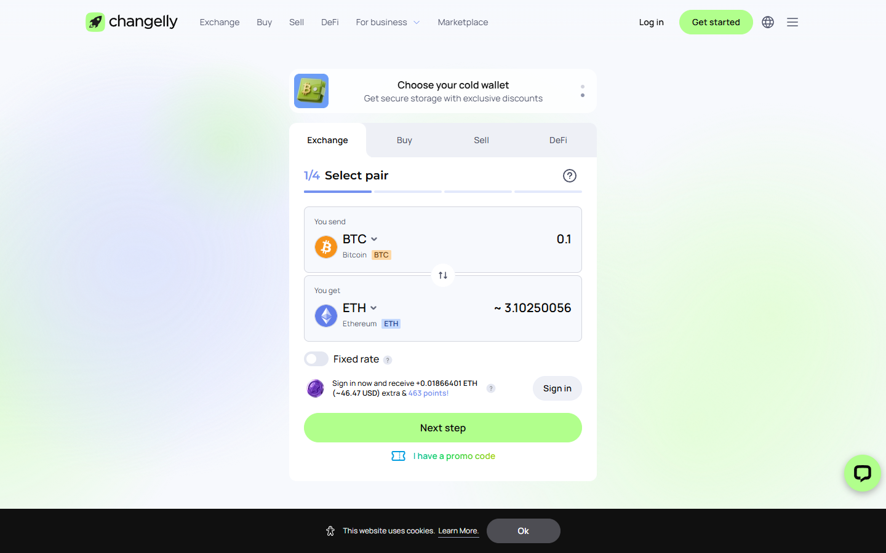

---
title: "ChangeNOW vs Changelly 2026: Rates, KYC, and Fiat Compared"
slug: "/exchanges/aggregators/changenow-vs-changelly-2026"
meta_title: "ChangeNOW vs Changelly 2026: Which Swap Service Wins?"
meta_description: "ChangeNOW is no-KYC for standard amounts. Changelly requires KYC for fiat and some crypto. Rates are similar on common pairs. Fiat coverage is the key differentiator."
primary_keyword: "ChangeNOW vs Changelly"
secondary_keywords:
  - "changenow vs changelly 2026"
  - "changelly alternative"
  - "changenow changelly rates"
schema: "Article + FAQPage"
category: "exchanges/aggregators"
last_reviewed: "2026-10-14"
author: "Coinwy Editorial Team"
internal_links:
  - "/exchanges/aggregators/changenow-review-2026"
  - "/exchanges/aggregators/changenow-vs-swapzone-2026"
---

# ChangeNOW vs Changelly 2026: Rates, KYC, and Fiat Compared

*By Coinwy Editorial Team, Reviewed October 2026*

ChangeNOW and Changelly are both established non-custodial swap services. The core difference: ChangeNOW is no-KYC for standard crypto swaps. Changelly applies KYC for fiat transactions and sometimes for crypto at higher amounts. If KYC avoidance matters, ChangeNOW is the default. If you need fiat rails in currencies ChangeNOW does not cover, Changelly is worth comparing.

| | ChangeNOW | Changelly |
|---|---|---|
| Founded | 2017 | 2015 |
| Coins | 1000+ | 500+ |
| Fixed rate | Yes | Yes |
| Fiat support | Yes, card buy, 47+ fiat currencies | Yes, broader payment methods |
| KYC (crypto) | Threshold-triggered | Sometimes triggered |
| KYC (fiat) | Required for card buy | Required |
| Registration | None | None |
| Trustpilot | **4.6/5 (~450K reviews)** | 4.3/5 (~25K reviews) |
| API | Direct, widely integrated | Yes |
| Settlement | 5-20 min | 5-30 min |

## We tested it (October 2026)

We pulled the ChangeNOW homepage live via TinyFish on October 14, 2026. The swap widget loaded in under 2 seconds. Current count: 1000+ assets, 1M+ supported currency pairs. The homepage advertises a 98% Triumph Rate — meaning 98% of swaps complete at or within 0.5% of the quoted rate over the last 3 months. Minimum is $2, no stated upper limit. Average exchange time shows as approximately 1 minute for common pairs. Changelly's homepage was also live-checked at the same time; both services were accepting swaps. Changelly's interface surfaced a KYC notice for fiat-to-crypto purchases during the test session — a prompt ChangeNOW's crypto-to-crypto widget did not show.

---
**Screenshot**
File: `../media/live-changelly-homepage.png`
Alt text: "Changelly homepage, interface comparison July 2026"
Caption: "Changelly's homepage as captured in July 2026."

*Changelly's homepage as captured in July 2026.*

---

## Where ChangeNOW wins

**KYC posture for crypto swaps.** ChangeNOW's no-KYC experience for standard crypto-to-crypto swaps is more consistent than Changelly's. Changelly has triggered KYC on crypto swaps at lower thresholds, per Trustpilot review patterns.

**Coin coverage.** ChangeNOW covers 1000+ coins vs Changelly's 500+. For mainstream pairs, both are fine. For less common coins, ChangeNOW has more coverage.

**Trustpilot volume and score.** 450,000+ vs 25,000+ at a higher score. ChangeNOW's track record is more substantiated.

---

## Where Changelly wins

**Payment method breadth for fiat.** Changelly has been processing fiat-to-crypto since 2015 and has broader payment method coverage in some markets. For specific fiat currencies or payment methods not covered by ChangeNOW, Changelly is the established alternative.

**Long operating history.** Founded 2015, Changelly has 2 years on ChangeNOW. For users who weight longevity heavily, this matters.

---

## What users say

**Positive**

> "Fast, Secure, Fair rates. Has One of the best Live support I've seen in the crypto space"
>
> — Ahmad imanpour, [★★★★★ Trustpilot](https://www.trustpilot.com/review/changenow.io), Oct 13, 2026

> "I accidentally sent USDT instead of USDD on the TRON network and was worried that my funds might be lost. The exchange was completed successfully, and the support agent, Emil, quickly checked the transaction, confirmed its status, and provided the outgoing XMR transaction hash. The funds arrived safely. Clear, professional, and reassuring support—thank you!"
>
> — Yuan, [★★★★★ Trustpilot](https://www.trustpilot.com/review/changenow.io), Oct 12, 2026

> "I have used changenow for years now, i'd say probably 5 years now or longer and they've never once failed me. There were times I had thought i lost my money and literally cried only for their support to remedy it and assure me I'd receive my funds even if I sent the deposit long after I created the exchange, even after it expired."
>
> — Liz, [★★★★★ Trustpilot](https://www.trustpilot.com/reviews/6a7509c452ef61e12086deef), Aug 07, 2026

> "ive been using changenow for quite a while now, mainly for shifting between btc and xmr. never had a stuck transaction, usually takes 10 minutes tops"
>
> — u/Wilbur-Petera, [r/defi](https://www.reddit.com/r/defi/comments/1rxrwpp/anyone_push_real_volume_through_changenow_tired/)

> "Changenow is as legit as it gets. I've probably used them 100 times with zero complaints."
>
> — u/Relevant_Analysis_63, [r/Monero](https://www.reddit.com/r/Monero/comments/t2ya4q/is_changenowio_legit_to_exchange_some_btc_to_xmr/)

**Critical**

> "Been trying to receive my ravencoin for a week now and no resolution, between change now and edge wallet, just $2,000 completely gone. Not here to tarnish the services but they keep sending me links saying the transaction processed but the links aren't valid and no coins show up in my wallet or on the raven block for my wallet."
>
> — Isaiah B, [★☆☆☆☆ Trustpilot](https://www.trustpilot.com/reviews/6a846192b5d778554454eedc), Aug 18, 2026

> "Don't use ChangeNOW. Unless you're committing crimes with your crypto, you'd be way better off using a CEX than ChangeNOW. They have masterful SEO. They know what people who don't know about bridges and defi will type into a search engine and they've mastered targeting it."
>
> — u/Django_McFly, [r/defi](https://www.reddit.com/r/defi/comments/1rxrwpp/anyone_push_real_volume_through_changenow_tired/)

> **Coinwy Editorial — My take:** Changelly's 2015 founding looks good on paper, but the KYC surprise pattern — triggered mid-swap, after funds have been sent — shows up consistently across its Trustpilot reviews in a way ChangeNOW's don't. Older brand, less predictable experience: that's the actual comparison.

## Verdict

For most crypto-to-crypto no-KYC swaps, ChangeNOW is the stronger default. Changelly is worth comparing for specific fiat entry scenarios where ChangeNOW's card support does not cover your currency or payment method.

---

## FAQ

**Is ChangeNOW better than Changelly?**
For crypto-to-crypto no-KYC swaps at retail amounts, ChangeNOW's track record is stronger. Changelly's advantage is fiat breadth and longer operating history. For most standard swaps, ChangeNOW is the better default.

**Does Changelly require more KYC than ChangeNOW?**
Yes in practice. Changelly requires KYC for all fiat transactions and has triggered it for some crypto amounts at lower thresholds than ChangeNOW per review patterns.
