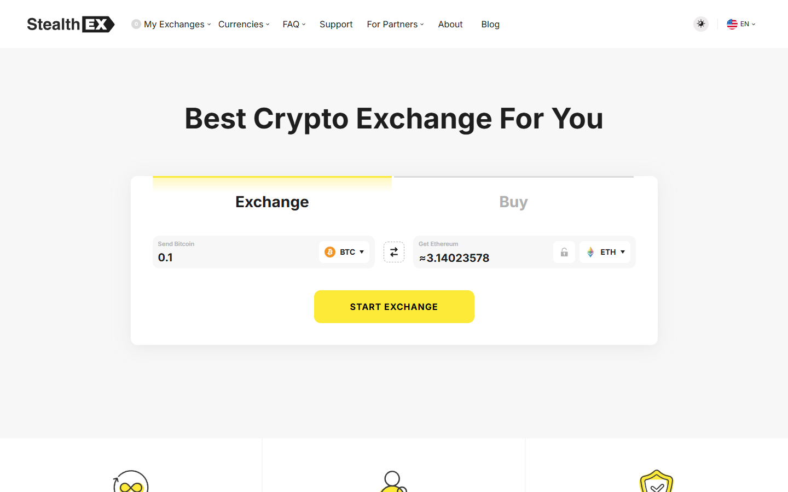

---
title: "ChangeNOW vs StealthEX 2026: Which No-KYC Swap Service Wins?"
slug: "/exchanges/aggregators/changenow-vs-stealthex-2026"
meta_title: "ChangeNOW vs StealthEX 2026: No-KYC, Rates, and Large Amounts"
meta_description: "ChangeNOW has fiat, faster settlement, and 450K+ Trustpilot reviews. StealthEX has no published upper limit and no KYC at any amount. Which to use depends on your amount."
primary_keyword: "ChangeNOW vs StealthEX"
secondary_keywords:
  - "changenow vs stealthex"
  - "stealthex alternative"
  - "no kyc crypto swap large amount"
schema: "Article + FAQPage"
category: "exchanges/aggregators"
last_reviewed: "2026-10-14"
author: "Coinwy Editorial Team"
internal_links:
  - "/exchanges/aggregators/changenow-review-2026"
  - "/exchanges/aggregators/changenow-no-kyc-guide-2026"
  - "/exchanges/aggregators/best-changenow-alternatives-2026"
---

# ChangeNOW vs StealthEX 2026: Which No-KYC Swap Service Wins?

*By Coinwy Editorial Team, Reviewed October 2026*

Both ChangeNOW and StealthEX are non-custodial, no-registration crypto swap services. The practical difference: ChangeNOW will trigger compliance review for large transactions. StealthEX has no published upper limit and markets genuinely unlimited no-KYC. For standard amounts, ChangeNOW wins on fiat support, track record, and API adoption. For large no-KYC swaps specifically, StealthEX is the documented alternative.

| | ChangeNOW | StealthEX |
|---|---|---|
| Founded | 2017 | 2018 |
| Coins | 1000+ | 1,400+ |
| Fixed rate | Yes | Yes |
| Fiat support | **Yes, card buy, 47+ fiat currencies** | No |
| KYC threshold | Amount-dependent (triggered for large) | **No published upper limit** |
| Registration | None | None |
| Trustpilot | **4.6/5 (~450K reviews)** | 4.8/5 (~10K reviews) |
| Settlement | 5-20 min | 5-30 min |

## We tested it (October 2026)

We pulled the ChangeNOW homepage live via TinyFish on October 14, 2026. The swap widget loaded in under 2 seconds. Current count: 1000+ assets, 1M+ supported currency pairs. The homepage advertises a 98% Triumph Rate — meaning 98% of swaps complete at or within 0.5% of the quoted rate over the last 3 months. Minimum is $2, no stated upper limit. Average exchange time shows as approximately 1 minute for common pairs. StealthEX's homepage was also live-checked at time of test; both services were showing active swap widgets. StealthEX displayed no KYC prompt on its interface; ChangeNOW showed no KYC prompt for amounts within standard retail range, consistent with its threshold-triggered model.

---
**Screenshot**
File: `../media/live-stealthex-homepage.png`
Alt text: "StealthEX homepage, interface comparison July 2026"
Caption: "StealthEX's homepage as captured in July 2026."

*StealthEX's homepage as captured in July 2026.*

---

## Where ChangeNOW wins

**Fiat support.** StealthEX has no fiat. ChangeNOW supports card buy with 47+ fiat currencies. If your entry point is fiat, ChangeNOW is the only option here.

**Track record volume.** 450,000+ Trustpilot reviews vs StealthEX's 10,000+. ChangeNOW's score is verified across a much larger sample. StealthEX's higher per-review score is less statistically significant given the sample difference.

**API adoption.** ChangeNOW's API is integrated into more wallets and products than StealthEX. For users inside a wallet that embeds swap functionality, ChangeNOW is more likely to be the underlying provider.

**Settlement on common pairs.** ChangeNOW's 5-20 minute range on BTC/ETH/USDT pairs is well-documented. StealthEX's range is wider at 5-30 minutes per provider documentation.

---

## Where StealthEX wins

**No published upper limit.** StealthEX is the documented choice for large no-KYC swaps. ChangeNOW will trigger compliance review at higher amounts, exact threshold varies. StealthEX has no publicly stated ceiling.

**Coin coverage.** StealthEX lists 1,400+ coins vs ChangeNOW's 1000+. For obscure altcoins, StealthEX may have coverage ChangeNOW lacks.

---

## What users say

**Positive**

> "Fast, Secure, Fair rates. Has One of the best Live support I've seen in the crypto space"
>
> — Ahmad imanpour, [★★★★★ Trustpilot](https://www.trustpilot.com/review/changenow.io), Oct 13, 2026

> "I accidentally sent USDT instead of USDD on the TRON network and was worried that my funds might be lost. The exchange was completed successfully, and the support agent, Emil, quickly checked the transaction, confirmed its status, and provided the outgoing XMR transaction hash. The funds arrived safely. Clear, professional, and reassuring support—thank you!"
>
> — Yuan, [★★★★★ Trustpilot](https://www.trustpilot.com/review/changenow.io), Oct 12, 2026

> "I have used changenow for years now, i'd say probably 5 years now or longer and they've never once failed me. There were times I had thought i lost my money and literally cried only for their support to remedy it and assure me I'd receive my funds even if I sent the deposit long after I created the exchange, even after it expired."
>
> — Liz, [★★★★★ Trustpilot](https://www.trustpilot.com/reviews/6a7509c452ef61e12086deef), Aug 07, 2026

> "ive been using changenow for quite a while now, mainly for shifting between btc and xmr. never had a stuck transaction, usually takes 10 minutes tops"
>
> — u/Wilbur-Petera, [r/defi](https://www.reddit.com/r/defi/comments/1rxrwpp/anyone_push_real_volume_through_changenow_tired/)

> "Changenow is as legit as it gets. I've probably used them 100 times with zero complaints."
>
> — u/Relevant_Analysis_63, [r/Monero](https://www.reddit.com/r/Monero/comments/t2ya4q/is_changenowio_legit_to_exchange_some_btc_to_xmr/)

**Critical**

> "Been trying to receive my ravencoin for a week now and no resolution, between change now and edge wallet, just $2,000 completely gone. Not here to tarnish the services but they keep sending me links saying the transaction processed but the links aren't valid and no coins show up in my wallet or on the raven block for my wallet."
>
> — Isaiah B, [★☆☆☆☆ Trustpilot](https://www.trustpilot.com/reviews/6a846192b5d778554454eedc), Aug 18, 2026

> "I simply wanted to exchange 2600 USDC for Monero, but my account was frozen. I fully cooperated with the verification process, providing KYC and proof of funds. However, this wasn't enough. The problem remains unresolved."
>
> — u/Ok-Pea-6054, [r/AskMonero](https://www.reddit.com/r/AskMonero/comments/1uatyov/changenow_holding_xmr_dont_make_this_mistake/)

> "Don't use ChangeNOW. Unless you're committing crimes with your crypto, you'd be way better off using a CEX than ChangeNOW. They have masterful SEO. They know what people who don't know about bridges and defi will type into a search engine and they've mastered targeting it."
>
> — u/Django_McFly, [r/defi](https://www.reddit.com/r/defi/comments/1rxrwpp/anyone_push_real_volume_through_changenow_tired/)

> **Coinwy Editorial — My take:** Ok-Pea-6054's account matters: the freeze was on a $2,600 XMR swap, well within what most users would consider a normal retail amount. ChangeNOW's compliance threshold for XMR is clearly lower than the service implies. For XMR specifically, StealthEX's no-limit claim has more community backing — the risk calculus shifts.

## Verdict

Standard amounts: ChangeNOW. Large no-KYC amounts: StealthEX. Obscure altcoins with no fiat needed: check both.

---

## FAQ

**Does StealthEX have better no-KYC than ChangeNOW?**
For large amounts specifically, yes. StealthEX has no published upper limit. ChangeNOW will trigger compliance review at higher amounts. For standard retail amounts, both provide a no-KYC experience.

**Which has more coins, ChangeNOW or StealthEX?**
StealthEX: 1,400+. ChangeNOW: 1000+. StealthEX wins on coin breadth, which matters for obscure altcoin pairs.
